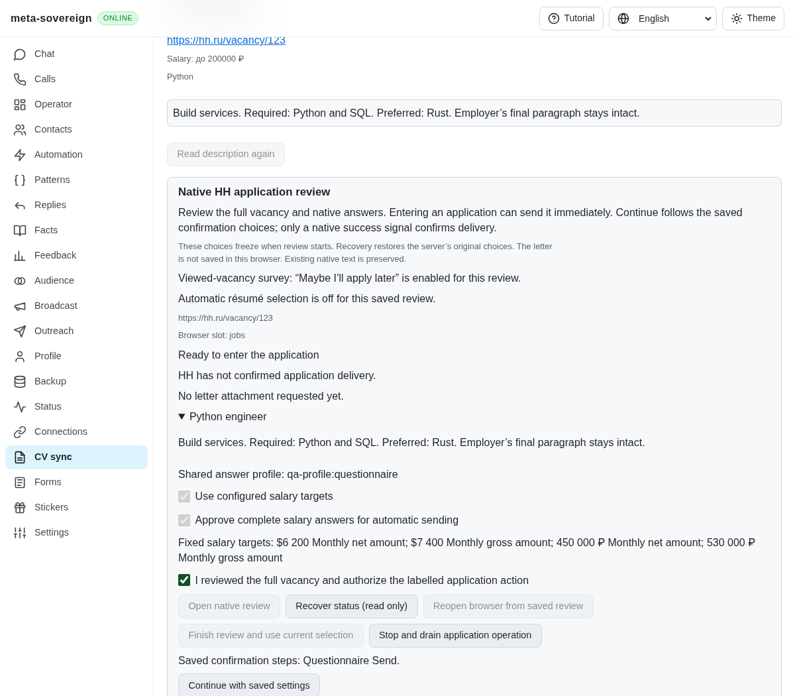
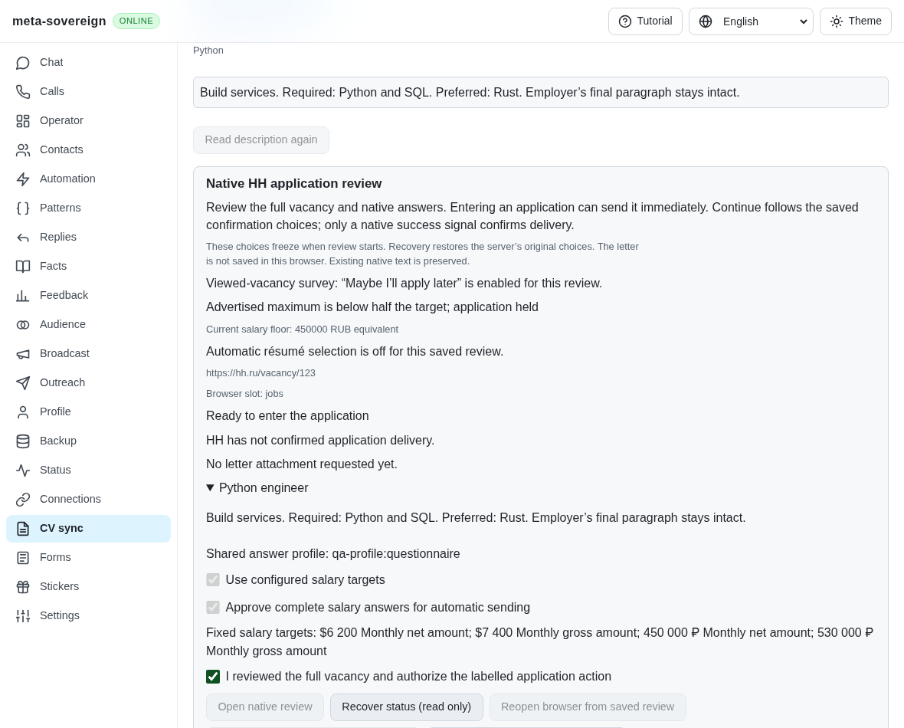
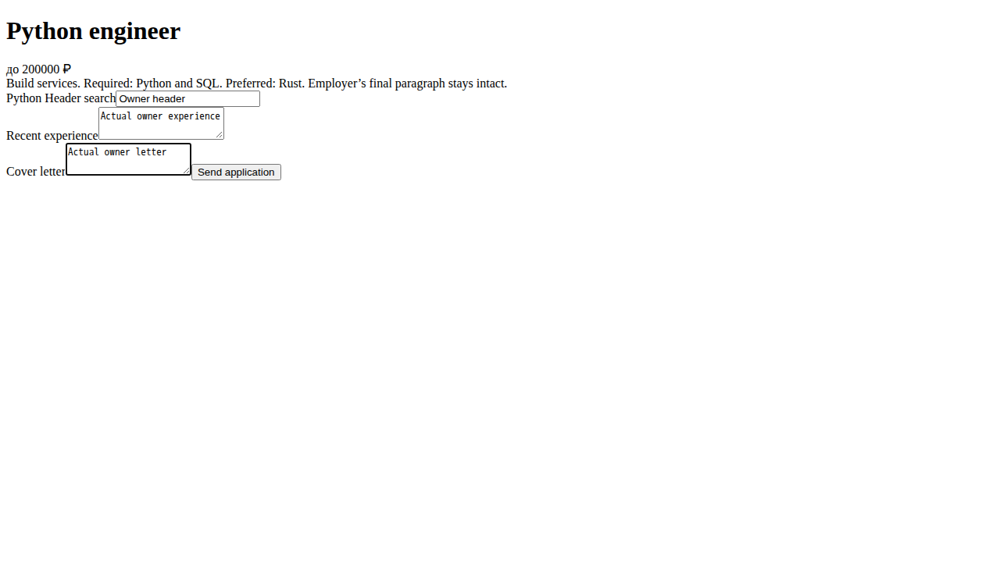
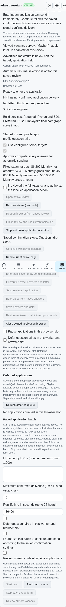

Application entry previously ignored the discovery salary decision. A vacancy
capped at ₽200,000 remained actionable against the owner's ₽450,000 target.
A direct questionnaire also lacked a safe way to obtain its missing full-vacancy
context while preserving actual native answers. This change implements these
parts of HH02/HH05/HH06; their wider acceptance remains unfinished.

Entry, full-form navigation and send now derive admission from frozen salary
settings and the complete vacancy. Maxima below half the independent target are
excluded; lower minimum-only offers defer until the current floor admits them.
Unknown pay remains eligible. An explicit opt-out preserves native behavior.
Stale exchange snapshots hold actions. Guards run again after acknowledged
reservations, and a changed shared vacancy snapshot requires fresh review.
Neither salary deferrals nor exclusions write permanent owner choices or the
ordinary questionnaire queue. Batch preservation closes only after actual Q&A
and private draft acknowledgements succeed. Temporary salary bookkeeping stays
bounded in RAM; this change does not claim a complete tier-revisit orchestrator.

An explicit same-vacancy native form URL can start a single review. With missing
context, the worker first backs up actual supported controls, including the
owner's letter, and acknowledges their Q&A observations. It then reads and caches
the full vacancy, returns to the same native form, discloses a saved letter field
when necessary, and restores only verified empty controls. It sends nothing.
Refused backups or Q&A writes keep the form open. Failed vacancy reads still try
to restore the saved form. Cancellation, owner navigation or changed run settings
stop subsequent navigation and retain the private recovery copy.

Both Lino transports, foreground CLI and shared UI freeze these settings. CLI
controls are `--form-url`, `--salary-floor-rub` and `--no-salary-ladder` alongside
existing salary configuration. Copying discovery results into an unarmed batch
also carries the actual salary target and current tier; a direct-form URL is
refused for batches. All four locales show the salary decision and current floor.
Owner backup, read and restoration controls remain available during a salary hold.

Reproduction and verification:

- `salary-application-admission.test.js` checks low maxima, temporary floors,
  full-form admission, unknown salary and opt-out, direct-form answer/letter
  restoration, refused acknowledgements, failed context reads, frozen recovery
  targets, changed cache and run modes, stale rates after reservation and batch
  preservation. Against published parent `4fefd254`, one test passes and 13 fail
  through actual assertions. The complete focused group passes 50/50 afterward.
- `salary-application-interfaces.test.js` verifies both Lino transports, CLI,
  discovery handoff and translated shared controls. Existing context, draft and
  full-form checks run in the same focused group. The CI browser entry point is
  syntax checked and includes the native salary scenario for its engine lanes.
- The final native Chromium scenario passes with two restored owner fields,
  four locales, a 390px viewport without horizontal overflow, zero sends and all
  owned resources closed. The single native click discloses the saved letter;
  it never enters or submits an application.
- Independent Playwright MCP reproduces enabled entry with the parent's exact
  published bundle, then confirms disabled entry/full-form/send in the changed
  UI. Four locales and the phone layout pass. Every owned resource closes with
  zero native clicks or application attempts. Fixture reuse initially recovered
  its earlier review; separate fresh fixtures resolve that harness error.
  MCP's console includes a favicon 404 and browser cache-write failures; requested
  pages and assertions complete with zero page exceptions. These events remain
  in the archive without an invented diagnosis.

Evidence: [application-salary-admission.tar.gz](data/application-salary-admission.tar.gz)
contains source snapshots, exact parent production modules/bundle, focused and
parent logs, native/MCP receipts, console output, screenshots and a SHA-256
manifest. Local checks also cover formatting, ESLint errors, secrets, duplication
and whitespace. Full runtime/browser matrices remain in hosted CI. Parent main
CI has a separately investigated Windows busy-port timeout; passing other
workflows does not accept the remaining 40 inventory criteria.

Before:

After:

Restored actual native answers:

Phone:

PR: https://github.com/link-foundation/meta-sovereign/pull/57.
