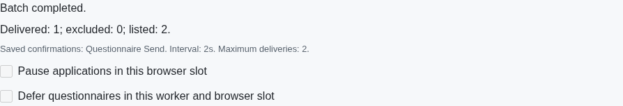
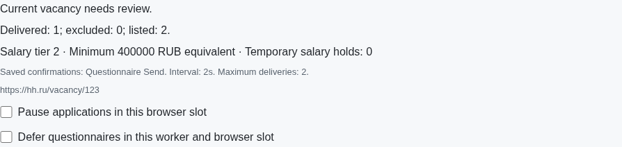
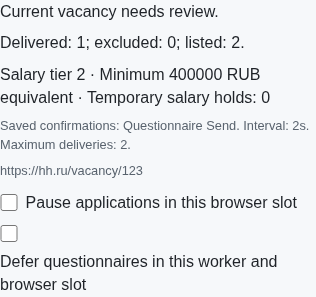

# Salary deferrals in a finite application batch

A supplied-URL batch used to finish after its initial pass even when salary
admission had temporarily held a vacancy. Reproduce with a ₽450,000 floor and
two vacancies advertising minimum-only salaries of ₽400,000 and ₽600,000:
the published parent delivers only the second vacancy and completes without
revisiting the first. This is another partial correction for HH02/HH05/HH06;
the full search/application orchestration contract remains unfinished.

The explicit batch worker now owns a bounded, temporary map of salary-held URLs.
After exhausting a pass, it reduces the current floor by exactly ₽50,000 and
revisits those URLs. Repeated reductions stop at zero. The worker retains the
original frozen salary targets, confirmation policy, delivery cap, pacing and
run modes. Revisited forms recover acknowledged actual answers and restore only
empty native controls. Failed preservation keeps the actual form open. Fresh
owner/responded choices take precedence and never become salary deferrals.

Neither saved progress nor application startup reconstructs the temporary map.
The worker clears its own salary bookkeeping when stopped, expired, refused or
completed. An inactive receipt reports no pending temporary work. No startup or
status read grants permission to send. Legacy batch receipts remain readable;
invented tier/floor/count combinations are refused. Ordinary single reviews
retain their own salary settings. Both Lino transports, foreground CLI and four
UI locales expose the same effective floor and batch progress.

Focused verification uses one worker and small owned fixtures:

- Ten salary batch tests reproduce the parent failure and check pass exhaustion,
  exact reductions, frozen targets, low hard-cap exclusion, fresh permanent
  choices, actual-answer restoration, refused backups, delivery caps, opt-out,
  test mode, stale receipts and restart behavior. All ten fail against the exact
  five parent backend modules from `82ff7202`.
- Three interface tests exercise the actual text/binary Lino routes, receipt
  validators, four translated renderings and the foreground CLI. Existing salary
  admission, batch ownership, safety and delivery tests run alongside them.
  The first 54-check draft run passes 53; its one failure expected the old behavior
  of abandoning salary deferrals. Updating that assertion to require both
  deliveries passes its focused recheck. The final run after the small
  style/complexity refactor passes all 54 checks. Two additional focused checks
  preserve backup-refusal behavior after sharing the fixture helper.
- Three CI registration contracts retain every native scenario exactly once,
  at most four scenarios per group, both mandatory engines and existing budgets.
  The new native scenario joins the existing answer/context group.
- A focused real Chromium scenario passes with two separately confirmed sends,
  four locales, no overflow at 390px, no replay after reload and all owned
  resources closed. Its opt-in traces contain state and salary decisions rather
  than native answer text. Full engine/runtime matrices remain in hosted CI.
- Independent Playwright MCP reproduces the parent backend completing with one
  send. The changed backend revisits at ₽400,000, requires a fresh Send
  confirmation, and completes with two sends. Both runs close all owned pages,
  servers and browser processes; neither contacts a live provider. Screenshots
  show the actual batch receipt before confirmation, including phone layout.
  A final MCP run checks the shared selector/lifecycle helpers; two sequential
  smoke checks also verify the pre-existing salary wrappers initialize and drain.

The archive retains intermediate harness failures: an initial native follow
helper followed the earlier intent; an initial MCP helper cleared that intent on
every locale reload. Correcting only those harness conditions produces the
passing checks above. A standalone parent native run was terminated with SIGTERM
and is not claimed as a passing or gracefully drained run; the independent MCP
parent check supplies the completed before evidence.

[Source-bound evidence](data/application-salary-batch.tar.gz) preserves production
and test snapshots, parent backend bytes, raw checks, native/MCP outcomes,
screenshots and a SHA-256 manifest. This change accepts no additional inventory
row: all forty unchecked original criteria remain required. In particular, a
finite supplied-URL worker does not prove automatic discovery of new URLs,
complete search/resume recovery, or the rest of HH application parity.

Before:

After, waiting for a separate Send confirmation:

Phone:

PR: https://github.com/link-foundation/meta-sovereign/pull/57.
