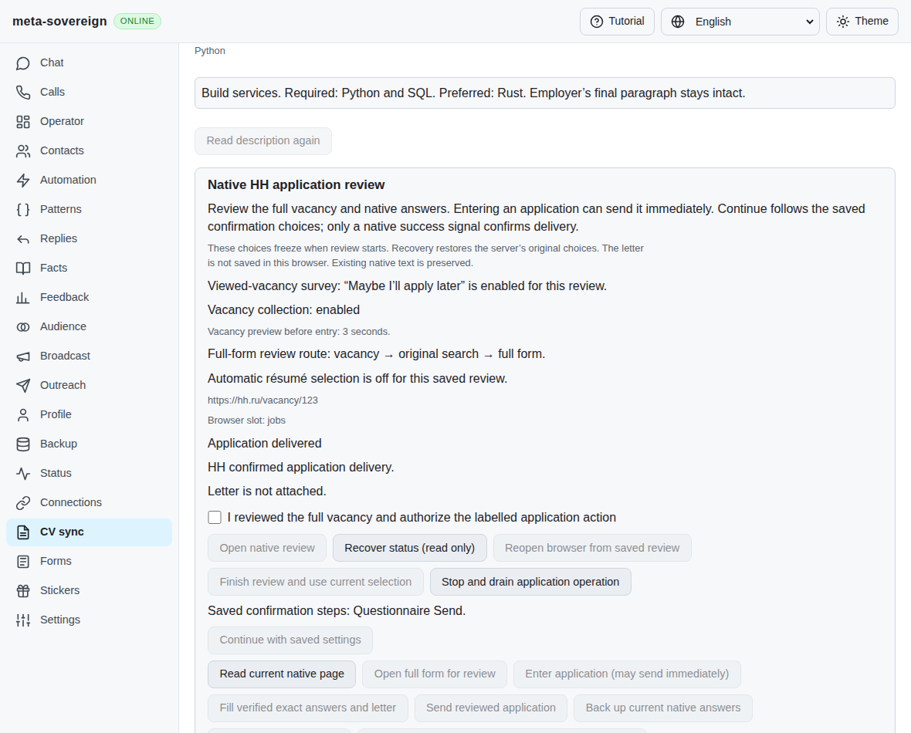
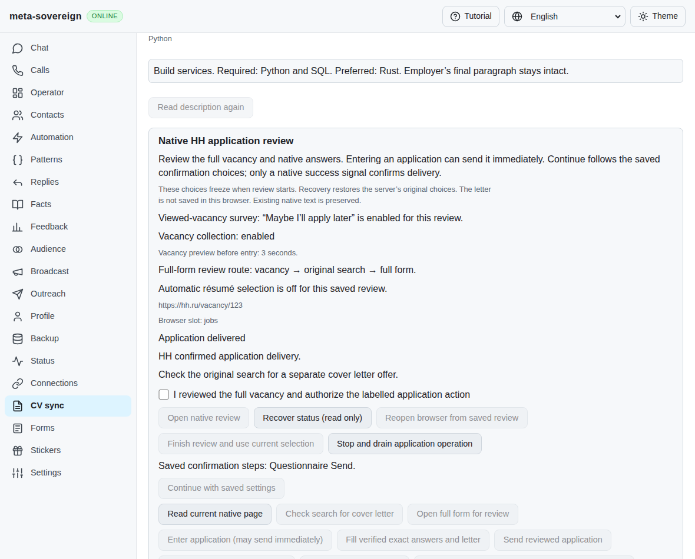

# Find a separate HeadHunter cover letter in the original search

Select an already delivered vacancy with a configured cover letter. Turn off
**Open the full form from the vacancy page**, keep the original search URL, and
open the native review. Confirm **Check search for cover letter**. When the exact
matching card offers a letter, the worker opens its native popup and prepares the
configured text only in an empty field. Review it, then confirm **Send cover
letter**. The application remains confirmed while letter delivery is checked
separately.

If the exact search has no eligible card offer, the worker can return to the same
vacancy and prepare its separate offer. A [confirmed send from that fallback](application-delivered-return.md)
returns to the original search. Duplicate cards, a different search,
native verification, and open drafts prevent automatic navigation or dispatch.
If the popup already has different text, the review keeps the owner's draft open.
When neither page offers the letter, the outcome retains the vacancy for manual
review. An uncertain send keeps its reservation. The lookup uses `letter-prepare`
and the current request and revision in the CLI and both Lino encodings. A batch
uses its saved **Cover letter** and **Questionnaire Send** choices for the two
confirmations. Reading status and preview mode leave the provider untouched.

## Verification

The published parent `2784e6f6` opens an already delivered vacancy without a
vacancy-page offer and shows no action for its available search-card offer. The
Chromium reproduction uses the parent's server modules and committed web bundle.
The fixture's exact search includes another vacancy with a numeric ID sharing
the requested ID's prefix. The revised browser scenario verifies the frozen
search route, one popup open and one confirmed send for the requested card, the
untouched neighboring offer, and the receipt after reload. Local runs use a
provider fixture. Node passed 61 focused checks and Deno passed 48. Additional
Chromium checks verify the same-vacancy fallback,
duplicate card protection, and preservation of an owner's draft. At 390 pixels,
Playwright independently checked that lookup requires confirmation, that the
owner's draft leaves Send unavailable across reload, and that closing the review
releases its browser resources. Authenticated behavior and the remaining
reference application routes are tracked in HH06 and HH08.

Scoped formatting, ESLint and secret scanning complete with no errors. ESLint
reports 18 complexity, size or parameter-count warnings. The phone run recorded
no page exceptions and one browser console error.

```sh
node --test --test-concurrency=1 js/tests/job-application-search-attachment.test.js
RUN_BROWSER_E2E=1 APPLICATION_SEARCH_ATTACHMENT_CONTROLS=1 node experiments/issue-56/application-search-attachment-browser.mjs
```

| Parent's delivered review                                                                                                 | Original-search lookup ready for confirmation                                                      |
| ------------------------------------------------------------------------------------------------------------------------- | -------------------------------------------------------------------------------------------------- |
|  |  |

[Reviewed popup](../../screenshots/application-search-attachment/ready.png) ·
[Confirmed receipt](../../screenshots/application-search-attachment/after.png) ·
[Source and logs](data/application-search-attachment.tar.gz) ·
[SHA-256 manifest](data/application-search-attachment.json)
