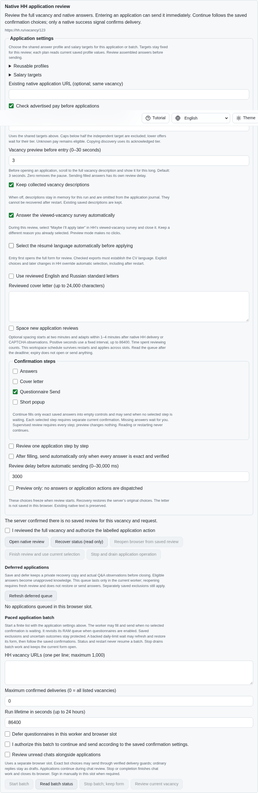
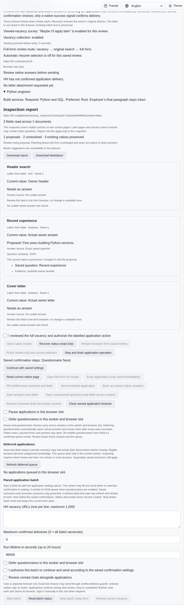

# HH native application route

The pinned HH reference at `fa0991b8c2d0896fb3b4be6c69947f0590094b15` supports
`applyFromVacancyPage`, default true, and the negative CLI alias. Previously
Meta Sovereign could open the full form directly, but could not return through
the original search first. This is one missing part of HH03; acceptance stays
**88/118 verified, 30 unfinished**.

Both native review routes now share the same collected vacancy, preview timing,
salary/pause/Stop admission and canonical full-form destination. The optional
search route preserves the original search filters and checks its document,
visible search identity and actual control values immediately before leaving.
Challenge, unexpected response form, draft, delivery, limit, changed controls and
Stop refuse navigation. It makes no Apply/Send click or delivery reservation.
Existing direct Apply behavior with automatic CV language selection disabled
is retained and explained in the UI.

`--apply-from-vacancy-page`, `--no-apply-from-vacancy-page`,
`APPLY_FROM_VACANCY_PAGE` and selected/current Lino configuration resolve through
the existing configuration layer. `--application-search-url` optionally selects
the return URL. CLI, both Lino encodings, selected-vacancy and completed-discovery
handoffs, frozen single/batch settings and all four translations share the
setting. Schema 26 reserves both additive fields without rewriting acknowledged
legacy signatures, attempts or draft data; collision, dry-run and idempotence
checks retain those records.

## Reproduction and verification

- Exact published `ef34179a` modules fail 22 new assertions, with two independent
  controls passing and no cancelled tests. Its actual panel has no route option.
- Ten specific test files pass **80/80** with one test process at a time. They
  cover original filters, both routes, native refusal states, Stop, read-only
  recovery, strict receipts, both wire formats, frozen batches, configuration
  precedence, discovery handoff and additive migration preservation.
- A bounded native Chromium check visits vacancy → full form and vacancy → the
  original filtered search → full form, preserving both actual owner answers.
  Four modified native search states refuse the second navigation. Apply and Send
  counters remain zero; every owned browser closes.
- Independent Playwright MCP operates the actual panel, recovers without replay,
  verifies Russian, Hindi, Chinese and English plus phone width, then closes the
  owned session. It records zero Apply/Send clicks and no page exceptions. Its
  console separately retains a favicon 404 and four bundle cache-write errors;
  their cause is unproven and this evidence does not claim a clean console.
- Scoped formatting, lint, secrets, whitespace and source/document limits pass.
  Lint retains three complexity warnings. Duplication must pass the unchanged
  6.5% gate before the collector can create the archive.

The regression entry points are `application-search-route.test.js`,
`application-search-route-controls.test.js` and
`migrations-application-route.test.js`. The native scenario is registered once
in the existing feedback group for both hosted browser engines, keeping the
existing group limit and deadlines. Full runtime/browser/build checks remain
hosted, with exact-source acceptance still required.

`data/application-search-route.tar.gz` and its SHA-256 manifest retain source
snapshots, published modules, pinned reference sources, test/static/native/MCP
logs, console limitations and screenshots. The collector validates receipts and
independently verifies every archived byte. The wider cache/insight audit and
all other unfinished issue requirements remain required in PR57.
