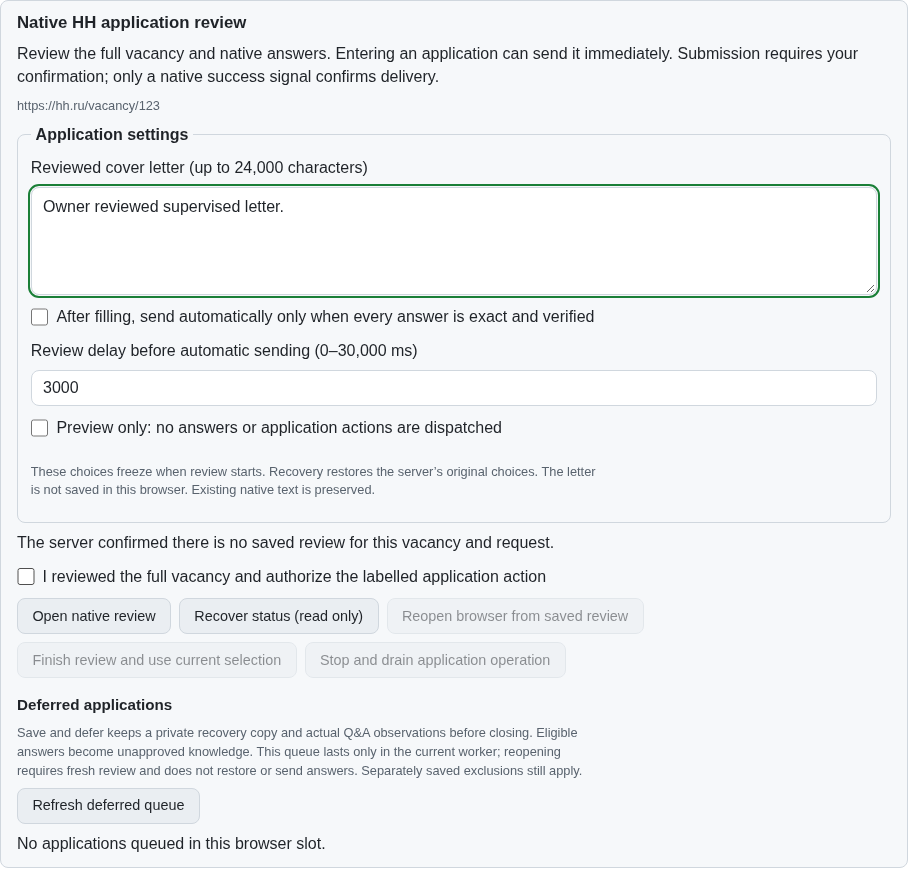
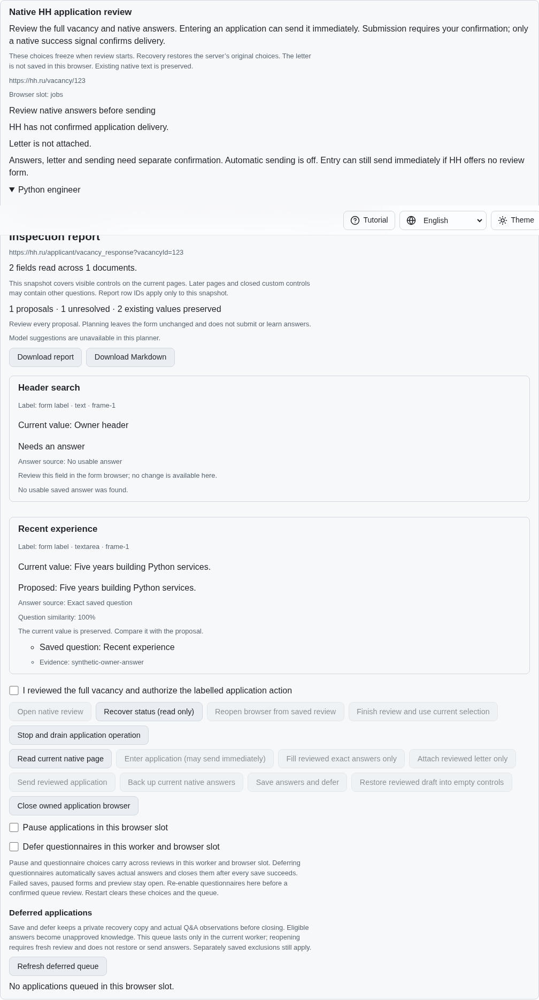
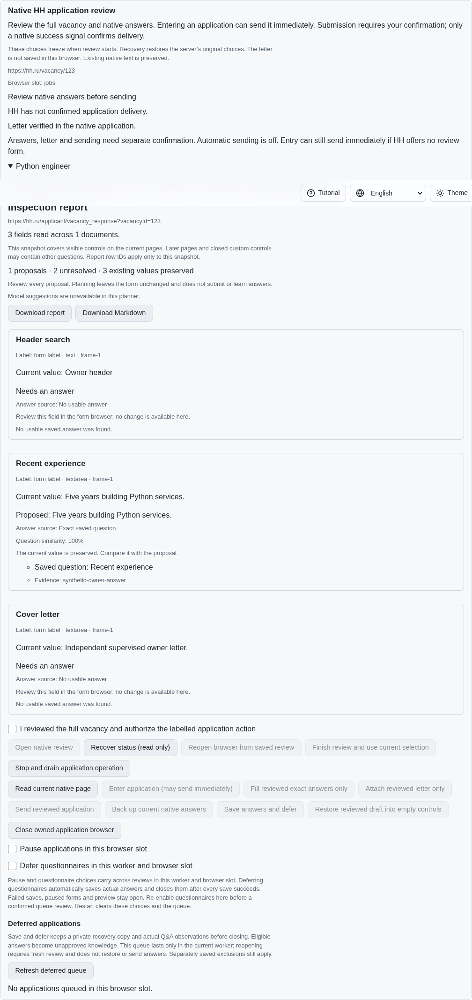
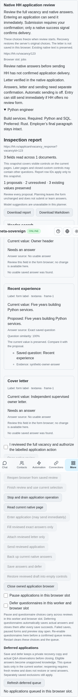

# Supervised single-application review

PR: https://github.com/link-foundation/meta-sovereign/pull/57

The opt-in supervised preset separates exact answer filling, letter attachment
and sending. It disables automatic sending and ends the foreground command after
one native-confirmed delivery, including delivery on entry. The existing preview
still performs no writes or clicks. Automatic paced queue revisits, independent
confirmation configuration, recruiter-panel behavior and all 81 unchecked
original inventory rows remain unfinished. This step does not complete HH08;
PR57 stays draft and unmerged.

## Requirement and reproduction

The pinned HH reference `fa0991b8c2d0896fb3b4be6c69947f0590094b15`, README
lines 368–389, describes a supervised test preset, separate answer/letter/send
confirmation and a one-application limit. Its term “test mode” permits confirmed
real actions. This repository's existing `testMode` promises zero effects, so a
separate `supervised` option preserves that promise. The larger reference runner
and independently configurable confirmation list remain required.

Published parent `f523ccc585a97a6f270082fe94dee00660dd5073` ignores these
new options: an answer-only request with automatic exact sending enabled fills
the letter and delivers immediately. The exact-parent Node and real native
Chromium experiments both fail at `provider-confirmed` versus expected `none`.
The before screenshot shows the parent's settings without the new preset; the
failure logs establish its subsequent combined fill/send behavior. The wrappers
restore source bytes and drain their owned fixtures. All five workflows pass
for that exact parent; the new commit needs its own hosted checks.

```sh
PYTHONDONTWRITEBYTECODE=1 python3 experiments/issue-56/application-supervised-before.py
PYTHONDONTWRITEBYTECODE=1 python3 experiments/issue-56/application-supervised-before.py --native
node --max-old-space-size=384 --test --test-concurrency=1 js/tests/job-application-supervised.test.js js/tests/job-application-supervised-controls.test.js js/tests/migrations-supervised-applications.test.js
DENO_V8_FLAGS=--max-old-space-size=384 deno test --no-check --allow-all js/tests/job-application-supervised.test.js js/tests/job-application-supervised-controls.test.js js/tests/migrations-supervised-applications.test.js
RUN_BROWSER_E2E=1 E2E_BROWSER=chromium E2E_EXECUTABLE_PATH=/opt/google/chrome/chrome node --max-old-space-size=384 experiments/issue-56/application-supervised-native.mjs
PYTHONDONTWRITEBYTECODE=1 python3 experiments/issue-56/native-rich-check.py --session
```

## Behavior and verification

| Requirement            | Implementation and evidence                                                                                                                                                                                                                                                                                                                                                                                                             |
| ---------------------- | --------------------------------------------------------------------------------------------------------------------------------------------------------------------------------------------------------------------------------------------------------------------------------------------------------------------------------------------------------------------------------------------------------------------------------------- |
| Separate confirmations | `prefill` admits `part: answers` or `part: cover-letter`. Each scoped action returns to review and never dispatches. Supervised reviews refuse combined or unspecified parts before any effect. UI receipt revisions renew the confirmation checkbox. Actual native DOM and independent MCP verify answers without a letter, then a verified letter without sending, and one separately confirmed send.                                 |
| Frozen choices         | `supervised: true` forces `autoExact: false` at server admission. CLI, both real HTTP Lino formats and recovered browser receipts retain the original settings despite caller changes. Local browser storage retains only recovery identity. Four actual locale reloads recover without replaying fills.                                                                                                                                |
| Existing behavior      | Normal combined prefill retains its explicitly configured automatic behavior. Both new scoped actions remain review-only even outside the preset. Strict input, stale revision, changed owner answer/letter, zero-effect preview and uncertain delivery checks pass. Native entry can still send immediately when HH supplies no review form; the UI explains this before confirmation.                                                 |
| Foreground completion  | The command accepts `answers`, `letter` and `submit`. It stops reading commands only after a provider-confirmed delivery and drains the owned browser. Immediate native entry confirmation also counts; a lost or unknown outcome remains unresolved and does not count. This is one URL per command, not the reference's future batch runner.                                                                                          |
| Legacy data            | Migration 0014 reserves the optional setting and advances the application schema without rewriting old journal bytes, options, signatures or dispatch reservations. Absence means normal review. An unexpected existing field refuses migration. Exact native/JavaScript schema negotiation advances together to 14. The native durable checkpoint envelope remains representation 13 because its generic record encoding is unchanged. |
| Shared controls        | CLI, text/binary Lino, strict public receipt validation and four translated browser dictionaries use the same server rules. Browser controls disable automatic sending under the preset and offer two distinct fill buttons. Phone layout has no horizontal overflow.                                                                                                                                                                   |

Local verification passes: 184 focused Node checks (application compatibility,
migration registry and dictionaries), 14 new Deno checks, seven finite native
session checks, scoped warnings-denied Clippy, two production Chromium scenarios after shared fixture consolidation
and independent Playwright MCP. The latter verifies four locales, separate
confirmations, actual native submission count one and complete browser cleanup,
with no page errors. Broad runtime/browser/native codec builds remain in CI.

The first draft test incorrectly modeled an edited field as a fresh empty-field
proposal; correcting that synthetic plan preserves the real planner's owner-value
guard. The first MCP cleanup assertion counted search browser records as
application attempts. The corrected probe checks the native application entry
and send counters separately, then requires every owned browser record closed.
Both initial failures are retained. Shared panel controls, phone assertions and
browser cleanup are reused by the existing and new native scenarios; both pass
after consolidation. Scoped formatting, lint, secret checks and the unchanged
6.5% duplication gate pass. No timeout or static threshold is raised.

The fixture uses synthetic HH pages and no authenticated provider account. Its
success does not establish complete live-provider or batch-runner parity.

## Screenshots and evidence

Before, the exact parent has no supervised setting:



After the separately confirmed answer fill, no letter is attached and sending
requires a renewed confirmation:



After separate letter attachment, sending still requires another confirmation:



The same review at a phone viewport:



The checksummed source/log/reference/screenshots archive is
`data/application-supervised.tar.gz`, with its manifest in
`data/application-supervised.tar.sha256.json`. Exact-parent evidence and local
checks are separate from the new commit's hosted verification. Every original
unchecked criterion remains required.
