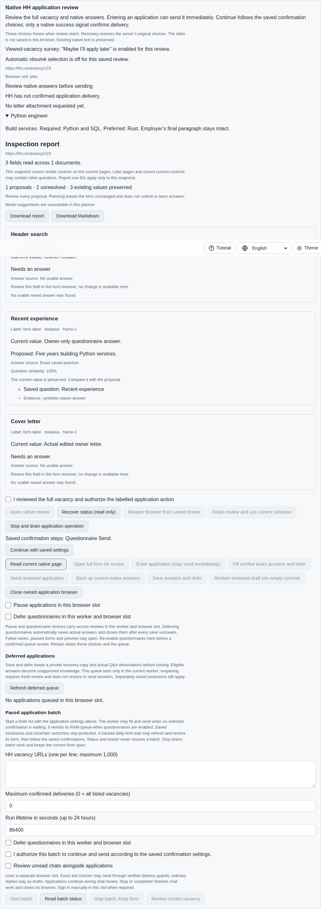
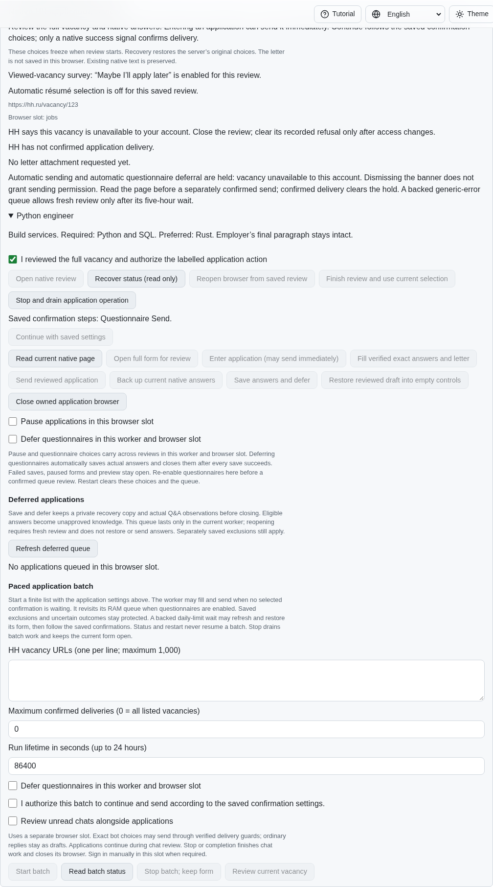
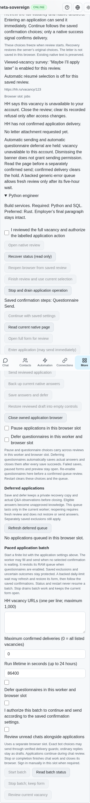
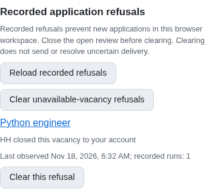

# Account-specific vacancy refusals

[PR #57](https://github.com/link-foundation/meta-sovereign/pull/57) remains draft.
This implements another permanent reason within HH05. Full deferred-question,
transient-retry and session policies remain unfinished; the inventory is still
86 verified and 32 unfinished criteria.

On published parent `13623bf7`, display “Вам недоступна эта вакансия” on the
bound vacancy page and read the native application. Review still appears usable;
no account-specific refusal is recorded. Four actual-parent unit tests fail,
and the native/MCP parent scenarios capture the missing state. The probes
restore the original source and web bundle in `finally`.

The pinned HH reference at `fa0991b8c2d0896fb3b4be6c69947f0590094b15`
records `vacancy_unavailable` as a permanent exclusion. The shared reader now
recognizes its visible Russian/English wording on the bound vacancy page,
including split spans and a long explanatory node. Hidden, collapsed, inert,
owner-entered, questionnaire and vacancy-description text do not invent a refusal.
Existing challenge, delivery and daily-limit boundaries retain precedence.

A positively observed refusal blocks prefill, send, automatic recovery and unsafe
questionnaire deferral. Existing owner answers and uncertain delivery reservations
remain intact. Dismissing the provider banner does not release the application
hold. The existing acknowledged private ledger retains the distinct reason
across restart and blocks new admission until the owner clears it. Revision and
ownership checks apply to clear operations; clearing cannot confirm delivery or
resend an uncertain attempt. CLI and both Lino formats share the same reason,
with English, Russian, Hindi and Chinese review/clear controls.

The focused run passes 98 checks with one worker and a 384 MiB Node heap.
The one-browser native scenario verifies ten ignored variants, five visible
variants, binary Lino readback, retained owner text, reload and manual clearing.
Independent Playwright MCP checks the actual parent failure and corrected
review, all four translations, a 390-pixel phone, reload persistence and clearing.
Both corrected scenarios report zero submissions and no page errors; their
owned browsers and fixture servers close. Full matrices remain hosted checks.

The mandatory existing visibility browser shard includes the regression. Scoped
formatting, lint, secrets, line limits and the unchanged duplication gate cover
the change. [Source-bound evidence](data/application-unavailable.tar.gz) and its
SHA-256 manifest preserve the parent, exact sources, finite checks and screenshots.

Before:

After, desktop and phone:

Recorded after closing and reloading:

