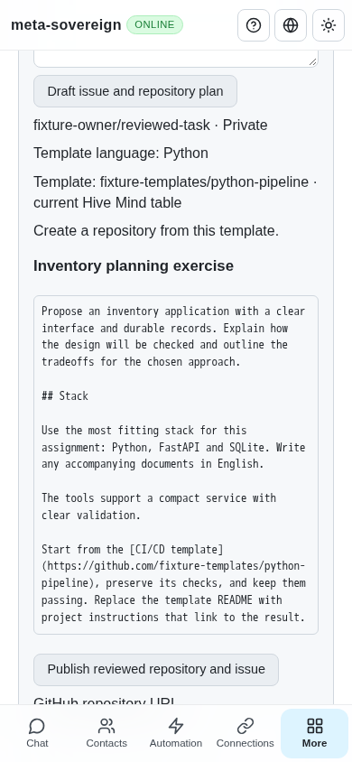
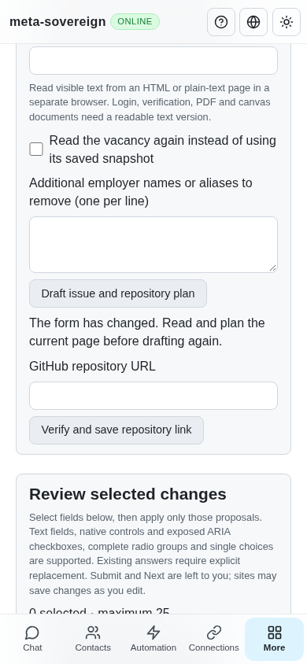

# Draft an assignment from an active Forms review

The pinned HeadHunter CLI reads an already open browser slot when invoked without an input file or URL. At published parent `be57b27a`, the shared CLI opens its own store and requires a serialized inspection or URL. The Forms publisher accepts the previous inspection when the current page changes. [Pinned donor command](https://github.com/konard/hh-job-application-automation/blob/fa0991b8c2d0896fb3b4be6c69947f0590094b15/src/test-assignment.mjs) · [PR #57](https://github.com/link-foundation/meta-sovereign/pull/57).

The CLI now asks the running Forms server to read its own open review. `--review-slot` names a slot. The default selects a unique open review with visible assignment instructions. The server owns the model, saved draft and publication ledger. The same server can recover the printed draft ID. The command can use text or binary Lino. The browser Forms UI supplies its review ID. Its current instructions and canonical form URL must agree with the prior review before the publisher invokes the model. The snapshot uses the existing review operation and checks the physical document before and after the read. It retains the current page and pending fill plan. [Publication guide](../../ASSIGNMENT-PUBLICATION.md).

To reproduce the stale preview, read and plan an assignment, change the employer page's visible assignment instructions in place, then choose **Draft issue and repository plan**. The parent creates a draft from the previous instructions. The revised UI asks the owner to read and plan the current page. Use the exact-parent replay and the production browser shard with an installed Chromium or an executable named by `E2E_EXECUTABLE_PATH`. [Replay script](../../../experiments/issue-56/assignment-active-review-parent.py) · [Automated browser regression](../../../js/tests/helpers/e2e-assignment-publication.mjs).

```sh
python3 -B experiments/issue-56/assignment-active-review-parent.py
python3 -B experiments/issue-56/assignment-active-review-parent.py --browser
RUN_BROWSER_E2E=1 FORMS_GROUP=forms-assignment ASSIGNMENT_ACTIVE_REVIEW_SCREENSHOTS=1 node --max-old-space-size=384 js/tests/e2e-forms-reader-browser.mjs
```

- Four focused tests fail at the exact parent. The revised cases cover named selection, unique automatic selection, ambiguity, missing slots, stale inspection and CLI recovery through both wire encodings. The only navigation recorded in each owned slot is its original open. [Regression tests](../../../js/tests/assignment-active-review.test.js).
- The focused Node run exited successfully after 143 passing tests. Deno exited successfully on the four active-review tests. The broader Deno run reported 143 passing assertions before the process received SIGTERM. Its shutdown remains unverified locally.
- All four focused production Chromium scenarios passed. The revised stale-instruction request records zero model calls, zero GitHub calls and one original navigation. After drafting from matching instructions, the same fill plan reaches its regular field-selection check. After a simulated lost issue response, the existing publication test recovers one repository and one issue and records zero employer submissions.
- Independent Playwright MCP restores the same draft at 390 pixels. It observes draft and restore requests, no publish request and no page exceptions. The disposable fixture records one employer GET, one model call, zero repositories, zero issues and zero submissions. The browser and fixture exit.





See the [evidence archive](data/assignment-active-review.tar.gz) and [per-file checksums](data/assignment-active-review.tar.sha256.json). The remaining QA24 work covers additional instruction formats, assignment handoff, notifications and authenticated execution.
