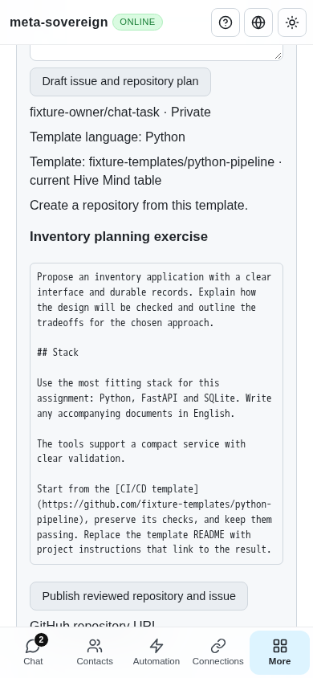
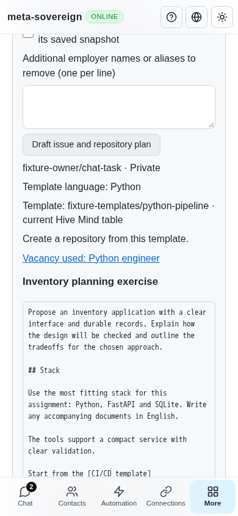

# Retain the HeadHunter vacancy when opening an assignment from chat

Import a HeadHunter conversation whose employer sends a link to a form with an assignment. Open the link in Forms, read and plan the form, leave the vacancy field blank, and draft the issue and repository plan. On the published parent `fc6bfaf0`, the draft has no vacancy even though the common-chat response recorded its ID. A legacy negotiation archive also lost an ID when salary and description were absent. A retained redirect record could still supply a vacancy after the source message was removed. [Pinned B20 requirement](https://github.com/konard/hh-job-application-automation/blob/fa0991b8c2d0896fb3b4be6c69947f0590094b15/docs/requirements/forms-and-chats.md#L202) · [HeadHunter OpenAPI](https://api.hh.ru/openapi/specification/public) · [PR #57](https://github.com/link-foundation/meta-sovereign/pull/57).

Forms now uses the ID from the exact common chat or imported negotiation. It keeps the observed form redirect and uses the precise captured destination when message link metadata is present. Plain text remains supported for imports without structured destinations. A disagreement between vacancy IDs asks the owner for an explicit choice. New drafts require a current message containing the link. Review and publication recovery retain the evidence bound to an earlier draft. Existing common-chat records work as stored. A legacy archive that lost its negotiation vacancy needs to be imported again.

## Reproduction and verification

Replay the exact published parent in a disposable checkout, then run the focused Node check and the local Chromium scenario with dependencies installed. `E2E_EXECUTABLE_PATH` can point to an installed Chromium executable.

```sh
python3 -B experiments/issue-56/assignment-chat-vacancy-parent.py
python3 -B experiments/issue-56/assignment-chat-vacancy-parent.py --browser
node --test --test-concurrency=1 js/tests/assignment-vacancy.test.js js/tests/assignment-vacancy-draft.test.js
RUN_BROWSER_E2E=1 FORMS_ASSIGNMENT_CHAT_ONLY=1 FORMS_ASSIGNMENT_CHAT_SCREENSHOTS=1 node js/tests/e2e-forms-reader-browser.mjs
```

- Six regression cases fail against the exact parent, alongside one passing control. The corrected source passes 49 focused tests in Node and 49 in Deno. They cover the default HH pull, legacy archives, misleading link labels, conflicting identities, edited or deleted messages, and the exact twenty-digit vacancy ID across the CLI and both Lino encodings. The three draft surfaces share one vacancy snapshot and make no publication writes. [Association tests](../../../js/tests/assignment-vacancy.test.js) · [CLI and wire tests](../../../js/tests/assignment-vacancy-draft.test.js).
- Chromium verifies the form redirect and review at desktop and phone widths. The parent draft returns HTTP 200 with unknown vacancy context. The corrected draft returns HTTP 200 with chat provenance and displays “Vacancy used: Python engineer.” The new regression runs in the hosted Forms assignment group. [Browser regression](../../../js/tests/helpers/e2e-assignment-chat-vacancy.mjs).
- Independent Playwright MCP verifies four HTTP 200 responses and the same review at 390 pixels without horizontal overflow, page exceptions, or publish and apply requests. The isolated fixture records one snapshot, one model call, zero repository and issue writes, and zero employer submissions. The empty employer field remains unchanged. Both owned browsers and the fixture close.





The [evidence archive](data/assignment-chat-vacancy.tar.gz) and [SHA-256 manifest](data/assignment-chat-vacancy.tar.sha256.json) contain the source comparison, exact-parent replay, and focused browser and runtime checks. The tests use synthetic HH responses and a local form. Native web-chat capture, authenticated B20 verification, exact-source hosted checks, and the rest of QA24 remain open. The issue inventory still has 88 verified and 30 open criteria.
