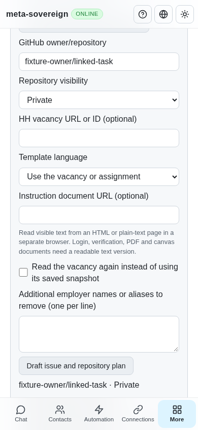
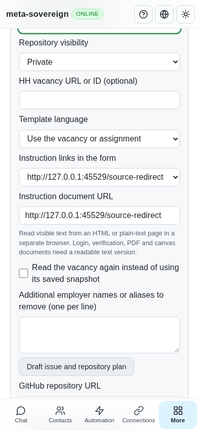

# Instruction links in Forms assignment sections

Forms recognized the visible text of a test assignment, but a link labeled “Read the assignment instructions” lost its destination. In the published build at `580a2012`, an owner could draft from the form alone and receive a draft with no document evidence. The fixture’s document contains information about damaged stock, daily reconciliation and a three-page limit. [Pinned HeadHunter task scanner](https://github.com/konard/hh-job-application-automation/blob/fa0991b8c2d0896fb3b4be6c69947f0590094b15/src/assignments.mjs) · [PR 57](https://github.com/link-foundation/meta-sovereign/pull/57).

The Forms reader now preserves visible instruction URLs in recognized task sections. Hidden links, editable content, other links and same-page targets are excluded. Changing a destination invalidates the saved task revision even when the visible text stays the same. When Forms finds a link, the owner selects it or provides a readable alternate URL. The server applies the same requirement to the CLI, both Lino formats and the shared Forms review. Only a draft request opens the source. The existing reader freezes complete visible HTML or plain-text instructions and records the resolved URL, then closes its owned browser.

## Reproduction and verification

Open `/assignment-linked` on the isolated [Forms fixture](../../../experiments/issue-56/forms-reader-fixture.mjs), read the current page and plan with the example profile. Enter a target repository in the assignment panel. The [parent replay](../../../experiments/issue-56/assignment-linked-parent.py) demonstrates a draft with no document read and fails on the missing URL. Its three focused regressions also fail. On the revised build, the browser verifies one detected link, disabled drafting before selection, no navigation on selection, a single read after drafting, document text in the model request and the resolved source in the draft. It closes both owned browser sessions with the employer field empty and zero submissions. This scenario runs in the existing `forms-assignment` CI group.

```sh
RUN_BROWSER_E2E=1 FORMS_ASSIGNMENT_LINKED_ONLY=1 \
  FORMS_ASSIGNMENT_LINKED_SCREENSHOTS=after \
  E2E_EXECUTABLE_PATH=/opt/google/chrome/chrome \
  node --max-old-space-size=384 js/tests/e2e-forms-reader-browser.mjs
```

Node and Deno each passed 42 focused cases. The independent Playwright MCP check confirmed the same control and redirect at 390 pixels without horizontal overflow, one model request, zero external writes and zero form submissions. [MCP fixture](../../../experiments/issue-56/assignment-linked-mcp-fixture.mjs) · [MCP verification](../../../experiments/issue-56/assignment-linked-mcp.mjs).





QA24 remains open. Direct PDF and other unsupported document formats still need a readable source, and authenticated assignment handoff and remaining notification checks require separate evidence. [Evidence archive](data/assignment-detected-links.tar.gz) · [Entry hashes](data/assignment-detected-links.tar.sha256.json).
