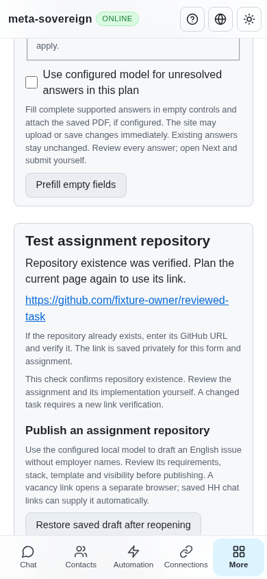
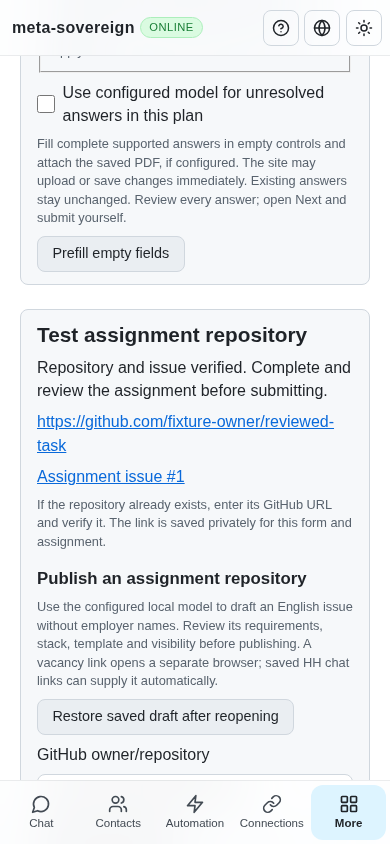

# Restore the confirmed assignment issue in Forms

The pinned HeadHunter assignment command records the repository and issue against the form source. At the published parent `b9b07e5c`, publication returns both links after positive GitHub readback. Reopen the same form and plan its answers. The plan and the review card show only the repository. [Pinned assignment command](https://github.com/konard/hh-job-application-automation/blob/fa0991b8c2d0896fb3b4be6c69947f0590094b15/src/test-assignment.mjs) · [PR #57](https://github.com/link-foundation/meta-sovereign/pull/57).

The revised plan reads the existing private publication ledger for the same assignment, canonical form URL, repository identity and association revision. Only a verified receipt with the exact GitHub issue identity supplies the second link. Forms shows it after confirmed publication and on later plans. The CLI and both Lino encodings expose `planning.assignment.issue`. The result field still uses the repository URL and the review asks the owner to complete and review the assignment before submitting. [Publication guide](../../ASSIGNMENT-PUBLICATION.md).

Open a Forms review, choose a profile, and plan a form containing an assignment. Draft and publish to the disposable GitHub fixture. When the simulated issue response is lost, restore the same draft and obtain positive readback. Close the review, reload Forms, open the same URL and plan it again. The exact parent misses the confirmed issue link. The revised browser and plan show `Assignment issue #1` with the matching repository. Set `E2E_EXECUTABLE_PATH` to a local Chromium if Playwright's browser is unavailable. [Parent replay](../../../experiments/issue-56/assignment-handoff-parent.py) · [Automated browser regression](../../../js/tests/helpers/e2e-assignment-handoff.mjs).

```sh
node --test --test-concurrency=1 js/tests/assignment-handoff.test.js
python3 -B experiments/issue-56/assignment-handoff-parent.py
RUN_BROWSER_E2E=1 FORMS_GROUP=forms-assignment ASSIGNMENT_HANDOFF_SCREENSHOTS=1 node js/tests/e2e-forms-reader-browser.mjs
```

- The previous source fails the plan, CLI, both Lino encodings and shared status link checks. The focused regression run passes 65 Node tests and 62 Deno tests with three substeps. It covers earlier saved publications, malformed or incomplete receipts, manual repository verification, changed instructions at the same URL, and each localized link label. Reopening keeps the repository field value and makes no GitHub requests or model calls. [Plan and link tests](../../../js/tests/assignment-handoff.test.js).
- The production Chromium group passes all four scenarios. The form stays held after a lost response. Recovery creates one fixture repository and one issue in total. Reopening shows the exact issue and makes zero GitHub calls. The employer form records zero submissions.
- Independent Playwright MCP checks the issue immediately after positive readback and after reopening at 390 pixels. The assignment links fit the viewport, reopening adds no publication requests, and both owned slots close. The fixture records one model draft, one repository, one issue, no file attachments and zero employer submissions. The browser console recorded a missing favicon, Chromium cache-write messages and the simulated publication-uncertain warning. No page exceptions occurred. [MCP steps](../../../experiments/issue-56/assignment-handoff-mcp.mjs).





QA24 remains open for additional instruction formats, actionable notifications and authenticated execution. See the [evidence archive](data/assignment-handoff.tar.gz) and [per-file checksums](data/assignment-handoff.tar.sha256.json).
