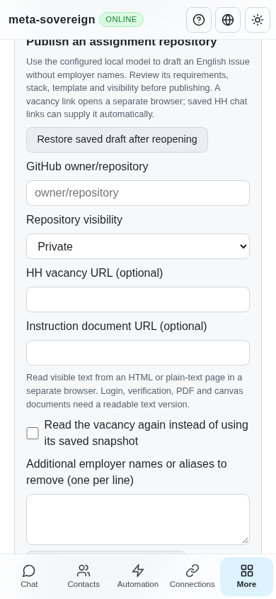
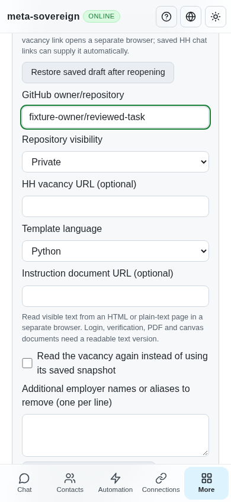
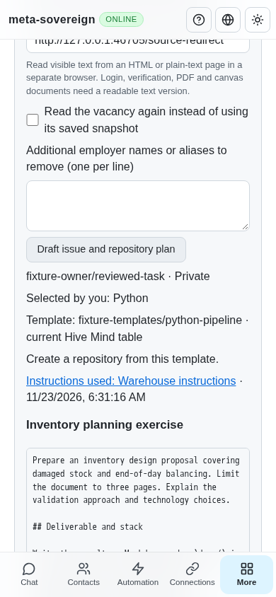

# Assignment template language

Open a recognized assignment in Forms, plan its answers and look between the vacancy and instruction URL fields. At published parent `92efe0f0`, there is no template language control. Passing `--language=python` to the CLI leaves a named TypeScript vacancy in control, and submitting `languageOverride` through Lino provides no reliable confirmation. The pinned HeadHunter assignment command accepts an explicit `--language` choice. The shared publisher now applies the owner’s choice to the existing template catalog and keeps the vacancy evidence available for the rest of the draft. [PR 57](https://github.com/link-foundation/meta-sovereign/pull/57) · [Pinned HeadHunter assignment command](https://github.com/konard/hh-job-application-automation/blob/fa0991b8c2d0896fb3b4be6c69947f0590094b15/README.md#test-assignments) · [Hive Mind template catalog](https://github.com/link-assistant/hive-mind/blob/main/docs/CI-CD-BEST-PRACTICES.md#recommended-cicd-templates).

Choose **Template language** in Forms, pass `--language` at the CLI, or include `languageOverride` in a draft request using either Lino encoding. The publisher checks the supported language, restricts the model’s structured response and refuses a conflicting result. The resulting private draft shows the exact language and template and retains the canonical choice for publication and restoration. A changed choice clears the visible publish review. An issued draft recovers from its saved choice and rejects attempts to replace it through `--draft-id`. Leaving the choice automatic preserves named-vacancy precedence and compatibility with previous drafts. The [user guide](../../ASSIGNMENT-PUBLICATION.md) documents the four localized controls and request field.

The [parent comparison](../../../experiments/issue-56/assignment-language-parent.py) swaps the relevant files to the exact published source, runs eight failing regressions and one passing legacy control, then restores each file. Its `--browser` run also swaps the production bundle and confirms the absent native selector and zero GitHub calls. The revised production bundle is covered by the existing `forms-assignment` browser group.

```sh
python3 -B experiments/issue-56/assignment-language-parent.py
python3 -B experiments/issue-56/assignment-language-parent.py --browser
RUN_BROWSER_E2E=1 FORMS_PUBLICATION_ONLY=1 node --max-old-space-size=384 js/tests/e2e-forms-reader-browser.mjs
```

- 103 focused tests pass in Node and 103 pass in Deno. Coverage includes C# and C++ aliases, invalid or mismatched choices, authentic text and binary Lino requests, current catalog selection, older drafts and lost response recovery. The archive retains the full outputs.
- In Chromium, Python is selected and appears in the preview. Selecting TypeScript removes the publish action, and restoring the saved draft restores Python. After a lost response, the form stays held until the same draft verifies by readback. The fixture creates one repository and one issue, confirms its pipeline and records zero employer form submissions. The source is read once.
- An independent Playwright MCP session verifies the native control at 390 pixels, draft invalidation after changing the choice, and restoration without publication. The owned fixture reports one model call, zero repositories, issues and submissions, and a closed review. The browser records no page exceptions. Its console records a favicon 404 and one cache write error.







The [evidence archive](data/assignment-language.tar.gz) and [per-file checksums](data/assignment-language.tar.sha256.json) preserve relevant source, the compiled bundle hashes, fixture logs and screenshots. The remaining QA24 requirements include other document formats, standalone drafting, complete handoff and notifications, and authenticated live execution. All 30 outstanding criteria remain unfinished in draft PR 57.
