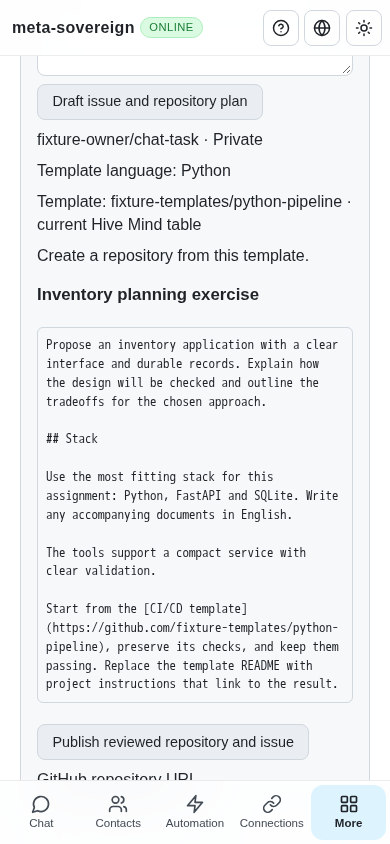
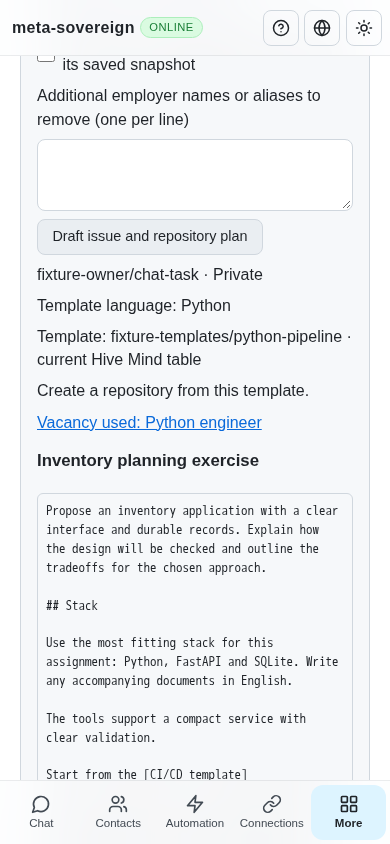

# Retain the vacancy from a native HeadHunter conversation

Open an HH conversation whose visible employer header links to the vacancy and whose message links to an assignment form. Capture the conversation, open the form in Forms, read and plan it, and draft the assignment with the vacancy field empty. On `cd0c7b25`, the archive preserves the form destination but drops the vacancy from the native header. The draft returns HTTP 200 with unknown vacancy context. The common-chat API and negotiation paths are documented separately. [Pinned B20 requirement](https://github.com/konard/hh-job-application-automation/blob/fa0991b8c2d0896fb3b4be6c69947f0590094b15/docs/requirements/forms-and-chats.md#L202) · [Earlier association work](assignment-chat-vacancy.md) · [PR #57](https://github.com/link-foundation/meta-sovereign/pull/57).

Current-window capture, older-history traversal and the owner watcher now preserve the same vacancy evidence. The reader checks the conversation route, document, message ownership and the visible HH employer header. The archive stores a bounded ID within the matching browser message's namespace. A new observation with a missing or invalid header clears the old vacancy for that row. A capture through an older caller without the header field retains previously observed evidence. Previously archived native messages without a vacancy need to be captured again. The Forms draft keeps its exact form-link and verified-redirect checks and still requires an explicit choice when matching messages point to different vacancies.

## Reproduction and verification

Run the exact published-parent replay with project dependencies installed. Set `E2E_EXECUTABLE_PATH` if the environment uses an existing Chromium binary.

```sh
python3 -B experiments/issue-56/assignment-chat-vacancy-parent.py --native
python3 -B experiments/issue-56/assignment-chat-vacancy-parent.py --native --browser
RUN_BROWSER_E2E=1 node experiments/issue-56/assignment-native-chat-browser.mjs
RUN_BROWSER_E2E=1 FORMS_ASSIGNMENT_CHAT_ONLY=1 FORMS_ASSIGNMENT_NATIVE_CHAT=1 FORMS_ASSIGNMENT_CHAT_SCREENSHOTS=1 node js/tests/e2e-forms-reader-browser.mjs
```

- The exact parent fails two archive regressions. The corrected source passes 56 targeted tests in Node and the same 56 in Deno. They preserve the exact twenty-digit ID, refuse nonbrowser records and unverified origins, avoid matching a different form query, and cover CLI and both Lino formats through the shared assignment API. [Archive regressions](../../../js/tests/browser-history-archive.test.js).
- Chromium covers direct native capture, an embedded HH frame, a form in an older virtualized window, hidden and foreign headers, and a header mounted while the owner watcher is active. The original composer remains unchanged. The scenarios are registered in the hosted question providers group. [Capture cases](../../../js/tests/helpers/e2e-hh-assignment-vacancy.mjs) · [Owner watcher](../../../js/tests/helpers/e2e-hh-live-capture.mjs).
- Desktop and phone Chromium verify the shared Forms draft after a form redirect. The corrected review uses “Python engineer” with the vacancy override empty and observes one exact vacancy lookup. Independent Playwright MCP reproduces the same phone render, including four successful HTTP responses and zero page exceptions, publish requests, or apply requests. Its console reports the fixture favicon 404 and a browser cache-write error after the page loads. The fixture records no chat clicks, text sends, GitHub writes, or employer submissions. The isolated browsers and server close.





The [evidence archive](data/assignment-native-chat-vacancy.tar.gz) and [SHA-256 manifest](data/assignment-native-chat-vacancy.tar.sha256.json) preserve the parent replay, runtime checks, browser receipts and screenshot hashes. The MCP phone screenshot matches the Chromium phone screenshot byte for byte. The native conversation and vacancy read are routed fixtures. Authenticated B20 and exact-source hosted verification remain open, along with the other QA24 requirements. The issue inventory remains at 88 verified and 30 open criteria.
