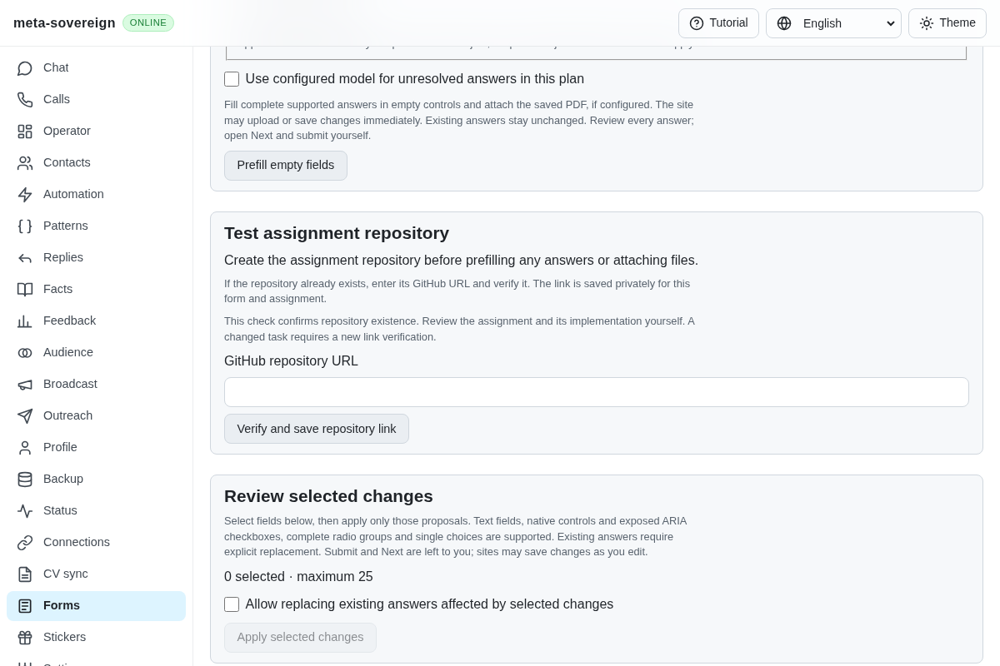
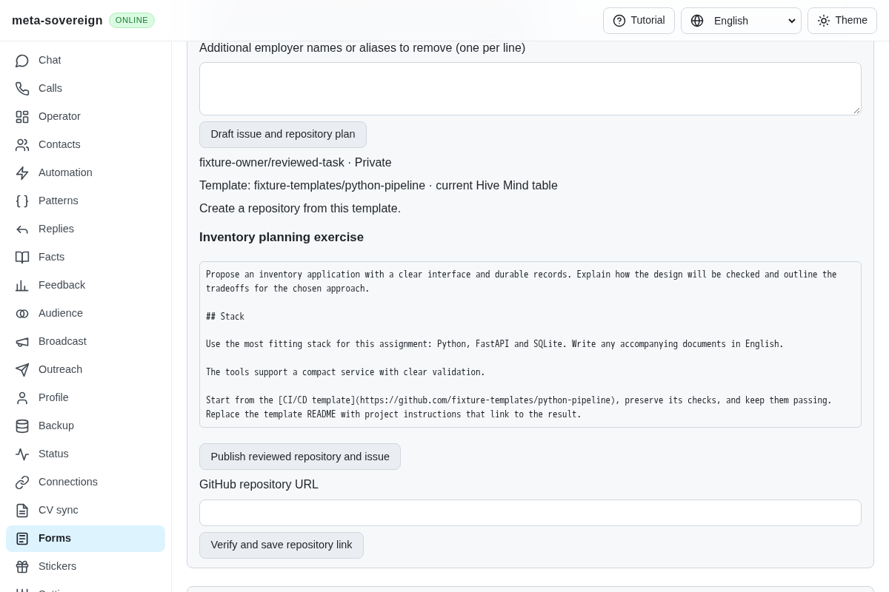
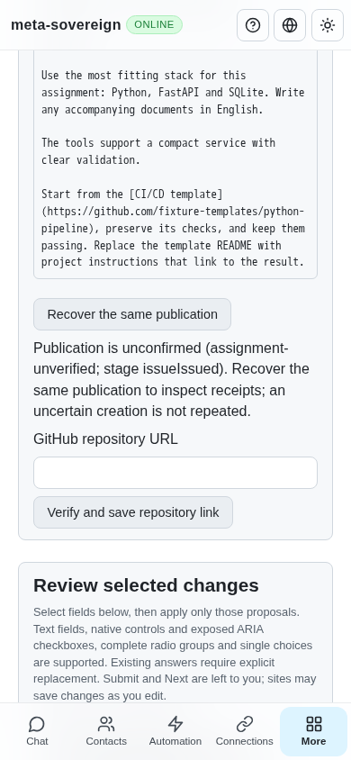
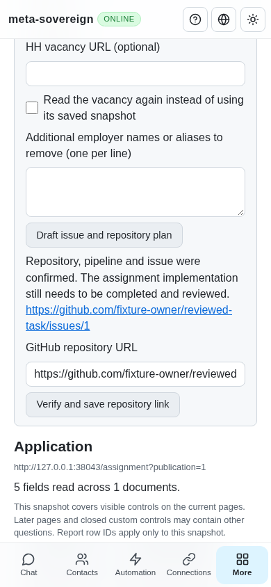

# Reviewed assignment publication

[PR 57](https://github.com/link-foundation/meta-sovereign/pull/57) extends the [whole-form prerequisite](forms-assignment-prerequisite.md) with B16/B19–B22 repository and issue publication through CLI, trusted text/binary Lino and four-language Forms controls. The assignment implementation remains a separate task: success explicitly confirms repository, pipeline files and issue, with no employer-form submission.

The reference `src/assignments.mjs` and its tests were read in full, together with the current primary Hive Mind CI/CD guide. Their behavior informed this implementation; source was not copied. The current recommended-template table is read before a disclosed language-specific fallback. A named role language outranks incidental technologies. The configured local model receives bounded untrusted assignment/vacancy data and a tool-free schema. A private preview shows exact English prose, stack, template, visibility and the existing/create/merge plan. Local checks reject six consecutive source words, known employer aliases/inflections/transliterations, short standalone aliases and predominantly non-English script. These are conservative checks; the owner reviews semantic fidelity and unknown aliases.

Actual GitHub templates use `gh repo create --template`. Other template repositories retain their history through clone/push. Existing repositories preserve owner files while adding missing workflow files and template ancestry. Fresh reruns update the uniquely marked issue and repair an absent pipeline. Written exercises produce issue instructions for original-language Markdown under `docs/`, source length limits, a proposed stack and a README linking to the result. The publisher does not claim to have written that result.

Explicit HH vacancy URLs and actual stored HH-message links provide title, description, skills and employer evidence. Original/redirect form aliases share a private association. A separate owned browser uses the stored assignments policy, closes on success/failure/late cancellation and caches only successful visible reads. Conflicting chat associations require an explicit vacancy. Refresh is explicit; incomplete/login/oversize pages cannot become cached evidence.

Private drafts bind assignment and model revisions, repository identity and issue snapshot. Every remote effect has a flushed durable intent before issue. Unknown writes remain uncertain, retain the form hold and are never repeated blindly. Readback reconciles actual repository identity, workflow presence and complete marked issue. Reopening restores the issued draft without another model call. Different saved drafts cannot take over pending publication; recreated repositories and owner-edited issues refuse stale recovery. Positive cached publication can recover a failed final local association write without remote writes. Store-wide ownership, argument-vector commands, process-tree cancellation, bounded output and deadlines drain before shutdown. Optional metadata diagnostics are off by default.

## Reproduction and verification

The production UI test against the preceding bundle fails because the server-backed publisher does not exist; its before screenshots are retained. Two later recovery defects were isolated with [assignment-publication-recovery-before.py](../../../experiments/issue-56/assignment-publication-recovery-before.py): removing the pending-draft/identity guards produces exactly two failures; source is restored in `finally`.

```sh
NODE_OPTIONS=--max-old-space-size=384 node --test --test-concurrency=1 js/tests/assignment-publisher.test.js js/tests/assignment-vacancy.test.js js/tests/assignment-publication-controls.test.js js/tests/assignment-template-history.test.js js/tests/forms-reader.test.js js/tests/forms-assignment.test.js
deno test --v8-flags=--max-old-space-size=384 --allow-all --no-check js/tests/assignment-publisher.test.js js/tests/assignment-vacancy.test.js js/tests/assignment-publication-controls.test.js js/tests/assignment-template-history.test.js
RUN_BROWSER_E2E=1 FORMS_GROUP=forms-assignment ASSIGNMENT_PUBLICATION_SCREENSHOTS=1 E2E_EXECUTABLE_PATH=/opt/google/chrome/chrome NODE_OPTIONS=--max-old-space-size=384 node js/tests/e2e-forms-reader-browser.mjs
```

Seventy-seven focused Node checks and 45 Deno checks cover draft-only behavior, real CLI ownership, both Lino formats, trusted origins, malformed/offline receipts, current template selection, privacy, document instructions, rerun repair, lost responses, stale task/model races, durable intents, reload restoration and shutdown. Four focused cases use actual tiny local Git repositories/owned child processes to verify history, file preservation, deleted-workflow recovery, cleanup and cancellation. No live repository is created by these checks.

Production Chromium runs both the existing assignment-link flow and the new publisher in the mandatory `forms-assignment` group. It preserves a refused input, shows a mutation-free preview, loses the synthetic issue response, keeps the form held, reloads/restores the same draft and recovers through readback. Exactly one repository and one issue are created in the synthetic adapter. A fresh plan places the repository only in the result field; submissions remain zero. Screenshots wait for actual viewport/layout settlement, preventing blank compositor captures.

Independent Playwright MCP repeats draft → uncertain → reopen/restore → verified on the production server at desktop and 390-pixel phone widths. Its server independently records one model call, one repository, one issue, a pipeline, closed owned browsers, preserved owner input, empty employer form fields, zero files and zero submissions. There are no page errors; the console records the expected uncertain-publication warning and an unrelated favicon 404. The browser and fixture are closed after verification.









The [evidence archive](data/assignment-publication.tar.gz) and [manifest](data/assignment-publication.tar.sha256.json) retain source, primary research, failing-before checks, focused results, production/MCP evidence and screenshot hashes. Recollect with [collect-assignment-publication.py](../../../experiments/issue-56/collect-assignment-publication.py). See [user/CLI/API documentation](../../ASSIGNMENT-PUBLICATION.md).

Authenticated live provider/model execution, linked-document acquisition, complete assignment handoff/notifications and every other unchecked issue criterion remain unfinished. Hosted CI retains the full runtime/browser matrix. Preceding head `55189505` passes Chromium and the completed runtime jobs, but macOS Node shard 1/2 exceeded the existing ten-minute job deadline: job 130341086349 started at 05:24:39 UTC; tests began at 05:27:59 and cancellation is at log line 3544 (05:34:51). GitHub annotations explicitly identify the job deadline. This is incomplete validation, with no assertion failure shown; balancing the hosted shard workload remains required. The archive preserves its metadata, annotation and raw log. WebKit is still running at collection. PR 57 stays draft and unmerged.
