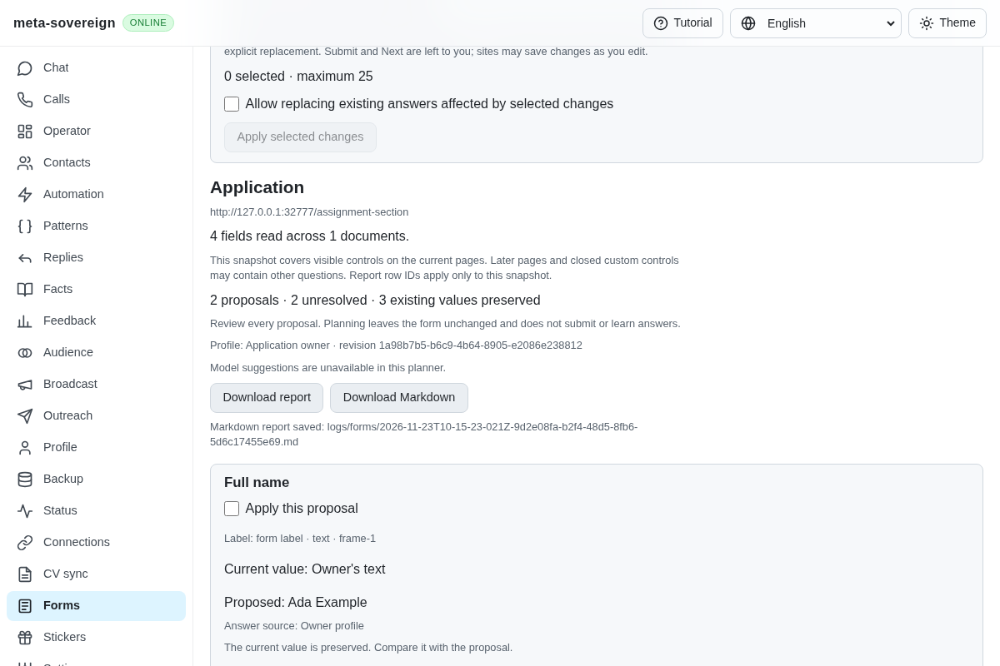
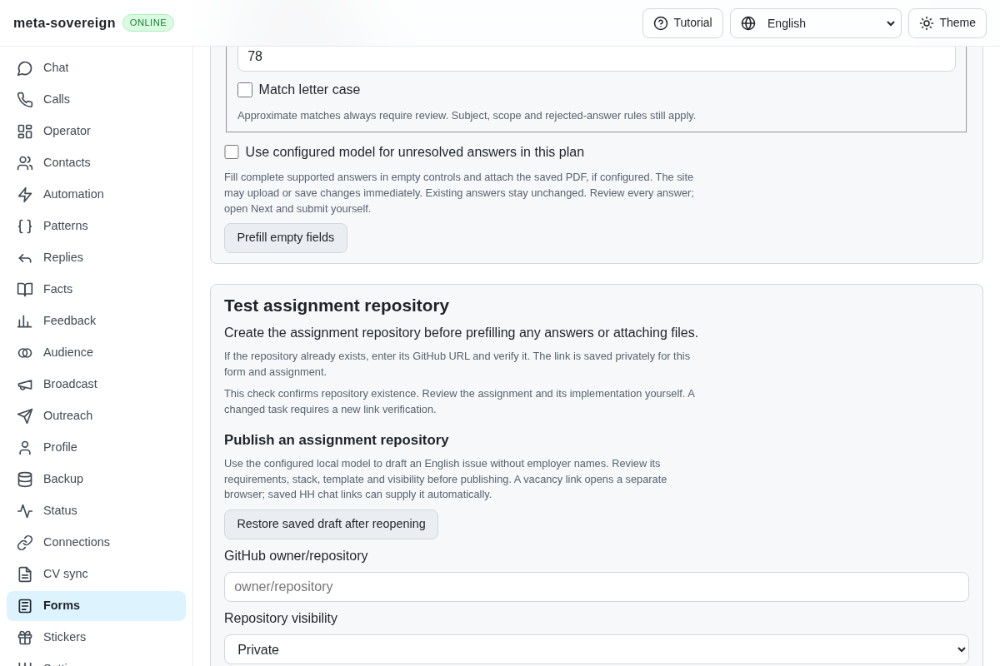

# Test assignment instructions below the first form field

The pinned HeadHunter reference searches visible form sections for task headings. Meta Sovereign already recognized assignment text in document introductions and field descriptions. Published commit `72d5a02c` stops the introduction at the first control, so the fixture below offered two ordinary answers while ignoring a required task farther down. [Pinned reference scanner](https://github.com/konard/hh-job-application-automation/blob/fa0991b8c2d0896fb3b4be6c69947f0590094b15/src/assignments.mjs) · [PR #57](https://github.com/link-foundation/meta-sovereign/pull/57).

The owned Forms reader now captures visible task sections, articles, fieldsets and items in visible frames. It preserves the complete instructions for private assignment review. The current visible task holds ordinary answers and PDF attachments even when the form has no repository-link field. Edited instructions change the saved revision. The capture excludes hidden text, values in editable controls, and verification content. A recognized task that exceeds the bounded read refuses planning with `form-assignment-limit`. Ordinary introductions and field-based task recognition remain available.

## Reproduction and verification

Open the [fixture](../../../experiments/issue-56/form-assignment-section-fixture.mjs) in Forms, read the owned page and plan with the example application profile. A name field appears before the task. The next ordinary answer has a saved rule. With the four Forms modules from `72d5a02c`, the browser regression reports two proposals and fails on the absent prerequisite. On the revised reader it reports zero proposals, shows the prerequisite and refuses automatic prefilling with zero write receipts. The provider field stays empty, the fixture receives zero submissions and the browser closes. The same case runs in the existing `forms-assignment` group. [Browser regression](../../../js/tests/helpers/e2e-form-assignment.mjs).

```sh
RUN_BROWSER_E2E=1 FORMS_ASSIGNMENT_SECTION_ONLY=1 \
  FORMS_ASSIGNMENT_SECTION_SCREENSHOTS=after \
  E2E_EXECUTABLE_PATH=/opt/google/chrome/chrome \
  node --max-old-space-size=384 js/tests/e2e-forms-reader-browser.mjs
META_SOVEREIGN_TEST_CHROMIUM=/opt/google/chrome/chrome \
  node --max-old-space-size=384 experiments/issue-56/form-assignment-section-probe.mjs
```

Node and Deno each pass 48 focused assignment, inspection and planning tests. The [Chromium probe](../../../experiments/issue-56/form-assignment-section-probe.mjs) reads the exact complete task, then confirms revision changes, hidden and waived sections, oversized instructions and the existing verification boundary. Independent Playwright MCP verifies a visible prerequisite and refused prefilling at 390 pixels. Both fixture sessions close with the English field unchanged and zero submissions. The logged browser warning identifies the expected refusal.





These checks use a local fixture. QA24 remains open for the other instruction capabilities, signed desktop notification behavior and authenticated provider workflows. [Evidence archive](data/assignment-sections.tar.gz) · [Entry hashes](data/assignment-sections.tar.sha256.json).
