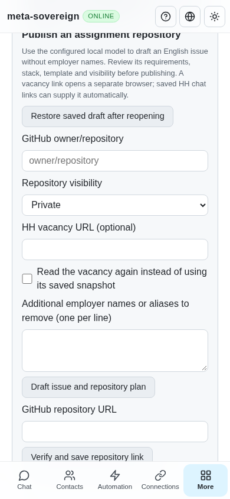
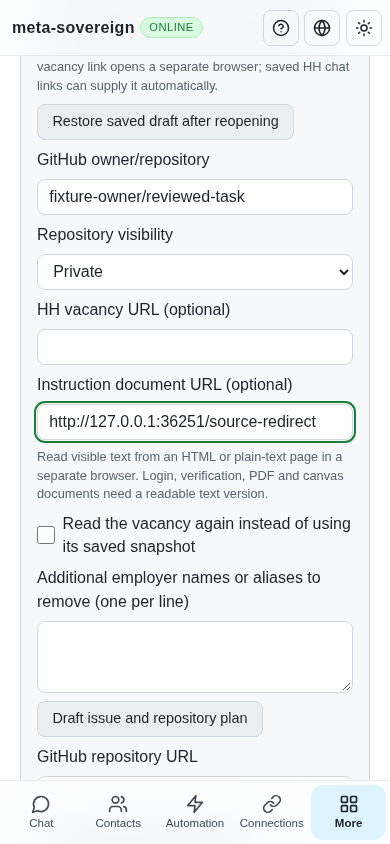
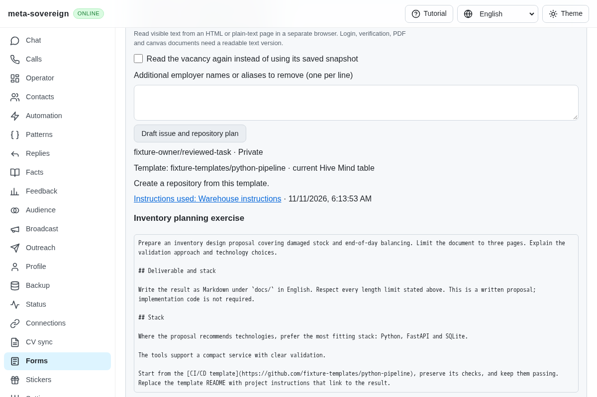

# Linked assignment instructions

[PR 57](https://github.com/link-foundation/meta-sovereign/pull/57) extends the reviewed publisher with explicitly selected instruction URLs. The parent ignored linked instructions, their six-word overlap and invalid source URLs; written tasks also lacked the reference's specific **Deliverable and stack** heading. Four focused regressions fail on parent `9feb1d62`; the reusable [reproducer](../../../experiments/issue-56/assignment-source-before.py) restores the working files afterward.

The shared CLI/Lino/UI service reads a selected HTML/plain-text source through an owned `assignments` policy browser in its separate `assignment-source` slot. It requires a positive commander navigation receipt, checks main-frame HTTP responses and records original/resolved URLs, title, timestamp and a fingerprint. Visible document text is private in the saved draft. The model receives it as untrusted data alongside the form instructions. Employer and overlap checks cover both sources before preview and publication. Changed saved source evidence refuses restore/publication. Restoring and publishing the frozen draft cause no source reread.

Native fields, ARIA editors, editable content and hidden text are excluded. Login/challenge pages, HTTP failures, PDF/canvas/embedded content and incomplete or oversized reads refuse before a model call. Bounds are 30,000 characters, 2,500 text nodes, 10,000 visited nodes and a sixty-second owned read deadline. Shutdown drains late launches and closes the owned browser. This is explicit visible-text acquisition; automatic recursive document discovery and other document formats remain unfinished.

The existing repository/issue recovery and whole-form hold remain intact. Written tasks now retain both **Deliverable and stack** and a final **Stack** section. The four-language UI includes the source URL, visible provenance and restoration of the same URL. See the [user/CLI/API guide](../../ASSIGNMENT-PUBLICATION.md).

Verification uses a finite synthetic task and model/GitHub fixtures:

- 58 focused Node checks and 53 Deno checks cover publisher/source/vacancy/CLI/Lino/UI validation and private Git diagnostics. Four parent regressions fail first. Five Node cases use tiny owned Git repositories/processes; they do not run a source build.
- Production Chromium checks the existing assignment hold, ten actual DOM cases and the publishing flow at desktop/phone sizes. A real HTTP redirect resolves to visible instructions; poison field getters remain unread, the length requirement reaches the reviewed document, and reload/recovery confirms one repository/issue with one source read and zero form submissions.
- Independent Playwright MCP captures before, source input and source evidence at desktop/phone sizes. Preview and restore use one source read/model call, perform no GitHub mutations, preserve owner input and close both review/source ownership. All page errors are empty.
- Scoped ESLint, formatting and secret checks pass. Duplication is 6.48%, below the unchanged 6.5% threshold. Full runtime/browser matrices run in hosted CI.

Before and after (phone):

The [archive](data/assignment-source.tar.gz) and SHA-256 manifest preserve source snapshots, four failing-before assertions, focused outputs and browser/MCP evidence. This unit does not complete assignment implementation, full handoff/notifications, live authenticated provider/model execution, or any other unchecked requirement. PR 57 remains draft and unmerged.
