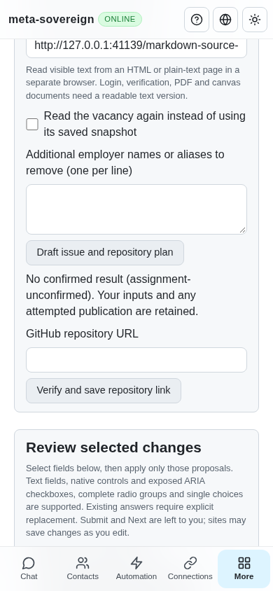
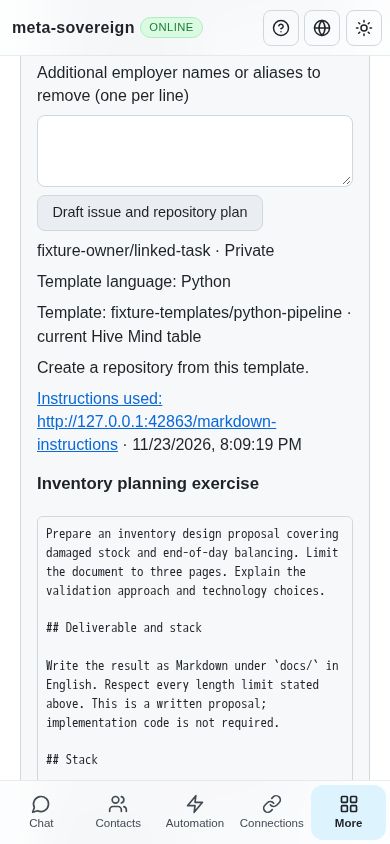
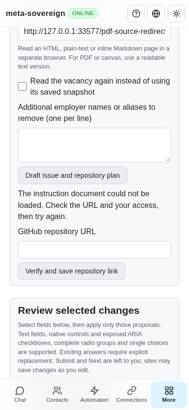
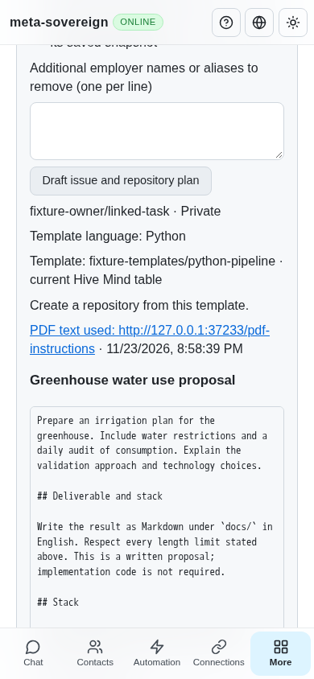

# Linked assignment instructions

[PR 57](https://github.com/link-foundation/meta-sovereign/pull/57) extends the reviewed publisher with explicitly selected instruction URLs. The parent ignored linked instructions, their six-word overlap and invalid source URLs; written tasks also lacked the reference's specific **Deliverable and stack** heading. Four focused regressions fail on parent `9feb1d62`; the reusable [reproducer](../../../experiments/issue-56/assignment-source-before.py) restores the working files afterward.

The shared CLI/Lino/UI service reads a selected HTML/plain-text source through an owned `assignments` policy browser in its separate `assignment-source` slot. It requires a positive commander navigation receipt, checks main-frame HTTP responses and records original/resolved URLs, title, timestamp and a fingerprint. Visible document text is private in the saved draft. The model receives it as untrusted data alongside the form instructions. Employer and overlap checks cover both sources before preview and publication. Changed saved source evidence refuses restore/publication. Restoring and publishing the frozen draft cause no source reread.

HTML extraction excludes native fields, ARIA editors, editable content and hidden text. Login or challenge pages, HTTP failures, canvases, embedded content and incomplete or oversized reads refuse before a model call. HTML bounds are 30,000 characters, 2,500 text nodes and 10,000 visited nodes. The owned browser read has a sixty-second deadline. Shutdown drains late launches and closes the owned browser. Automatic recursive document discovery and additional document formats remain unfinished.

The existing repository/issue recovery and whole-form hold remain intact. Written tasks now retain both **Deliverable and stack** and a final **Stack** section. The four-language UI includes the source URL, visible provenance and restoration of the same URL. See the [user/CLI/API guide](../../ASSIGNMENT-PUBLICATION.md).

Verification uses a finite synthetic task and model/GitHub fixtures:

- 58 focused Node checks and 53 Deno checks cover publisher/source/vacancy/CLI/Lino/UI validation and private Git diagnostics. Four parent regressions fail first. Five Node cases use tiny owned Git repositories/processes; they do not run a source build.
- Production Chromium checks the existing assignment hold, ten actual DOM cases and the publishing flow at desktop/phone sizes. A real HTTP redirect resolves to visible instructions; poison field getters remain unread, the length requirement reaches the reviewed document, and reload/recovery confirms one repository/issue with one source read and zero form submissions.
- Independent Playwright MCP captures before, source input and source evidence at desktop/phone sizes. Preview and restore use one source read/model call, perform no GitHub mutations, preserve owner input and close both review/source ownership. All page errors are empty.
- Scoped ESLint, formatting and secret checks pass. Duplication is 6.48%, below the unchanged 6.5% threshold. Full runtime/browser matrices run in hosted CI.

Before and after (phone):

The [archive](data/assignment-source.tar.gz) and SHA-256 manifest preserve source snapshots, four failing-before assertions, focused outputs and browser/MCP evidence. This unit does not complete assignment implementation, full handoff/notifications, live authenticated provider/model execution, or any other unchecked requirement. PR 57 remains draft and unmerged.

## Linked Markdown instructions

The same reader accepts inline `text/markdown` documents. To reproduce the original failure, open a Forms review with a task link whose HTTP redirect ends at a Markdown document, choose that link and request a draft. The Chromium fixture returns `assignment-source-unreadable` on `d48ef4e2` even though the browser displays the source. The revised reader freezes the literal Markdown, requested and resolved URLs, and capture time. Links and HTML examples stay literal, and no example URLs are requested.

The browser regression runs in the normal assignment group. Focused Chromium and WebKit runs verify one successful owned read and one model call, then a challenge refusal with no further model call. Forms retains the entered URL and displays the unreadable status instead of an unknown publication outcome. Source and review browsers close with the form untouched. The API regression first fails on `d48ef4e2`, then passes as part of 27 focused checks in Node and 27 in Deno. [Browser regression](../../../js/tests/helpers/e2e-assignment-publication.mjs) · [Browser API regression](../../../js/tests/assignment-source.test.js)

Independent Playwright MCP verifies source selection, draft-only requests, the resolved link and phone layout. The document-type probe confirms visible plain text and records the PDF viewer behavior that led to the later PDF reader. [Document-type probe](../../../experiments/issue-56/assignment-document-types.mjs) · [Evidence archive](data/assignment-linked-markdown.tar.gz)

## Linked PDF text

To reproduce on parent `1b31e592`, open the fixture's linked assignment, select the instruction link and request a draft. The redirected attachment returns HTTP 200 but the former reader refuses it with `assignment-source-unavailable`. Chromium's inline viewer and WebKit's native download expose response metadata without the original bytes through Playwright's navigation body. A WebKit trace also records `goto` rejecting between the redirect and the final response and download events. [Parent regression](../../../experiments/issue-56/assignment-pdf-parent.mjs) · [Response probe](../../../experiments/issue-56/assignment-pdf-response.mjs)

The reader accepts a positive main-frame PDF response or the browser's exact download URL after the owned navigation reports a download. It cancels the native download and fetches the resolved URL inside an inert page in the same browser context. The authenticated fetch requires HTTP 200, exact URL and PDF MIME, refuses a fresh redirect or partial response and caps the decoded bytes at 2 MiB. The parser worker uses `pdfjs-serverless@2.1.1`, whose bundled PDF.js reports `6.5.438`. It reads at most 20 pages, 5,000 text items and 30,000 characters with a ten-second parser budget. Receipt creation requires text from every page. Saved evidence binds the resolved link, PDF text scope and fingerprint. [PDF.js release](https://github.com/mozilla/pdf.js/releases/tag/v6.5.438) · [Playwright download events](https://playwright.dev/docs/api/class-download)

The production Chromium and WebKit scenarios select a cookie-protected attachment through a real redirect, read both pages and close the owned source profile. The model receives the exact two paragraphs once. A second explicit request with a textless page shows the localized refusal and preserves its URL, with zero further model calls and zero form submissions. The browser byte probe also verifies inline content, blocked access, streamed and advertised size limits, partial responses and redirect refusal.

The parent fails all four PDF regressions. The corrected reader passes 32 focused checks each in Node and Deno, plus four PDF checks in Bun. The independent Playwright MCP session confirms one private draft, the resolved source link and no overflow at 390 pixels. Both fixtures close, and their counters show zero external writes and submissions. [Regression tests](../../../js/tests/assignment-pdf.test.js) · [Source and test evidence](data/assignment-linked-pdf.tar.gz) · [File hashes](data/assignment-linked-pdf.tar.sha256.json)

Other non-text formats, complete notification delivery and authenticated provider verification remain required for QA24.
