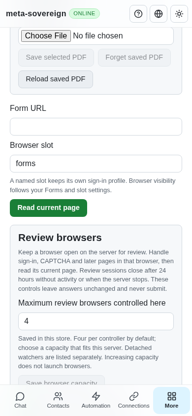
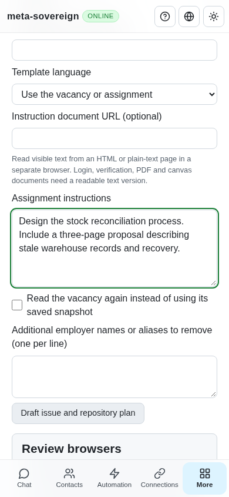
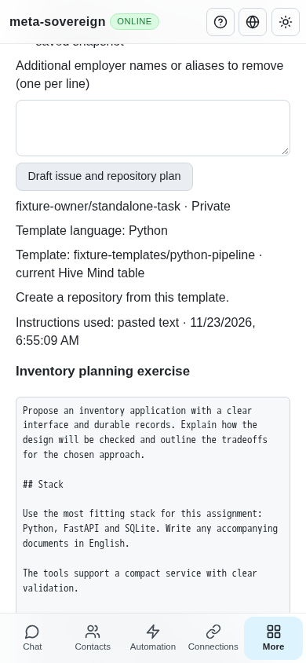
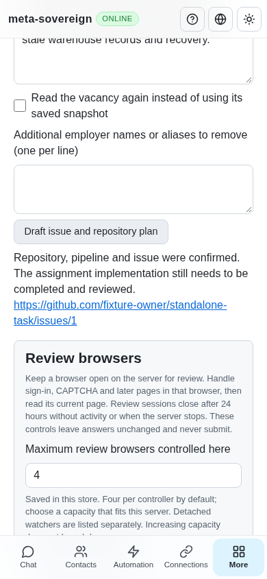

# Draft assignments from standalone instructions

The pinned HeadHunter command accepts a local text file or standard input through `--from`. At published parent `a9491837`, the shared CLI always tries to inspect a form, and Forms has no entry point for standalone instructions. The trusted draft API also requires a form inspection. A file, pasted text or standalone document therefore cannot reach the publisher without an employer form. [PR 57](https://github.com/link-foundation/meta-sovereign/pull/57) · [Pinned donor command](https://github.com/konard/hh-job-application-automation/blob/fa0991b8c2d0896fb3b4be6c69947f0590094b15/src/test-assignment.mjs).

Open **Draft from assignment instructions** in Forms and choose one source. Use `--from=<file>` or pipe UTF-8 text into `--from=-` from the CLI. `--from=<form-url>` selects the existing form path. Using `--source=<readable-document-url>` alone selects a standalone document. Both Lino encodings use the existing draft, restore and publish routes. [Publication guide](../../ASSIGNMENT-PUBLICATION.md).

The selected repository has one latest standalone draft in the private store. The draft keeps the exact normalized text and fingerprint for later review. Editing the source removes the active publication action. After an unknown GitHub response, the issued draft remains recoverable and blocks replacement. Recovery verifies the pipeline and marked issue without repeating issued creations. The standalone receipt confirms the repository and issue. A form association belongs to a separate form review.

The [parent comparison](../../../experiments/issue-56/assignment-standalone-parent.py) reruns six regressions and one unaffected form control against the exact published source. Its `--browser` mode loads the parent's published bundle and asserts the missing Forms disclosure. Each comparison restores the saved source and bundle before returning.

```sh
python3 -B experiments/issue-56/assignment-standalone-parent.py
python3 -B experiments/issue-56/assignment-standalone-parent.py --browser
RUN_BROWSER_E2E=1 FORMS_GROUP=forms-assignment node --max-old-space-size=384 js/tests/e2e-forms-reader-browser.mjs
```

- Six standalone checks fail on the published parent and the legacy form control passes. The revised source passes 110 focused Node and 110 Deno tests. The added tests cover source exclusivity, changed bytes, portable stdin, malformed or oversized input, both Lino encodings, a lost issue response and failed local receipt persistence.
- Production Chromium passes the four registered assignment scenarios. The standalone case reviews pasted text, edits it, restores it, then reloads after a lost issue response. Exact readback confirms one repository, one issue and one model call, with zero employer submissions. The form workflow separately keeps its hold until its own receipt is verified.
- Independent Playwright MCP exposed a label whose accessible selector changed once React filled the textarea. The explicit native label stays stable across typing, editing and restoration. The final check fits a 390-pixel viewport and records one model call, zero publication requests, zero owned form/document reads, zero submissions and no page exceptions. The console records a favicon 404 and two cache write errors. The browser and isolated server both close.









The [evidence archive](data/assignment-standalone.tar.gz) and [per-file checksums](data/assignment-standalone.tar.sha256.json) preserve source, bundle hashes, test outputs, MCP observations and the browser captures. QA24 still needs active form-slot input, bare vacancy IDs, other source document formats, completed-assignment handoff, notifications and authenticated execution.
