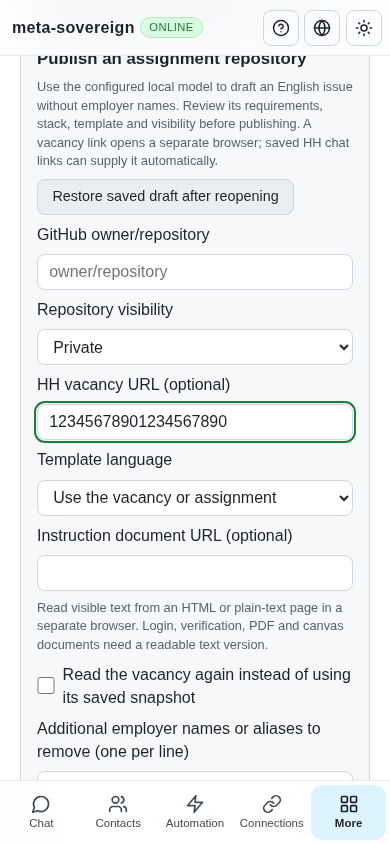
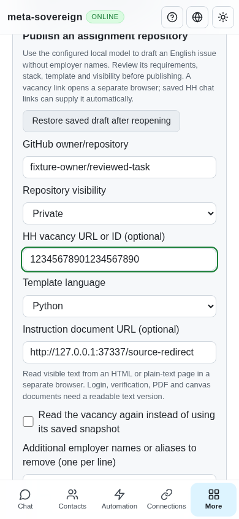
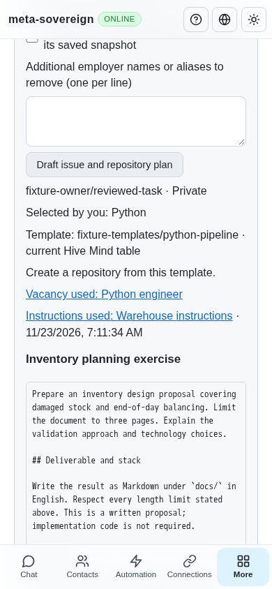

# Preserve the reviewed HH vacancy in assignment publication

The pinned HeadHunter command accepts a bare vacancy ID and includes the vacancy description when it checks an English issue for six consecutive copied words. At published parent `9167a0d5`, the shared publisher accepts only vacancy URLs. The Forms input rejects a numeric value before it sends a request. The model receives the vacancy description, but the public issue check omits it. Saved drafts contain a vacancy fingerprint that the publish path does not check. [Pinned donor command](https://github.com/konard/hh-job-application-automation/blob/fa0991b8c2d0896fb3b4be6c69947f0590094b15/src/test-assignment.mjs) · [PR 57](https://github.com/link-foundation/meta-sovereign/pull/57).

Enter an HH URL or decimal ID in the Forms vacancy field. The CLI accepts `--vacancy=12345`, and both Lino encodings accept the same string in `vacancyUrl`. The server preserves every digit and uses the existing canonical HH cache key, browser policy and chat association. An explicit reference is validated before document, GitHub or model reads. The Forms review displays the canonical link, clears the publish action when the vacancy changes and restores the reviewed vacancy with the saved draft.

The draft retains the private description and verifies the saved content fingerprint on restore and publish. New drafts also bind the source, canonical URL and capture time to that fingerprint. Older drafts continue to use their existing content fingerprint. Draft and publish checks compare issue prose with the reviewed vacancy description as well as the assignment instructions. The CLI rejects vacancy overrides during `--draft-id` recovery. [Publication guide](../../ASSIGNMENT-PUBLICATION.md).

The parent replay compares the exact source and bundle, then restores the current files. Run the focused Chromium scenario with a locally installed browser or the Chromium executable supplied by `E2E_EXECUTABLE_PATH`. [Reproduction script](../../../experiments/issue-56/assignment-vacancy-parent.py).

```sh
python3 -B experiments/issue-56/assignment-vacancy-parent.py
python3 -B experiments/issue-56/assignment-vacancy-parent.py --browser
RUN_BROWSER_E2E=1 FORMS_PUBLICATION_ONLY=1 ASSIGNMENT_VACANCY_SCREENSHOTS=1 node --max-old-space-size=384 js/tests/e2e-forms-reader-browser.mjs
```

- Six regression cases fail on the exact parent and its established canonical URL control passes. The revised code passes 116 focused tests in each of Node and Deno. Checks cover leading API refusal, a twenty-digit ID above the exact integer range, alias/cache reuse, legacy draft recovery, copied description text, changed saved content and a different canonical HH URL in stored or returned evidence.
- The four registered production Chromium assignment scenarios pass. The reviewed form scenario takes one synthetic vacancy snapshot, recovers one repository and issue, and records zero employer submissions after a simulated lost issue response. The browser path verifies the same evidence through editing, restoration and reload.
- Independent Playwright MCP accepts and restores the canonical ID in standalone Forms at 390 pixels with no horizontal overflow. The isolated server records one snapshot and one model call, zero form/document reads, zero GitHub writes and zero employer submissions. MCP reports no page exceptions and records a favicon 404 and a cache write error. Both the browser and its disposable fixture close.







The [evidence archive](data/assignment-vacancy-evidence.tar.gz) and [per-file checksums](data/assignment-vacancy-evidence.tar.sha256.json) preserve the parent source, pinned donor, fixture, final source and verification outputs. QA24 still requires active form-slot input, additional source formats, assignment handoff, notifications and authenticated execution.
