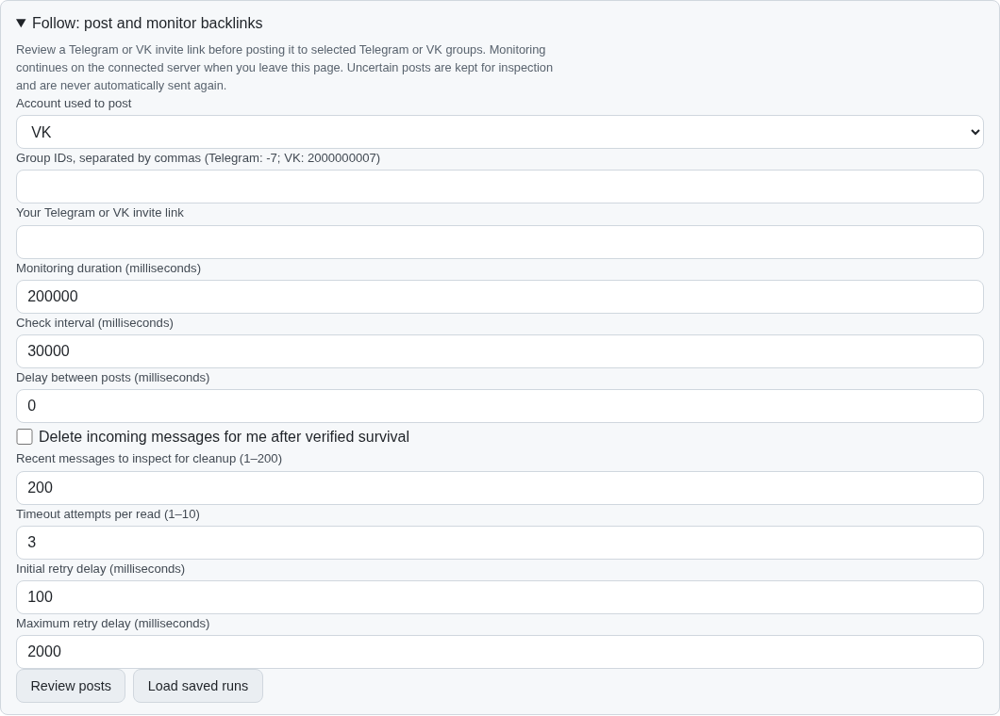
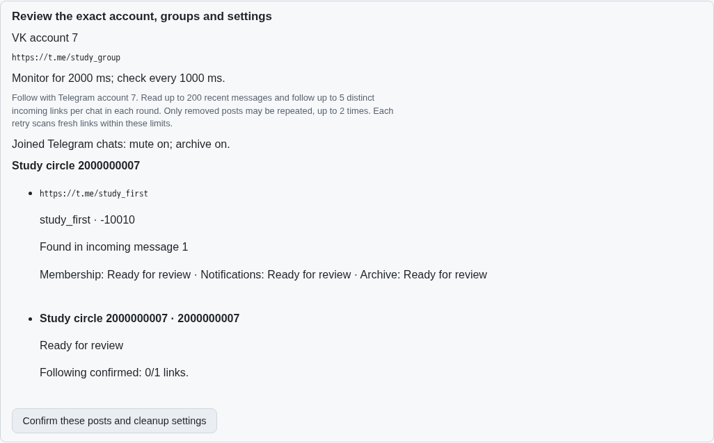
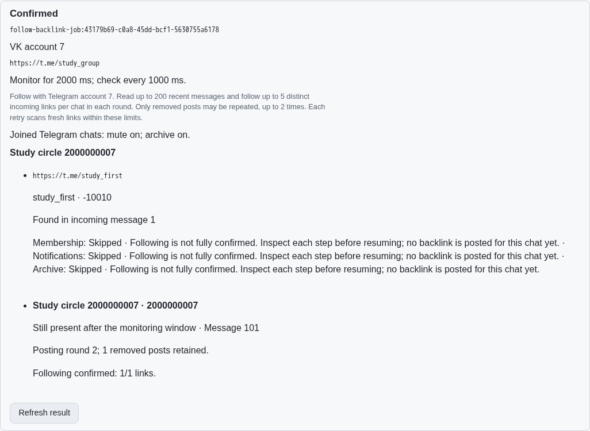
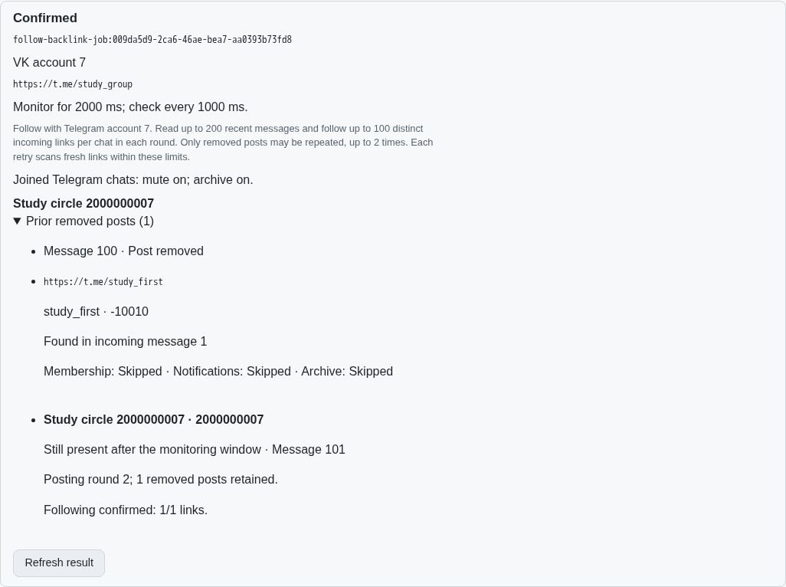
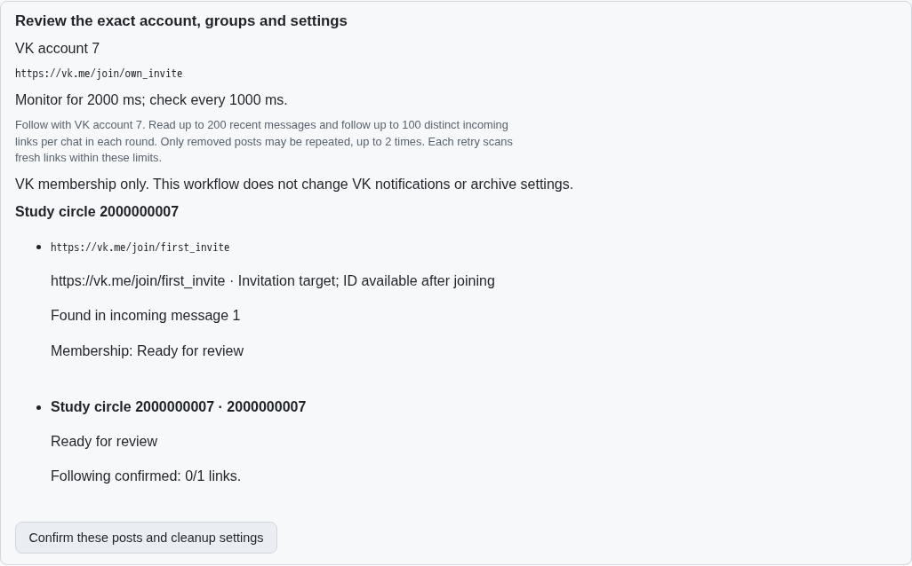
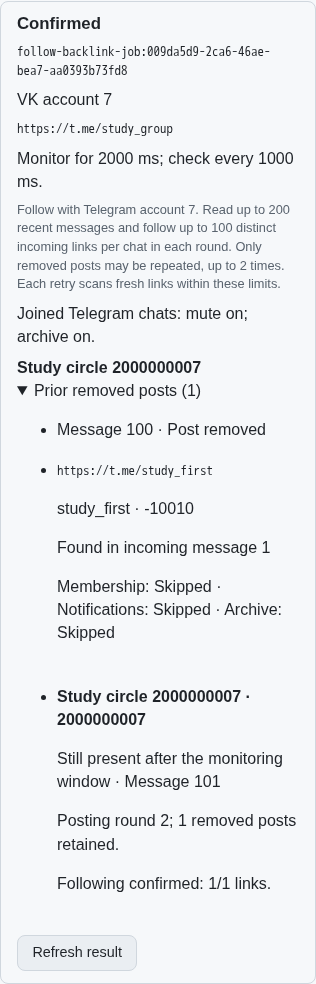

# Automatic Follow rounds across Telegram and VK

Work for [issue 56](https://github.com/link-foundation/meta-sovereign/issues/56)
in [PR 57](https://github.com/link-foundation/meta-sovereign/pull/57).
FL07 and FL09 now share an optional bounded automatic runner through the
existing backlink CLI, production Lino API and common React controls. FL08's
broader Telegram retry/lifecycle audit and all other unchecked issue-wide
requirements remain unfinished.

## Reviewed behavior

With automatic following off, the existing reviewed-post workflow is preserved.
When enabled, review resolves the actual source account, the target-provider
account, each incoming invite and each intended membership/preference phase.
It shows message provenance, scan/link limits, pacing and the additional-post
limit. Changing a field dismisses the old one-use plan.

The runner follows incoming links using the provider of the user's backlink,
then posts and monitors that backlink for the entire configured window. Telegram
membership, mute and archive each require their own positive receipt or fresh
observation that the desired state is already applied. VK joining uses the
user API, current membership readback and the exact returned conversation ID.
VK notification/archive changes are unavailable in this workflow and are
neither offered nor claimed as successful.

| Source   | Incoming links followed | Backlink posted | Verification                                                                     |
| -------- | ----------------------- | --------------- | -------------------------------------------------------------------------------- |
| VK       | Telegram                | Telegram        | Actual membership/preference adapters, production Chromium and independent MCP   |
| VK       | VK                      | VK              | Actual VK join adapter, production Chromium and independent MCP                  |
| Telegram | Telegram                | Telegram        | Actual Telegram source and membership adapters with focused protocol fixtures    |
| Telegram | VK                      | VK              | Actual Telegram source and VK membership adapters with focused protocol fixtures |

Only positively removed posts qualify for another round. Each retry scans
fresh incoming links for those conversations; surviving conversations are not
reposted. The default permits ten additional rounds, configurable from zero
to ten. Existing wait notices exclude a conversation from automatic retry.
Each post gets a distinct stable key, while prior removed-message receipts
remain in the saved run. Exhaustion remains a rejected result. Missing or
uncertain joins, preferences, source posts and readbacks stop progress rather
than manufacturing success.

Invites are bounded, deduplicated and filtered by provider. Outgoing/service
messages, Telegram message URLs and malformed VK invite suffixes are excluded.
History covers at most 200 messages per chat; at most 100 distinct links per
chat/round can be followed. Omitted coverage is disclosed. Telegram mute and
archive are independent booleans; VK rejects unsupported preference requests.

## Interruption and recovery

Parent runs, rounds, prior receipts and per-link outcomes are persisted. VK
membership intents are flushed before requests, as are the existing Telegram
phase and source-post intents. A durable unknown intent prevents replay after
closing and reopening the real Lino file. A fresh positive membership read may
skip a previously completed join; it does not infer preference completion.
Explicit resume rechecks accounts, resolved targets and individual phases.

Cancellation reaches the internal Telegram phase writer through an internal
callback, including final target resolution. VK checks cancellation and changed
credentials again after its rate limiter, immediately before the HTTP request.
The source adapter rechecks its bound identity after conversation resolution.
Stop drains an issued join and saves its uncertain/positive receipt before
returning. No test uses a live provider account or changes the user's server.

VK joins use single requests. Only timeout reads have the configured finite
backoff; a timeout during join readback never repeats the join. Rate limits,
captcha, permission errors and incomplete provider responses stop the workflow.
The wider Telegram/client retry policy remains tracked under FL08.

The official
[VK schema pinned at 333481bd](https://github.com/VKCOM/vk-api-schema/tree/333481bd082ad747d4873ef4a77f9247097eeef0)
defines user-only `messages.getChatPreview` and `messages.joinChatByInviteLink`.
The adapter requires current `is_member`, not the historical `joined` flag, and
requires positive `chat_id` plus matching membership readback after a join.
The selected official schemas are preserved in
[the experiment directory](../../../experiments/issue-56/vk-follow-schema/).
The pinned Follow reference's `auto-follow.mjs` was studied for behavior; its
implementation was not copied.

## Reproduction and verification

With configured source/target user accounts, review first:

```sh
meta-sovereign automations follow backlinks post --source=vk --chats=2000000007 --backlink=https://t.me/YOUR_GROUP --auto-follow=true --max-retries=2 --max-links=20 --join-delay-ms=1000
```

`--confirm=true` applies that newly reviewed policy. `--follow-mute=false` and
`--follow-archive=false` independently choose Telegram preferences. Default
output is Lino; `--json=true` opts into JSON. Saved listing, status, resume and
cancellation retain the existing backlink command surface.

`POST /api/automations/follow/backlinks/preview` accepts the existing configuration
plus `autoFollow: { maxRetries, maxLinks, joinDelayMs, mute, archive }`. Omitting
`autoFollow` preserves reviewed posting alone. The preview, confirmation and
saved results use both text and binary Lino in the production routes. Remote
receipts reject changed account scopes, missing steps, null/malformed results
and contradictory confirmed phases.

- 80 serial focused checks pass: 79 combined workflow/CLI/HTTP/receipt checks
  plus the real Lino reopen regression. They cover all four provider pairs,
  fresh links after rejection, mixed chat outcomes, zero retries, exhaustion,
  wait notices, partial preferences, malformed/current membership, timeout
  readback, cancellation, account changes, stop ownership and unknown replay.
- 50 existing Telegram Follow and VK source/publication compatibility checks pass.
- Production Chromium passes the automatic runner and existing Telegram-source
  backlink workflow. The new runner is registered in the existing CI browser
  list for the full remote matrix.
- Independent Playwright MCP verifies read-only review, two-round convergence,
  saved result reload, VK capability labels and a 390 CSS-pixel mobile layout.
- A failing-before regression in `auto-follow-phase-before.log` catches the
  draft's incorrect incomplete warning for confirmed skipped phases; it passes
  after status-aware rendering. Before/after images are retained below.
- All five workflows passed for preceding commit `75a5e130`. The new commit
  still requires its own exact-head GitHub CI checks.

Evidence and source hashes are in [data/auto-follow.tar.gz](data/auto-follow.tar.gz)
and [its manifest](data/auto-follow.tar.sha256.json).

Before: automatic following is absent from the existing posting controls.





Draft regression before correction:



After correction and a positively removed first post:







PR 57 remains draft and unmerged while FL08 and the other unchecked issue-wide
criteria are implemented and verified. Passing this runner's checks does not
complete the issue.
