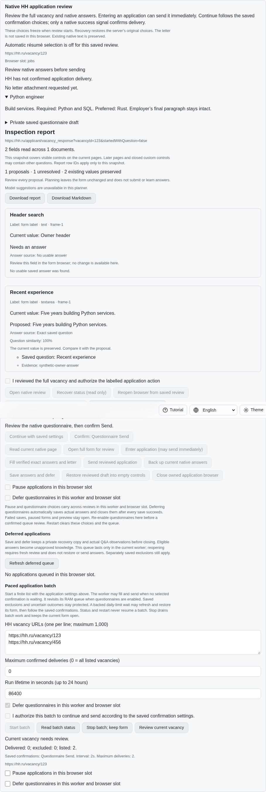
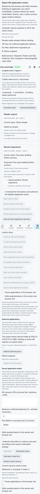
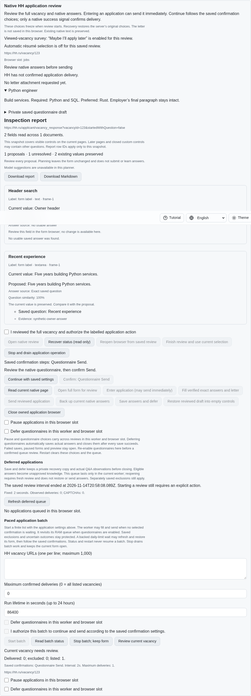
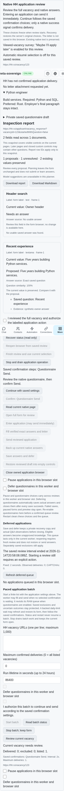

# Keep an active batch's own review operable

An active finite application batch reserves the shared vacancy workspace. The
discovery change correctly disabled competing search and discovery operations,
but its `application-batch` busy classification also disabled the confirmation
checkbox inside that batch's own followed application review. A batch waiting
for separately confirmed Send could no longer progress from the UI.

The application panel now admits native actions for that busy classification
only when its active review matches the active batch's application URL, browser
slot and request ID. Read-only status and release of an inactive identity remain
available when the batch moves to its next review. Other operations and stale
native actions stay blocked. Each current step still requires fresh owner
confirmation; native guards, delivery reservations and server ownership remain.

## Reproduction and verification

Published discovery head `8007a002e94eafaccc5f45c5de2b8073a264d6bf` started Checks
`43635159024` at 2026-11-14 20:00:43 UTC. Chromium shard 3 job `132572456753`
passes the preceding draft and daily-limit restoration scenarios, then fails
the existing batch scenario. Complete job-log lines 2222–2244 show
`locator.check: Timeout 10000ms exceeded` and the disabled owner confirmation
checkbox. WebKit shard 3 job `132572456912` fails the same control at lines
2010–2035. Both complete job logs and the completed 151,393-line workflow log are
preserved. Workflow lines 45378–45398 and 50599–50619 contain the two failures;
lines 151375–151377 report the aggregate browser failure. All other parent jobs
and the four companion workflows pass.

```sh
python3 -B experiments/issue-56/batch-review-ownership-before.py
python3 -B experiments/issue-56/batch-review-ownership-before.py --native
```

Both probes use the exact published parent and restore working sources and
bundle. The focused regression fails two owner/recovery cases while its negative
case passes. The unchanged finite native scenario reproduces the disabled
checkbox after four-language reload and captures the problem state.

The focused regression renders the real panel in four locales and covers URL,
request and browser-slot mismatches, inactive/missing batch ownership, a busy
application and competing discovery/collection/action operations. A matching
owner can read and provide new confirmation; unconfirmed Send remains disabled
and zero sends occur. An initial owner-only correction reached the next vacancy
but disabled status and inactive identity release. The unchanged native scenario
exposed this; the regression now covers that transition too. Early Follow timing
probes are retained without assigning an unproven cause.

Targeted admission tracing also exposed an independent intermittent Start
refusal: reading the clock twice could make the default 24-hour receipt lifetime
24 hours plus one millisecond, which the unchanged validator correctly rejected.
Start and expiry now use one captured time. The finite advancing-clock test
fails before that fix and passes on Node and Deno, without opening a browser.

Focused Node 16 and Deno 4 pass. The unchanged native Chromium scenario passes
with two deliveries, one manual delivery, two RAM queue revisits, zero entry
clicks, four locales, phone layout, no reload replay and closed resources.
Independent Playwright MCP passes with one delivery/revisit/Send, zero entry
clicks, four locales, phone layout, no reload replay and zero fixture errors.
The browser, owned server and bundle restoration drain before publication.
No production or test deadline, scenario, engine or shard is increased or
removed. Broader runtime/browser verification stays in CI.

Before:





After:





The [checked archive](data/batch-review-ownership.tar.gz) and its
[per-file hashes](data/batch-review-ownership.tar.sha256.json) preserve source,
exact-parent failures, focused checks, native/MCP receipts, screenshots and
hosted logs. The ordinary release changeset includes both corrections.
This correction does not complete any of the 81 original incomplete inventory
rows. Work continues in [PR #57](https://github.com/link-foundation/meta-sovereign/pull/57),
which remains draft and unmerged.
