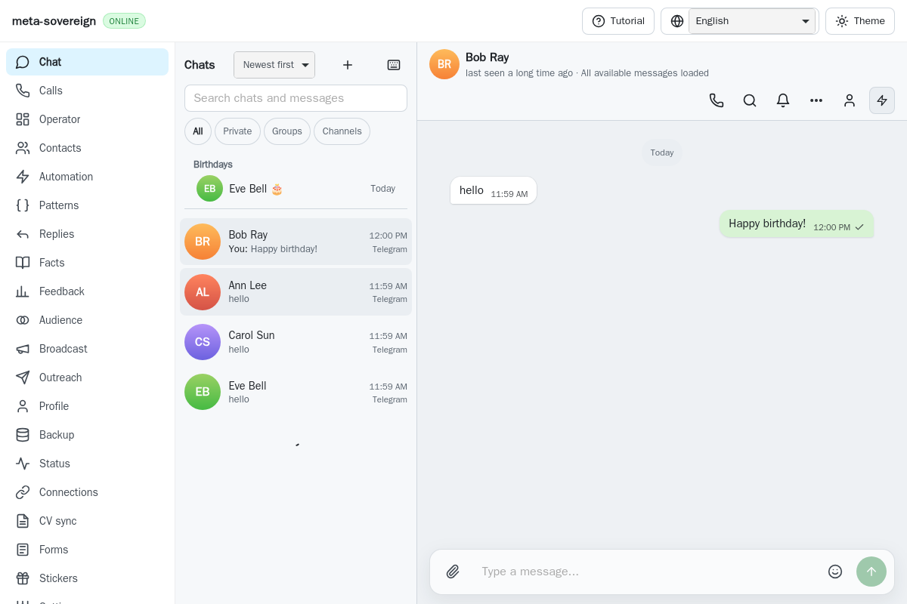
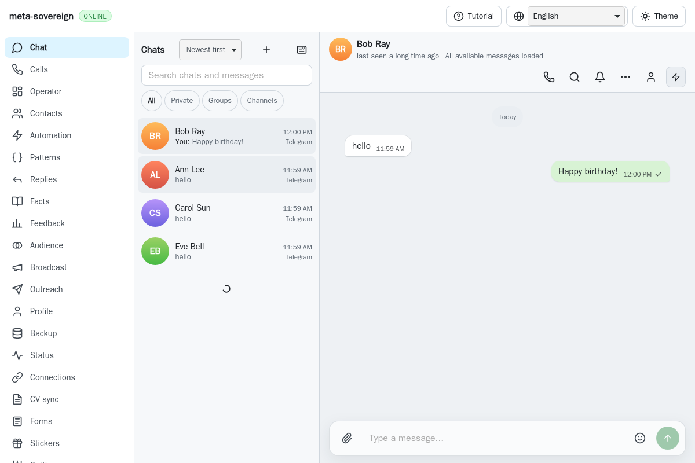

# Birthday history and chat selection

On reload, the birthday block previously inserted today's contacts before checking their delivered greeting history. It then removed already-greeted contacts as those reads completed. This moved chat rows between pointer-down and pointer-up, allowing a click on Ann to leave Bob selected.

The block now waits for the initial account/day/contact history check before publishing reminders. Existing delivered greetings, tomorrow preference, opt-out and retry behavior remain supported. Failed reads settle as unavailable and retain conservative reminder behavior. Default-off browser diagnostics record only the pending/settled phase and contact count. A hidden state marker lets verification distinguish loading, ready, unavailable and disabled without adding product text.

## Evidence and reproduction

Hosted WebKit [job 135058574454](https://github.com/link-foundation/meta-sovereign/actions/runs/44375254274/job/135058574454) failed on published `ef34179a` with pointer-down on Ann and a later click whose target was no chat row. The URL and selected chat remained Bob; full log lines 982–990 preserve the selection trace. An isolated unmodified rerun passed. A metadata trace of that passing run observed Ann's position change as birthday reminders appeared and disappeared. The original hosted runner's exact response timing remains unproven.

The deterministic regression holds contact birthdays until Ann's native row is pressed, then holds the real stored history containing Eve's earlier delivered greeting. Published UI modules insert Eve's transient reminder, move Ann and lose the click. Corrected modules keep the row fixed and select Ann on release. Both use the same existing deadlines and finish the rest of the profile extras scenario. The helper is integrated into the existing hosted profile test without adding a browser group.

Run sequentially with the existing installed WebKit:

```sh
RUN_BROWSER_E2E=1 E2E_BROWSER=webkit NODE_OPTIONS=--max-old-space-size=384 node experiments/issue-56/birthday-selection-before.mjs
node js/scripts/build-web.mjs
RUN_BROWSER_E2E=1 E2E_BROWSER=webkit NODE_OPTIONS=--max-old-space-size=384 node js/tests/e2e-profile-extras-browser.mjs
node --test --test-concurrency=1 js/tests/birthday-reminders.test.js
```

The before variant expects the lost-click signature and loads the exact published UI source. Its successful exit confirms reproduction. Afterward, native WebKit records no transient reminder, no row movement and selected chat 42. The eight focused history/reminder checks pass. Independent MCP verifies the same held-history pointer sequence, ready state, selected Ann, a phone screenshot and zero page errors. The MCP fixture has no provider sender, records zero sends and closes its owned server/store/browser. Missing unrelated Telegram endpoints in that isolated fixture produce HTTP warnings; these are not counted as application exceptions.

Before: the already-greeted contact is temporarily inserted above Ann during the press.



After: the history check remains pending and Ann stays under the pointer.



An initial after test incorrectly waited for the hidden loading marker to become visible. It was corrected to wait for attachment with a ten-second deadline; the failed attempt is preserved. The initial MCP fixture used JSON instead of the app's Lino wire format; its corrected responses are encoded before VM execution. A reused browser context also replayed an old initialization script on `about:blank`; the final independent run starts after closing that context and reports no page errors. These fixture corrections are not product fixes.

`collect-birthday-selection.py` preserves the parent modules, complete hosted failure and screenshot, passing metadata probe, deterministic native pair, focused results, MCP attempts/final result, source and validation logs in `data/birthday-selection.tar.gz`. All archived entries are independently hashed. This correction does not promote any acceptance criterion: 88 remain verified and 30 unfinished. PR57 remains draft and unmerged; fresh hosted checks are required for the pushed source.
