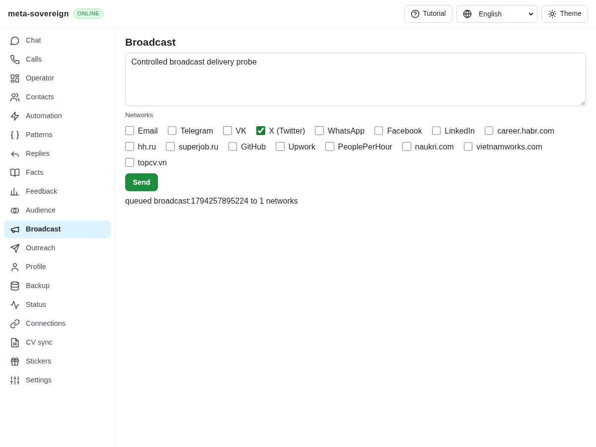
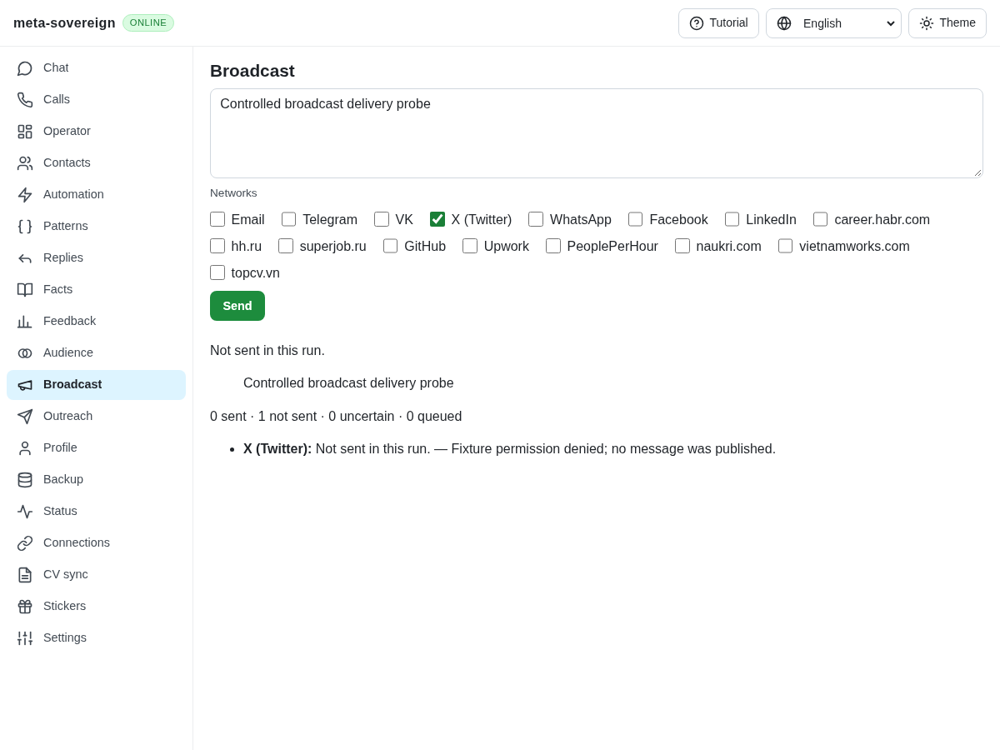
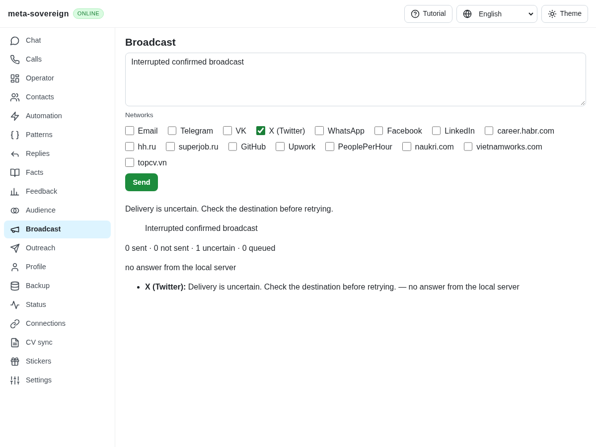

# Actual broadcast delivery outcomes

The server recorded every dispatched broadcast as `sent`, including complete provider failure. The handler retained its input queue state after dispatch. The shared Broadcast screen wrote a local placeholder instead of calling the confirmed publishing API and always displayed a queue acknowledgment. These were three independent causes of inaccurate delivery state, not evidence that any provider published a post.

A shared outcome calculation now preserves each provider result and counts confirmed sends, failures, uncertainty and queued work. Both server and handler persist the derived state. The screen uses the real two-request confirmation protocol, renders aggregate and per-provider outcomes, preserves the draft and selected networks, and disables duplicate clicks while a send is pending. Results retain the attempted text even if the draft changes during the request. Browser-only operation without a supported server explicitly creates no queue entry; the existing low-level local queue API remains available. Identifier/count-only tracing is available through `META_SOVEREIGN_BROADCAST_DEBUG=1` and is off by default.

A lost response after a confirmed request cannot establish non-delivery. The browser now reports each affected destination as uncertain, retains the attempted text and requests manual destination inspection before retrying. Publishing is never automatically retried. Valid initial confirmation challenges no longer produce application failure warnings; malformed challenges, expired confirmations and actual refusals remain failures. Browser HTTP diagnostics still record the expected 428 response.

The two initial handler/server regressions fail before the correction. A separate confirmation-warning regression and a real-browser interrupted-write regression also fail before their fixes. Final focused checks pass all 47 tests with concurrency one: both default Lino encodings, actual confirmed server routes, stored outcomes, exactly-once provider attempts, shared browser API behavior, existing handlers, localization and action-error reporting. Changed-source ESLint and the production web build pass. The reusable `node examples/broadcast-delivery-outcomes.mjs` exercises the real handler against controlled successful/uncertain results without credentials or external writes.

The production Chrome regression passes failed, partial and unknown provider results, pending-edit preservation, duplicate prevention, bound confirmations, an interrupted confirmed write with no retry, and an unavailable route with no fake queue record. It is included in the existing Chromium/WebKit CI manifest. Its first unavailable-route fixture used an arbitrary error instead of the server's actual `unknown route` response; the corrected fixture passes. The failed fixture log is retained. Local development runs only this browser check, leaving the complete matrix to CI.

Independent Playwright MCP uses an isolated server with mocked providers. Before, selecting X and pressing Send creates a dispatched local placeholder and claims it is queued. After, the same message produces a stored `failed` result with the fixture's permission reason and zero sent/queued destinations. A deliberately interrupted confirmed request is attempted once and displays uncertainty. The final console has no application warnings; its four resource diagnostics are the missing fixture favicon, two expected 428 challenges and the deliberately aborted request. Both browser and fixture are closed. Raw observations, failing and passing checks, build logs and the interrupted-before screenshot are preserved with verified hashes in `data/broadcast-outcomes.tar.gz`.

Before:

After:

Interrupted confirmed write:

This step addresses delivery accounting and the real shared screen. Saved channel/wall destinations, provider authentication modes, lifecycle operations and complete CLI/API/UI parity remain open in BC01–BC07 and R-AA7. The complete issue remains unfinished in [PR 57](https://github.com/link-foundation/meta-sovereign/pull/57).
