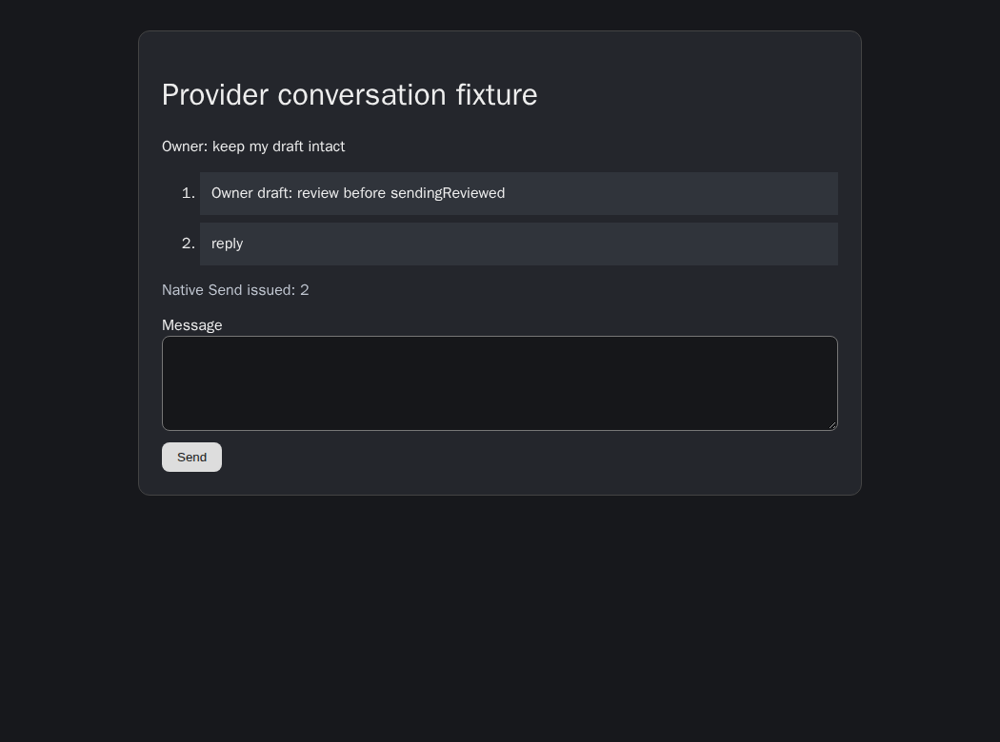
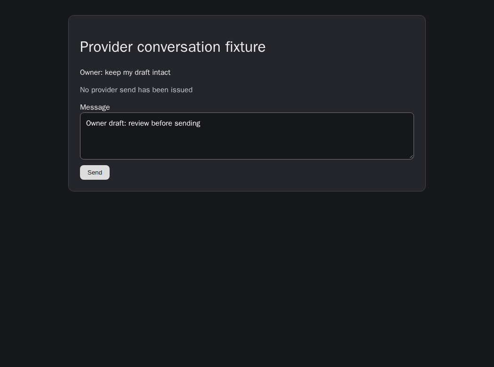
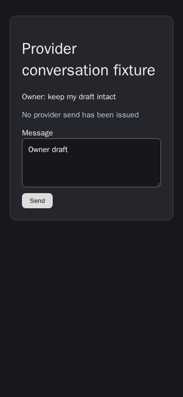

# Preserve the native composer before plain browser sends

PR: https://github.com/link-foundation/meta-sovereign/pull/57

## Reproduction

The published `623a144c7d99f2a7c345a4d1c0fea95e28a12d0d` plain sender
focuses the composer and types without checking the owner's existing text.
Its fill path calls simulated typing with `checkEmpty: false`; native typing
appends and a line break can press Enter before the full reply is ready.
WhatsApp also places the reply in the navigation URL before inspection.

```sh
python3 -B experiments/issue-56/browser-composer-draft-before.py
```

The finite published-parent replay fails 21 assertions and retains two empty
composer controls. Its actual Chromium/commander replay sends
`Owner draft: review before sendingReviewed` and then `reply`, clearing the
composer. This is an isolated provider fixture with native keyboard effects,
not a live provider account. Current source bytes are restored after replay.



## Correction

Require one visible writable composer and an empty initial value. Keep its
native node, page URL and operation token in the page; only verification state
leaves the page. Check it after focus and consent waits and after the Send
button lookup, requiring the exact full reply before issuing Send. Refuse
ambiguity, unreadable state, owner changes or replacement nodes without
fallback. WhatsApp navigation no longer prefills text.

Textarea fill checks emptiness and fills without simulated Enter. Rich
composers use native typing with Shift+Enter, because the dependency's fill
emptiness check calls `inputValue()`, which does not support contenteditable.
Keep typing delay, positive receipts and already-issued send uncertainty.
Cleanup failures cannot replace an issued receipt.



## Verification and limits

```sh
node --max-old-space-size=384 --test --test-concurrency=1 js/tests/browser-composer-draft.test.js js/tests/browser-sender.test.js js/tests/consent-browser-send.test.js js/tests/whatsapp-personal.test.js js/tests/browser-text-admission.test.js js/tests/hh-web-ui.test.js js/tests/ci-browser-shards.test.js
node --max-old-space-size=384 experiments/issue-56/browser-composer-native.mjs
```

All 118 focused checks pass. The six native cases retain three existing owner
drafts and send three empty-composer multiline replies exactly once, with no
URL prefill or page errors. That native scenario joins the existing mandatory
`question-text-guards` hosted entry; complete matrices remain hosted checks.
Independent Playwright MCP inspection at 375px verifies both composer kinds,
owner edits after acquisition, no sends, no overflow and an empty console.
Clearing a rich composer can leave a line break: whitespace remains an owner
draft and is conservatively refused. The first MCP harness attempted an
unavailable VM dynamic import; both harness diagnostics are retained.



This checks the observed boundaries, not every native event race after the
last check or every provider DOM. It does not complete the broader automatic
answer requirement. QA20 remains unfinished; acceptance stays 88/118 with
thirty unfinished criteria, and PR57 stays draft/unmerged. The adjacent archive
contains exact parent bytes, current sources, all finite logs and image hashes.
