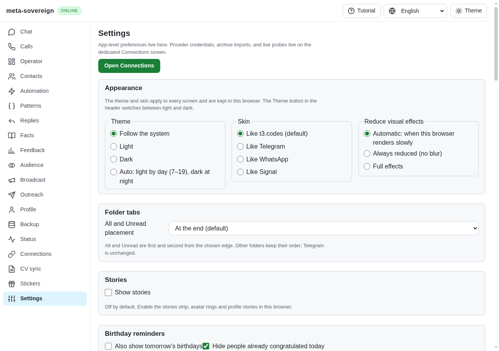
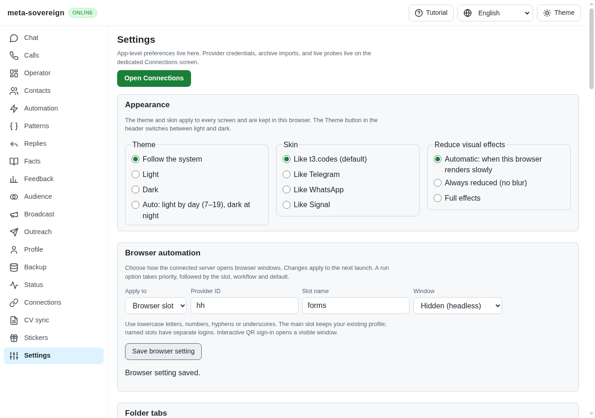
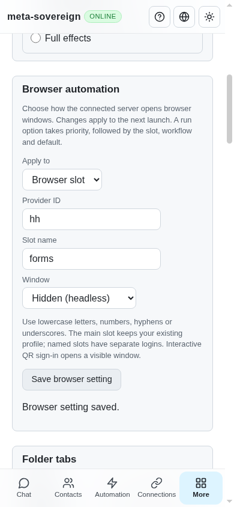

# Persistent browser visibility and slots (R-AA2)

The headed-default fix exposed the next gap: each caller still needed its own flag, with no stored preference shared by the CLI, API and UI. Imports also coalesced all sessions for one provider, so independent login slots could not coexist.

Portable `browser-policy:` links now store one independent default, workflow or provider/slot preference. Resolution is explicit run option, slot, workflow, default, then visible. Null means inherit. Separate links avoid overwriting unrelated settings during concurrent writes. Invalid names are rejected before constructing paths. Schema migration 0007 adds a visible default while preserving restored preferences; older read-only stores resolve missing settings without writing.

The resolver is connected to the shared browser factory, CV facade/CLI/API, message browser fallback, auto-import and marketplace sessions. Named import slots get separate profiles, downloads and active jobs. The legacy main profile stays in place. Interactive QR sign-in remains visible because it needs a person. The reserved jobs/forms workflow keys do not imply those workflows are implemented.

Settings exposes the same preferences as `browser-configure`, `browser-policies` and `/api/browser/policies`. The panel waits for a confirmed successful save, keeps input after failure, allows retry, clears success when edited and hides itself when the connected backend does not support the endpoint. Credentials and profiles are excluded from policy links.

## Verification

- `browser-policy.test.js`: precedence, explicit false, inheritance, independent writes, invalid names, CLI/API parity, origin protection and old-schema/idempotent/dry-run migration cases.
- `browser-mode.test.js`: factory/facade defaults and persisted named-slot policy through CV CLI and API.
- `browser-policy-launch.test.js`: isolated concurrent import slots and message profile/visibility at the session boundary, using fakes.
- The focused seven-file unit check passed 86 tests before adding three additional launch integration cases; the launch check passed all seven cases afterward. Logs are in `evidence/local/browser-policy-focused.txt` and `browser-launch-tests.txt`.
- `RUN_BROWSER_E2E=1 npm run test:e2e:browser-preferences` passed in Chromium. It is registered in the existing browser CI matrix. It checks reload persistence, slot precedence, inheritance, failed-save retention/retry, accurate success feedback, mobile width and unsupported-backend hiding.
- Playwright MCP independently checked these interactions in installed Chrome launched visibly through browser-commander under Xvfb, using a temporary store/server and no accounts. There were no page errors. The fixture and browser were closed afterward.

Before:

After:

Mobile viewport:

This is one implementation step. The reference feature inventories, new job/form workflows, remote browser execution and the other issue requirements remain unfinished in the work plan.
