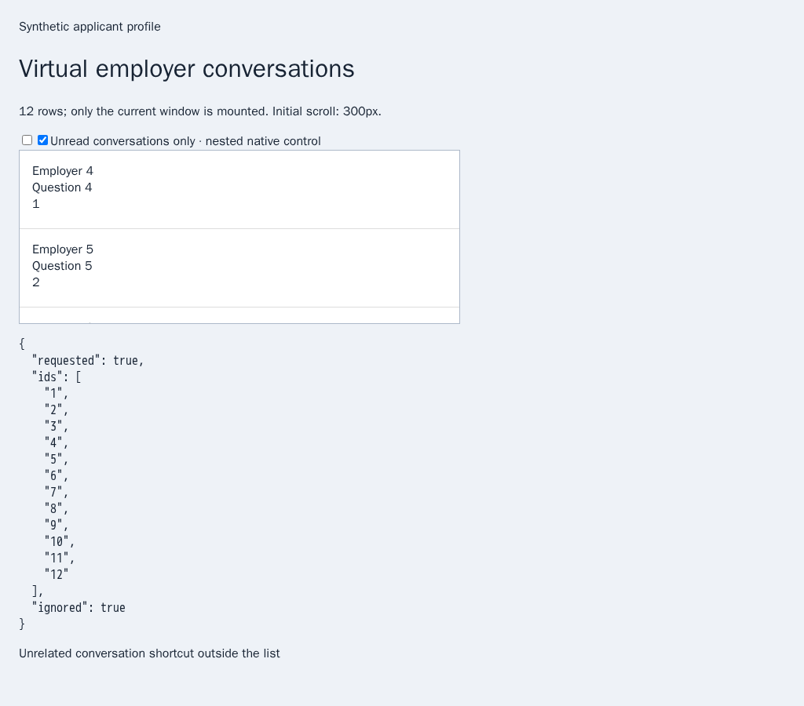
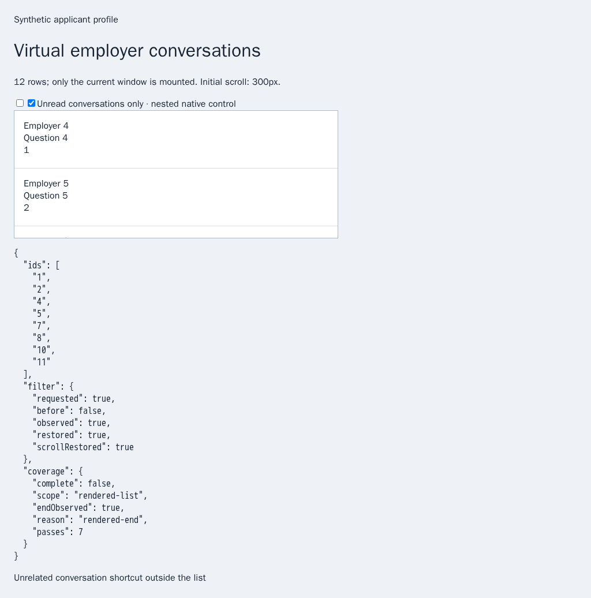
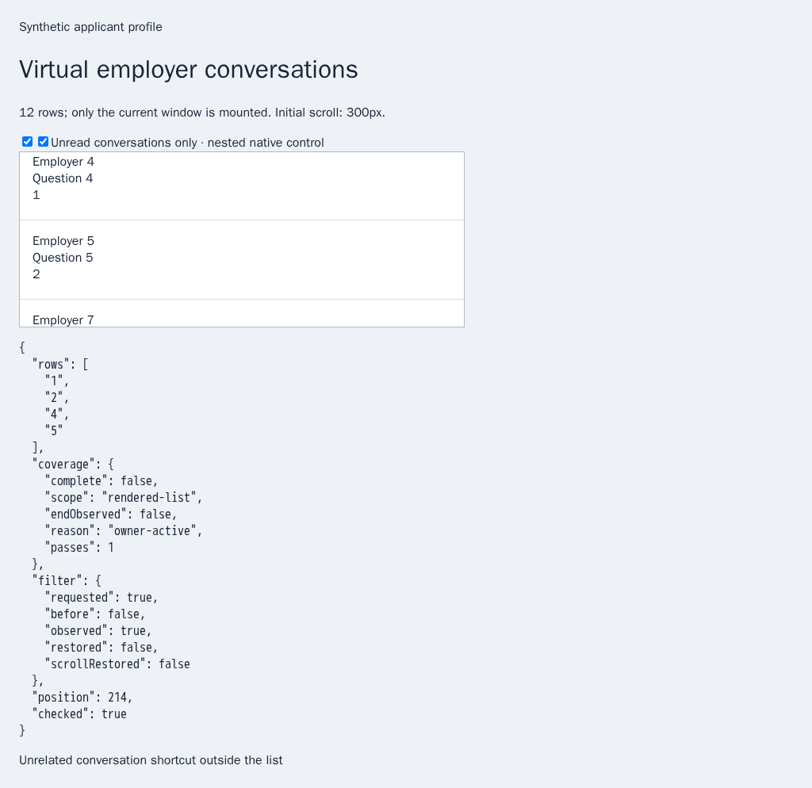

# Verified HH unread filter ownership

The bounded HH list scanner ignored an `unreadOnly` option, so a caller requesting unread conversations could receive read conversations as well. The pinned HH reference describes separate all/unread traversal and restoration of the owner’s previous filter and list position. HH may render two nested native checkboxes with different values; the decorated inner input does not reliably represent the list’s actual outer control. This change adds that prerequisite to the production browser sender. It does not complete unread cross-chat automation or its CLI/Lino/Chat/Operator controls.

`scanChats({source: 'hh', unreadOnly: true})` explicitly selects unread conversations. `false` selects all conversations; omitting the option preserves the existing filter and behavior. Other values are rejected before browser acquisition. Providers without the declared filter capability refuse the explicit option before opening a browser.

The scanner binds one native control and the existing list container to a private token, activates the actual checkbox without assigning `checked` or taking pointer focus, and verifies its new value. HH’s configured selector prefers the unadorned outer control and accepts a single-input fallback. Ambiguous, disabled, replaced or nonresponding controls refuse the operation. An owned filter remains a document witness when filtering temporarily removes all rows; empty rows still do not prove complete provider coverage.

Trusted owner input, an edited filter, lost inactive ownership or a changed container stops subsequent reads. Only the exact synchronous input/change events generated by the owned checkbox activation are exempted; the separate inactive-view guard also exempts that exact control only during its synchronous activation. Unrelated input interrupts ownership. The scan independently rejects read rows after an unread-only selection as `filter-unconfirmed`, rather than claiming success from a checkbox value alone.

On normal completion or cancellation, the original filter is activated and allowed to settle, then the original list scroll position is restored only while ownership remains valid. Returning owners retain their current filter and scroll. The result includes `filter.requested`, `before`, `observed`, `restored` and `scrollRestored`; overall restoration requires both the existing scan restoration and the filter receipt. Provider coverage remains explicitly incomplete. The existing scan bounds remain unchanged; filter selection/restoration each adds one bounded configured settling interval. `MS_BROWSER_CHAT_SCAN_DEBUG=1` adds only the filter booleans to the existing optional diagnostic output.

## Reproduction and verification

`PYTHONDONTWRITEBYTECODE=1 python3 experiments/issue-56/chat-filter-before.py` temporarily restores the actual `a203a29c` options/scanner files, runs the new validation regression and captures the ignored-filter browser state. The regression fails with “Missing expected exception”; the actual earlier scanner returns all twelve rows for an unread request. A second regression restores the actual earlier inactivity guard and reproduces native checkbox input cancelling its own operation. All three working sources are restored in `finally`. The native fixture uses deliberately disagreeing checkbox copies, overlapping virtual windows and synthetic data routed at official HH origins. No provider account is accessed and no messages are sent.

Thirty-eight focused Node checks and the same 38 Deno checks cover strict admission, both filter directions, fallback/already-selected controls, exact native events, interruption, replacement, cancellation, failure cleanup, token isolation, inactive ownership and existing conversation/list guards. Production browser scenarios cover both directions, restoration, cancellation, real wheel interruption, empty filtering and stale unfiltered rows. The existing 20-case Chromium chat-list group passes. The final seven-case filter run additionally verifies a genuinely inactive tab with the production focus preparation and inactivity lease. The expanded verifier is included in the mandatory Chromium/WebKit group with the same deadlines; unsupported background focus continues to refuse on WebKit. One focused registry contract passes. Independent Playwright MCP uses the bundled production scanner with separate page/time adapters and verifies actual unread rows plus owner interruption. Its read-only bundle rejects any accidental send-token generation. The first bundle attempt exposed a stale missing `randomBytes` export in the earlier inspection adapter; that failure log is retained, and the shared adapter now explicitly refuses that unused write path.

Before: the earlier scanner ignores the request and includes read conversations.

After: eight actual unread identities are observed, the original all-conversation filter and 300px list position are restored, and coverage remains partial.

Independent owner interruption keeps the current unread filter and scroll.

Scoped strict lint, formatting, secrets and the unchanged duplication gate pass (38,774/597,762 lines, 6.49%). For published `a203a29c`, Security, Links, Pages and Desktop pass; the broader Checks workflow is still running/queued as of 22:50 UTC. These preceding runs do not verify the new filter commit.

The expanded mandatory chat-list group explicitly requests the existing full-Chromium native-focus fixture. The headless shell forces focus in both tabs and cannot verify the new inactive case. The registry contract checks that this setting remains enabled; production focus guards and all deadlines remain unchanged.

The adjacent [evidence archive](data/chat-filter.tar.gz) and SHA-256 manifest retain sources, actual-parent sources, focused logs, screenshots and hosted status metadata. This is a browser primitive. Persistent single-flight cross-chat/unread orchestration, URL/draft/selection/message-scroll restoration, CLI/Lino/shared controls, live provider verification and every other unchecked requirement remain active; PR57 stays draft and unmerged.
