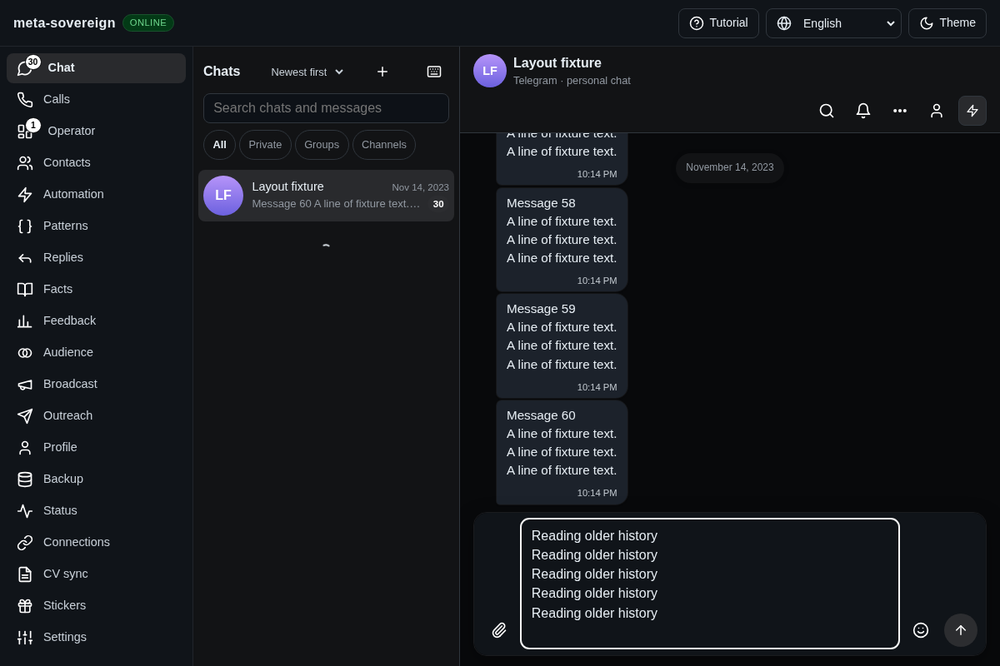
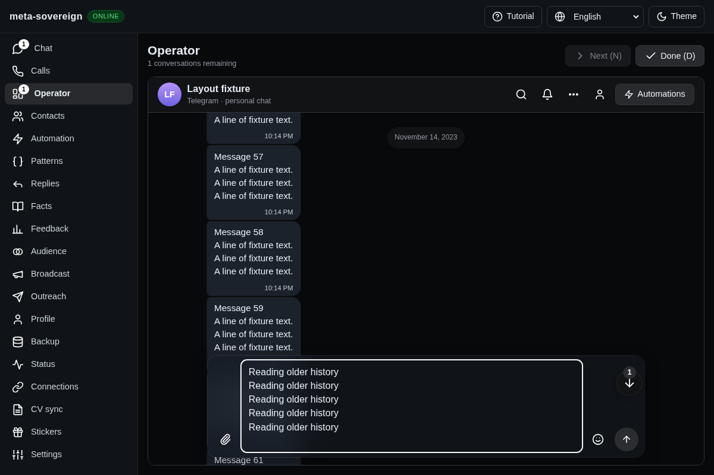

# Preserve reading position across a viewport resize

Chromium CI on `bc76f80c88916ec9e10095ac3fc20c7146401cea` exposed an existing shared Chat/Operator race: the Operator reader moved 112 pixels when a multiline draft expanded. Job `129122851718`, log line 2006, records `278.640625 → 166.640625`. The screenshot downloaded from that run is [the CI failure](chat-layout-ci-before.png).

The follow hook remembered viewport dimensions only when a scroll event arrived. A status/header resize could therefore leave those dimensions stale. When the reader next scrolled upward, the layout-correction branch mistook that gesture for resize drift and returned to the tail. Expanding the composer then moved the previously measured row by its 112-pixel height increase.

The existing browser regression now reproduces the ordering deterministically: briefly insert a 48-pixel status bar, record the smaller viewport, remove it and scroll upward before resize-observer delivery. It fails against the original hook with `209.765625 → 97.765625`. The correction also records the preceding scroll position and reconciles a changed viewport only when the reader has not moved upward. The same hook serves Chat and Operator; no provider-specific behavior was added. Optional `metaSovereignDebug` scroll diagnostics report only geometry and following state and are off by default.

The focused Chromium regression passes after the correction. It checks both surfaces, reply/multiline clearance, narrow and scaled layouts, stable unread boundaries, ordinary Chat acknowledgements and Operator acknowledgement only on Done. Full browser matrices remain in CI.

```bash
RUN_BROWSER_E2E=1 E2E_EXECUTABLE_PATH=/usr/bin/google-chrome \
  NODE_OPTIONS=--max-old-space-size=192 \
  E2E_ARTIFACT_DIR=/tmp/issue-56-layout-after \
  node js/tests/e2e-chat-layout-browser.mjs
```

The shared browser fixture accepts an installed executable to avoid downloading another browser locally. Stores and accounts are fake and isolated. [Before](evidence/local/layout-before.txt) and [after](evidence/local/layout-after.txt) logs retain the regression results.

Playwright MCP independently attached to visible Chrome launched by browser-commander under Xvfb. The isolated fixture reproduced the same resize/scroll ordering in Operator and filled a multiline draft; message 57 remained at exactly `245.4375` pixels before and after. The [MCP screenshot](chat-layout-mcp-after.png) records that state. A preliminary attempt exposed a missing fake dialog-state response in the experiment, which was added without changing production behavior. Both fixture/browser and MCP were closed afterward. Reuse the fixture with `ISSUE_56_CHAT_LAYOUT=1 xvfb-run -a node experiments/issue-56/browser-preferences-ui.mjs`.

Before, the reader has been returned to the tail:



After, older messages remain in view while the composer grows:


