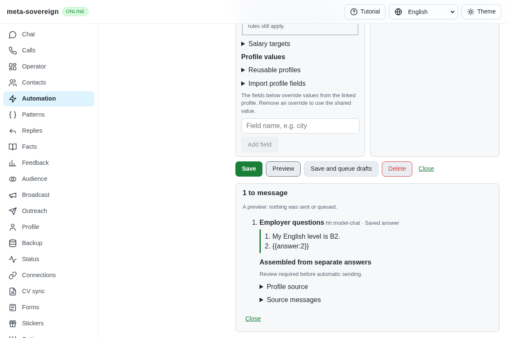
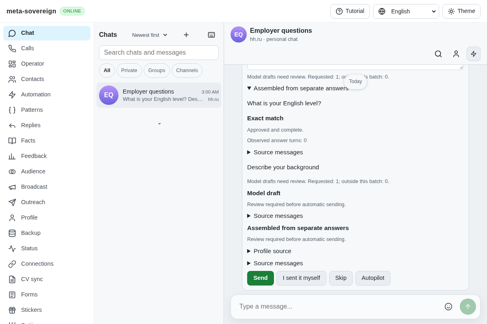
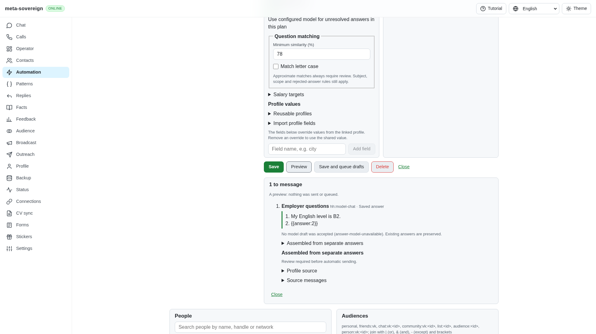
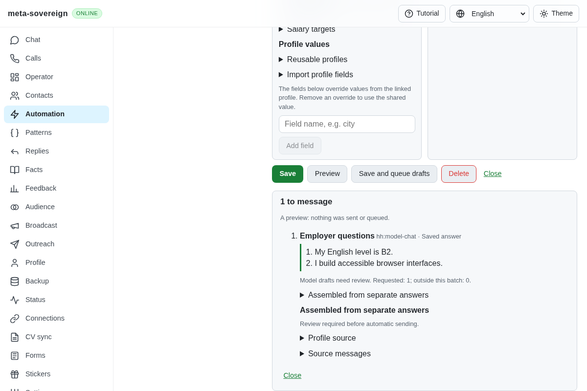
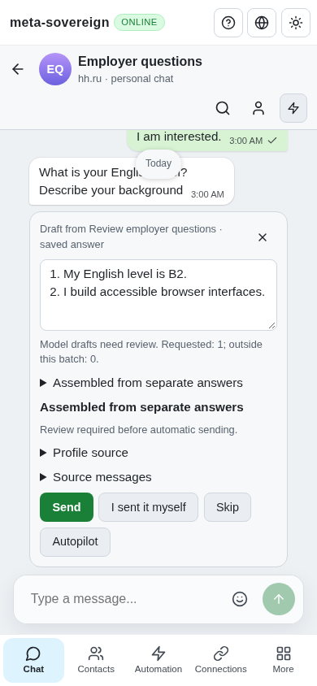

# Reviewed model drafts for unanswered chat questions

Issue: <https://github.com/link-foundation/meta-sovereign/issues/56>. Implementation: <https://github.com/link-foundation/meta-sovereign/pull/57>.

An explicitly enabled question automation can now draft unresolved questions from the latest consecutive unanswered employer messages. Approved saved answers stay intact. The configured optional model receives the selected CV, current profile, bounded conversation/vacancy context and nearby approved examples; unsupported personal facts remain visible clarification questions. The result always waits for owner review, including in automatic mode. Planning, queueing and final validation never send or regenerate model text.

This supplies the shared chat mechanism in C3, QA18 and R-AA1/R-AA6. Full authenticated provider workflows, the reference matching algorithm, assignment automation and every other unchecked issue criterion remain required. No live model account or employer account was used. PR 57 remains draft and unmerged.

## Reproduction and root cause

At preceding commit `7034426b14f6e79e3d6cb966141b19cb4f1da045`, save an approved answer to “What is your English level?”, enable a model with a stored CV describing the owner's background, and ask both that question and “Describe your background”. A combined message produces a numbered saved answer followed by `{{answer:2}}`. Separate consecutive messages consider only the last message and produce no draft. The automation normalizer discards `modelDraft`; the runner has no model stage; the shared model preview skips a partially answered assembled message because its placeholder text is nonempty.

`experiments/issue-56/chat-model-before.py` restores the preceding tracked sources and production bundle in a finite `try/finally` probe. Four focused regressions and the production browser check fail. The before screenshot shows the unresolved placeholder. The current implementation preserves the strict boolean opt-in, selects the current unanswered turn, invokes the shared model only for empty parts, and keeps per-part rule/model evidence.

A second regression demonstrated that changed offered choices could otherwise leave a reviewed model answer deliverable. `chat-model-choices-before.py` removes only the options binding, runs that one finite regression and restores the source. It fails without the binding and passes with it. Changed choices now leave the draft pending, with no second request or send.

## Shared configuration and behavior

Set `action.modelDraft: true` on a saved `answer-questions` automation, in addition to enabling the existing revisioned Answers model settings. The shared automation editor exposes the same opt-in in English, Russian, Chinese and Hindi. Existing actions remain opted out. CLI `automations save`, default text/binary Lino API and offline editor round trips retain the setting. The CLI `automations plan/run` commands own the same configured adapter lifecycle as standalone answer previews.

The chat candidate threshold is 0.7 when matching is unspecified; explicit matching settings are preserved. The existing standalone/form matching default remains unchanged. Approximate answers still require review. Exact/approved answers, partial saved text, question subjects, rejection policy, profile resolution and salary rules keep their existing behavior. Model generation supplements empty parts without replacing saved text.

Only the latest contiguous question turn is considered: at most twenty question messages, at most 6000 combined characters, and no more than one day between the oldest and newest. An owner reply, service/deleted message or nonquestion ends the turn. Invalid timestamps, pending/failed/unknown delivery or oversized current text refuse a candidate. Completed recruiter summaries remain nonactionable. Validation reads at most twenty-one recent messages in a 300000-byte window; insufficient retained context refuses the draft rather than asserting completeness.

The adapter retains its existing context, prompt/output, timeout, schema and process limits; see [model adapter and form review](forms-model-drafts.md). Requests run serially. A response with unknown facts produces explicit `[clarify: …]` text and an incomplete, review-required draft. Disabled, unavailable and refused states stay visible in previews, Chat/Operator notices and CLI output. A wholly unanswered candidate with no model text is excluded rather than queueing an empty message. Offline controls report actual unavailability.

Issued drafts bind message IDs, bodies, timestamps and offered choices, plus current model settings, selected CV, resolved profile, context, rules, rejection policy and normalized automation action. These are checked after model completion, before queueing and before reviewed delivery. Owner replies, edited questions/choices, changed knowledge, disabled/deleted automations or missing sources refuse the stale draft. Validation makes no model request. Existing pending drafts win over newly generated output, preserving owner edits made during planning; reopening a pending Chat draft also makes no request.

Automatic mode queues model output for review even when no send confirmation was supplied. Explicitly reviewed delivery can use owner-edited wording after the unchanged-context check. Model generation itself never delivers a message. Default-off question diagnostics report only event identifiers/codes.

## Verification

Sixty-five focused Node checks and the same sixty-five Deno checks pass. They cover strict opt-in persistence, partial and wholly unanswered drafts, actual selected CV/conversation context, explicit clarification, automatic-mode review, refusal/unavailability, latest-turn barriers, held-request edits, changed choices, stale queue/delivery, pending owner edits, cancellation, offline behavior, the real CLI handler, trusted-origin protection, both Lino encodings, four locales and per-part evidence.

The production Chromium check uses the built application with an isolated memory store and injected finite provider. It verifies opt-in/opt-out persistence, mixed answers, one queued draft, actual Chat text, provenance, phone width and close/reopen edit retention. Its receipt records two successful model requests (preview and run), one queued draft and zero sends. It is mandatory in the shared browser registry for both hosted engines.

Independent Playwright MCP verifies a refused request, explicit retry, recovered mixed answers, desktop/390-pixel layouts, actual pending Chat text and retained owner edits. Its server receipt records three issued calls, two successful model drafts and zero sends. The only initial console resource error is the fixture's absent favicon. The browser and owned test server close after verification. This is synthetic contract/UI evidence; live provider/model execution remains unverified.

```sh
NODE_OPTIONS=--max-old-space-size=384 node --test --test-concurrency=1 js/tests/chat-answer-model.test.js js/tests/question-automation.test.js js/tests/answer-model-drafts.test.js js/tests/automation-api.test.js js/tests/automations-view.test.js js/tests/question-matching-options.test.js
deno test --v8-flags=--max-old-space-size=384 --allow-all --no-check js/tests/chat-answer-model.test.js js/tests/question-automation.test.js js/tests/answer-model-drafts.test.js js/tests/automation-api.test.js js/tests/automations-view.test.js js/tests/question-matching-options.test.js
RUN_BROWSER_E2E=1 CHAT_MODEL_SCREENSHOTS=1 E2E_EXECUTABLE_PATH=/opt/google/chrome/chrome NODE_OPTIONS=--max-old-space-size=384 node js/tests/e2e-chat-model-browser.mjs
```

Strict changed-code lint, scoped formatting, production bundle and the unchanged 6.5% duplication gate pass. Full suites and browser/runtime matrices remain on hosted CI. All five hosted workflows pass on the preceding `7034426b` head, including both mandatory browser lanes and the full runtime matrix. Exact new-head CI remains required.

The [evidence archive](data/chat-model-drafts.tar.gz) and [per-file manifest](data/chat-model-drafts.tar.sha256.json) retain source snapshots, finite regressions, raw focused/browser/MCP observations and CI metadata. Screenshot hashes are included. All CV/profile content is synthetic.

## Before and after

Before: the approved answer is present but the other question remains a placeholder.



After: the saved answer and separately sourced model draft are assembled for review.





Independent refusal and recovery:






