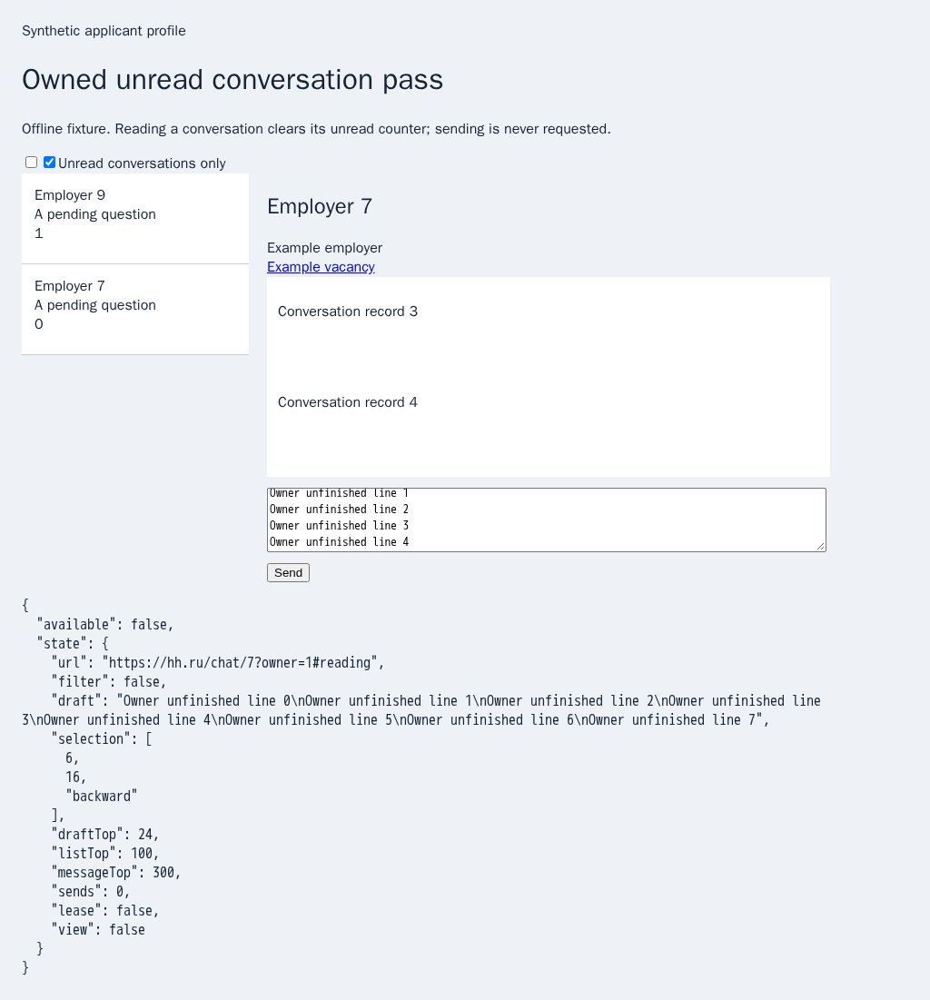
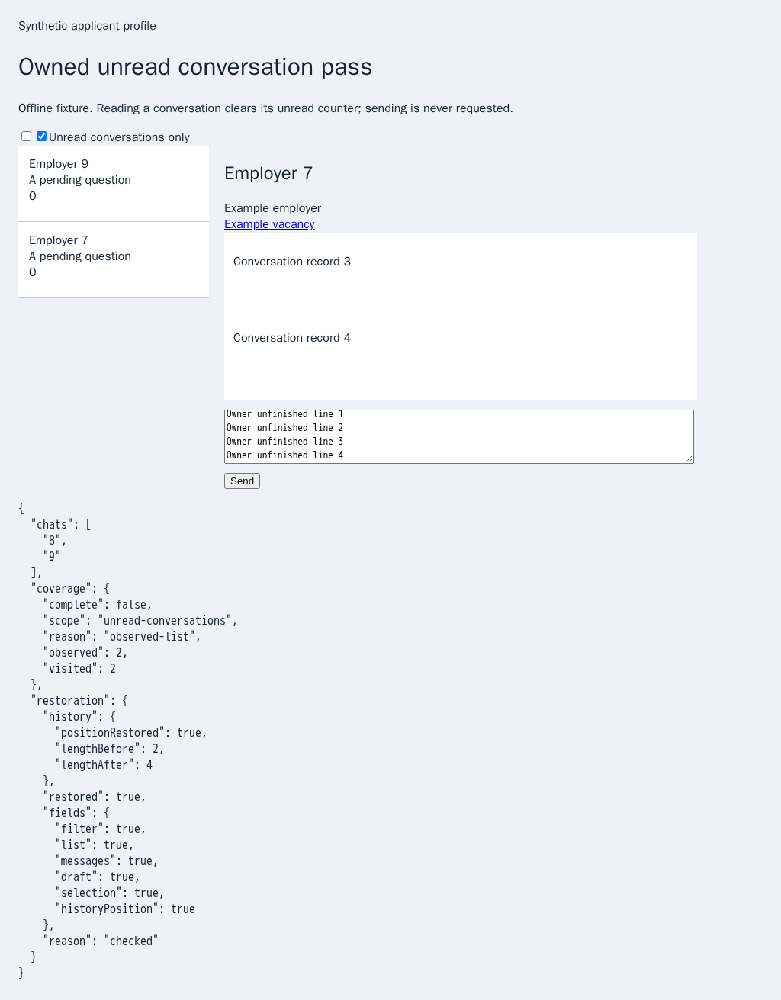
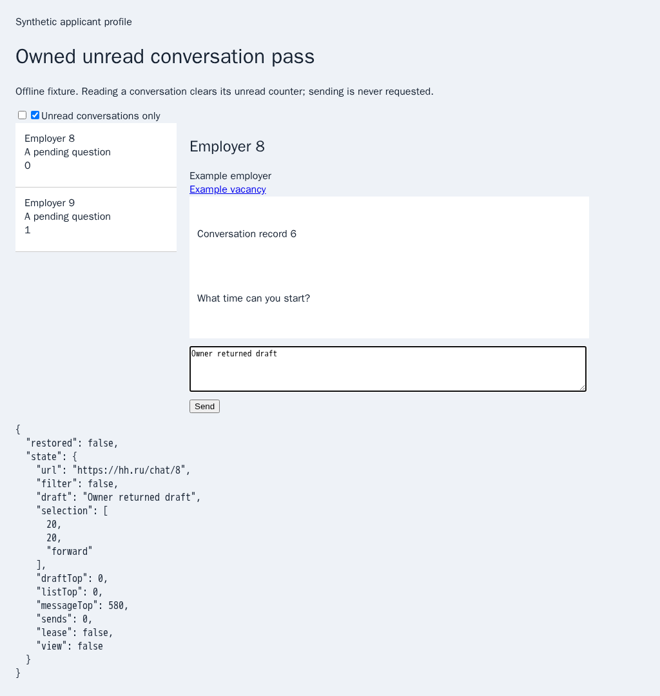

# Owned finite unread conversation reads

Follow-up: [repeated owned unread passes](chat-repetition.md) adds exact native suffix proofs, allowing reuse only until owner activity or navigation. The original finite-pass evidence below records the preceding implementation and its limits.

The preceding browser sender could scan one list or one conversation, but each public method opened its own URL. Composing them could not preserve an already open, inactive owner view. This step adds `scanUnreadConversations({source: 'hh', maxChats, ...scanBounds})` to the browser sender and fallback wrapper. It requires an existing session, never launches a browser for the pass, and never sends or accepts anything. Opening a native conversation may mark it read. Persistent unread watching, policy delivery and CLI/Lino/shared controls remain required.

The pass selects actual unread rows through the previously verified filter primitive, restores that list selection, then visits observed conversations sequentially through native SPA controls. It binds one visible trusted main/child document, its trusted outer owner and private document identities. Hidden decoys cannot establish ownership. The existing guarded history scanner retains overlapping rows, provider-start proof and partial-history reasons; answer inspection preserves the current draft. Overall provider coverage always remains incomplete. Defaults remain 20 chats, 30 seconds and 100 passes, with the existing bounded overrides and finite navigation settlement. Expired budgets admit no additional history read. Empty rendered unread lists remain incomplete, including an unavailable list-container reason.

A private page-local lease keeps the original exact URL, native filter, list/message positions, draft, selection direction and draft scroll. Draft content remains in the page and is absent from default diagnostics. Missing drafts are restored through the shared native input setter and actual input/change notifications. A different nonempty owner draft is preserved and reports failed restoration. Returning focus, real owner input, an unexpected route, replaced/reloaded documents or lost identity stop subsequent work. Restoration also requires current inactive ownership. Stop during target revelation never activates the next conversation; shutdown drains restoration before closing the browser. Changed or replace-only routes never claim a successful Back restoration.

## History limits

A finite Chromium probe confirms that iframe SPA pushes participate in the top-level joint history stack. Admission checks its native CDP position and refuses existing forward entries before touching the view, preventing native clicks from discarding owner forward history. Each owned transition verifies the expected history growth, index and original document. Back restores the original position and exact URL.

New native pushes still add forward entries: browser history has no API to remove them after Back. The restoration receipt explicitly reports `history.positionRestored`, `lengthBefore` and `lengthAfter`; `restored` covers the reported view fields and history position, not unchanged history length. A subsequent pass at the restored position refuses `browser-chat-view-history-forward`. Full history-length preservation and safe persistent repetition remain unfinished, rather than silently altering or discarding history. WebKit refuses unsupported native inactive-focus preparation. Cross-provider and live HH behavior remain unverified.

## Reproduction and focused verification

Run `PYTHONDONTWRITEBYTECODE=1 python3 experiments/issue-56/chat-navigation-before.py`. It temporarily restores the actual preceding `eca91d6b` sender/scanner, demonstrates the missing method in the new admission test and captures the earlier unavailable state. Both working files are restored in `finally`.

The isolated fixture routes finite synthetic HH documents locally. It has real pushState/popstate navigation, nested native filters, overlapping virtual history, per-chat drafts and a send counter that remains zero. A virtual list forces revelation of a later target. Native main/child tests verify exact original URL, filter, list/message scroll, draft, selection direction and draft scroll; changed drafts, cancellation, owner return, replace-only routes, existing forward history, small budgets, reloads, empty unread results and shutdown have separate assertions. The mandatory `question-unread` and `question-unread-guards` groups use actual full Chromium focus and retain the existing 180-second subprocess and 35-minute job budgets. No full browser/runtime matrix is run locally.

Before: the actual preceding sender has no existing-view unread pass.

After: two observed conversations are read, the owner view is restored, and provider coverage remains incomplete. The receipt also discloses added forward entries.

Returning owners retain their current conversation and edits.

Twenty-seven focused Node and 27 Deno checks pass, together with six mandatory-registry/partition contracts. Four native main/draft cases, eight native guard/boundary cases and two added native Stop/shutdown cases pass (14 distinct cases). Independent Playwright MCP verifies one complete synthetic unread history with exact restored view and a returning owner whose current chat and draft remain intact; both cases have zero sends and no page errors. The MCP sandbox needs explicit page/time/clock adapters; its first missing-clock error is retained. An identical URL navigation preserved the first case’s already-read state, so the second fixture now uses a distinct query URL to force a new document. The observed chat 9 diagnostic and corrected two-case result are retained. Native history tracing also exposed background scroll settlement exhausting an unrealistically short fixture wait; the final fixture uses the unchanged production 150 ms / 30-second defaults. Pending scroll ownership and all production/CI limits remain enforced. `MS_BROWSER_CHAT_VIEW_DEBUG=1` emits phases, bounded reasons and list elapsed/coverage metadata; it emits no URLs, drafts or transcript text. Existing history tracing remains opt-in.

The preceding diagnostic commit `a203a29c` has passed hosted Checks. Refreshed issue/PR conversation comments are empty; the six existing automated inline comments/reviews are preserved. At publication, the preceding `eca91d6b` has successful Security, Links, Pages and Desktop workflows; broader Checks remains queued/running. These runs do not verify this new unit. PR57 remains draft and unmerged; every unchecked issue-wide criterion remains active. [Archived sources, raw logs and screenshots](data/chat-navigation.tar.gz) and the [SHA-256 manifest](data/chat-navigation.tar.sha256.json) retain the actual-parent regression and these limits.
