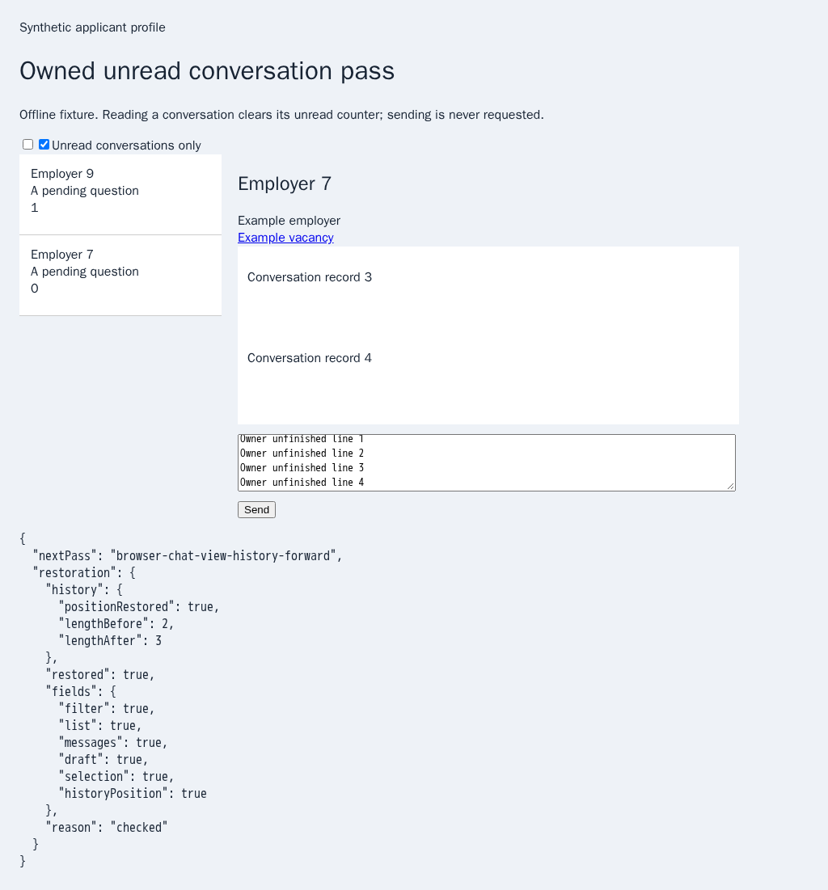
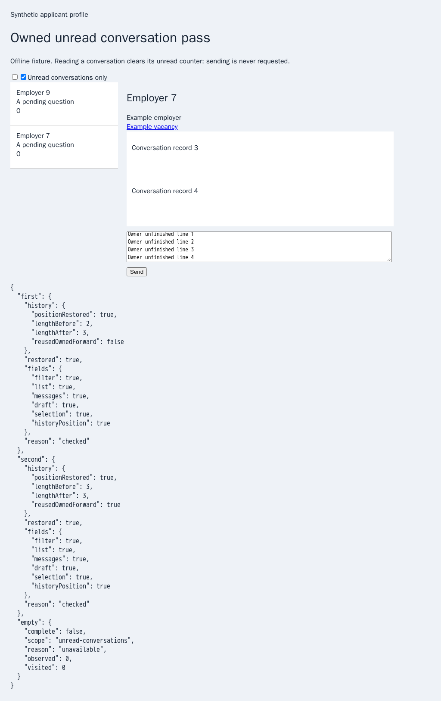

# Repeated owned unread passes

The preceding finite pass restored the original chat with native Back, leaving automation-created forward entries. Its next pass refused those entries as unverified owner history. The pinned HH reference also uses Back; it does not delete native forward entries. Replacing only a still-owned suffix allows repeated passes while retaining the original history prefix and current position.

The new private proof contains native entry IDs, the original index and exact frame/document bindings. Page-local activity witnesses retain no draft or transcript content. A subsequent pass must match every ID and binding, and both outer and child witnesses must still report no owner activity. Focus, actual input, wheel/touch/pointer/key activity, navigation, detachment or close revokes reuse. Even focus followed by leaving again cannot reauthorize the old suffix. Pre-existing forward history remains unavailable, as does any suffix after a restart or failed restoration. Exact current owned input/filter notifications are the only input exemptions. Witnesses cannot authorize navigation or sending; each pass still acquires and verifies its separate inactive ownership lease.

Each native push must retain the complete original prefix and introduce exactly one new entry. It may replace the proved automation suffix. Restoration uses the difference in native indices, since truncating an owned suffix can keep or reduce total length. Unchanged indices alone no longer verify history: all entry IDs must remain equal outside controlled transitions. Finite capacity guards refuse before Chromium's bounded history could evict an owner entry. A finite 52-push probe in installed Chrome 155.0.8059.79 observes 50 native/DOM entries and index 49; the guard stops before the next owner-prefix eviction. Chromium's [published history constant](https://chromium.googlesource.com/chromium/%2B/refs/heads/trunk/content/public/common/content_constants.cc) provides historical source context; the current installed-browser observation is preserved separately. Admission failures drain every issued witness call, and failed/closed views cannot retain a proof. Between passes the proof has only passive event hooks, with no timer or background scan; route changes and session shutdown remove them.

The receipt adds `history.reusedOwnedForward`. History lengths remain explicit: the first pass can add forward entries, and this change does not claim to remove browser history or restore its original length. Subsequent equivalent passes reuse their own suffix without continuing to grow the stack. Persistent polling, policy dispatch, public CLI/Lino/shared controls, full provider parity and live HH verification remain unfinished.

## Reproduction and verification

`PYTHONDONTWRITEBYTECODE=1 python3 experiments/issue-56/chat-repetition-before.py` temporarily restores the actual `82360a8f` navigation implementation. The first native pass succeeds; its next pass refuses `browser-chat-view-history-forward`. The working navigation file is restored in `finally`.

`NODE_OPTIONS=--max-old-space-size=384 node experiments/issue-56/chat-navigation-browser.mjs --repeat` runs only five isolated full-Chromium cases. Main and trusted-child fixtures read chats 8 and 9 in separate passes, preserve exact owner state, keep history length stable on the second pass and restore after an empty third pass. Three further cases prove focus, input and intervening navigation revoke reuse without changing the resulting view or native history. Mandatory CI registration retains native focus and existing subprocess/job deadlines in both engines. WebKit retains its explicit unsupported-focus refusal.

Before: the next pass refuses its own preceding entries.

After: two sequential passes retain exact original state and disclose their native history receipts.

Focused unit checks additionally cover native ID substitution, changed document identities, prefix eviction, multiple/unowned pushes, capacity refusal, exact input exemptions and partial-admission cleanup. Independent Playwright MCP uses bundled production code and actual native focus to verify a repeated read and owner-return revocation. Twenty-five focused Node and 25 Deno checks pass, together with 12 relevant CI contracts, five native repetition cases, two retained native Stop/shutdown cases and two independent MCP cases. The finite history-capacity probe also passes. Strict lint, formatting, secrets and the unchanged duplication gate pass. No full local runtime/browser matrix is run. [Archived sources and raw evidence](data/chat-repetition.tar.gz) and the [SHA-256 manifest](data/chat-repetition.tar.sha256.json) retain both the actual-parent failure and all measured limits. Hosted verification of the new commit remains required; PR57 stays draft and unmerged.
