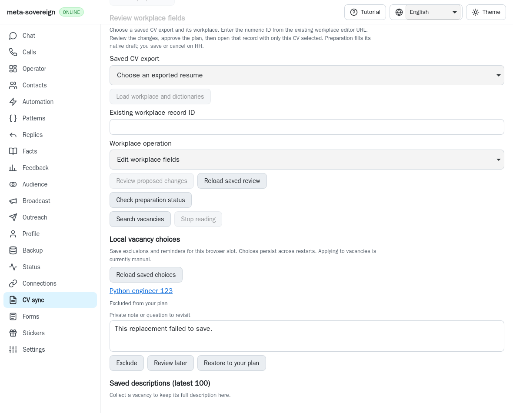
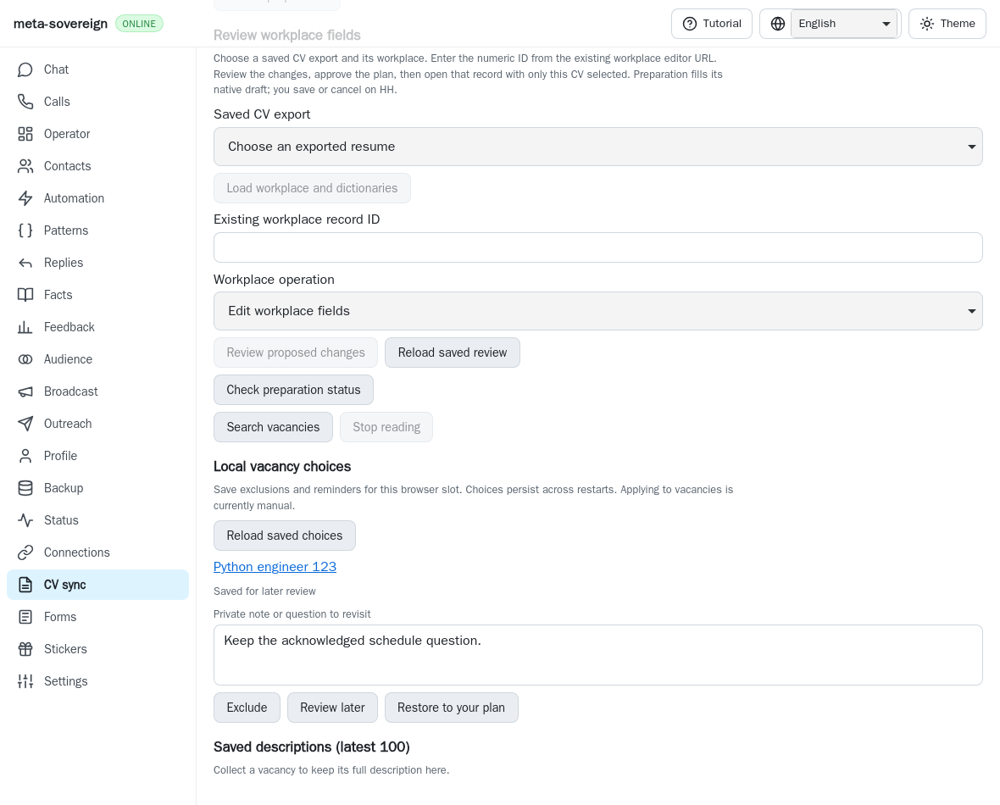
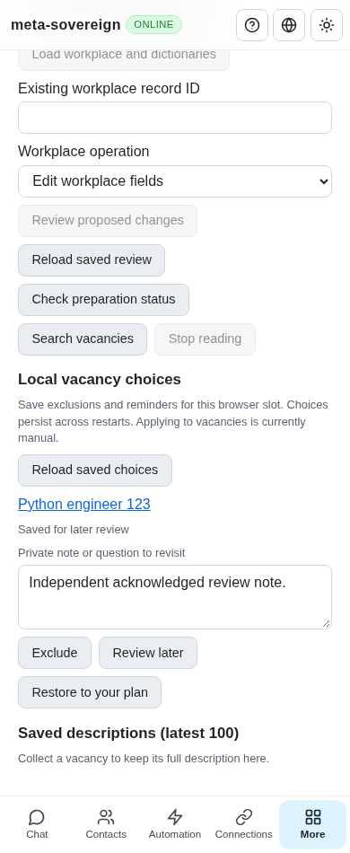

# Preserve acknowledged job data when a put rejects

[PR #57](https://github.com/link-foundation/meta-sovereign/pull/57) remains
draft and unfinished. This correction covers failed persistence in the shared
job-record helper and technology catalog. Every unchecked original requirement
remains required.

The actual browser store admits a record to memory before awaiting its snapshot
driver. A driver rejection therefore leaves the new record in memory. The job
helper previously caught only `flush()` failures: its `put()` ran outside the
rollback block. A failed vacancy exclusion or note could subsequently appear as
saved after reloading the CV panel, despite the rejected write. The technology
catalog independently repeated the same pattern.

The helper now catches failures from both mutation and flush, restores the prior
acknowledged record or removes a newly admitted record, and propagates the
failure. Catalog saves use the same helper. The service's existing admission
barrier keeps readers and Stop waiting for the attempted save and restoration.
Immediate optimistic memory behavior in the general storage layer is unchanged.

Four finite regressions use `createBrowserStore` and its real snapshot writer,
with a held, single injected `ENOSPC` rejection. They cover initially absent
and previously acknowledged choices and catalogs, verify memory really changes
before rejection, and inspect both public readback and the durable snapshot
after the operation settles. Reads and Stop must wait while the failure is held.
All four fail on actual parent `262280fc`; all pass after the correction.

Reproduce the parent failure and automatically restore both source files with:

```sh
python3 -B experiments/issue-56/choice-put-rollback-before.py
```

The script also runs one isolated WebKit workflow. Save a deferred vacancy with
an acknowledged note, reject the next real snapshot save while changing it to
excluded, then reload. Parent readback displays the excluded state and failed
replacement note. Corrected readback retains the acknowledged deferred state and
note. No provider application is submitted. The fixture injects storage failure
only; it does not replace the production service, routes or browser controls.

Before, actual parent after the rejected write and reload:



After, the last acknowledged state survives reload:



Focused validation runs 29 cases with one test worker:

```sh
node --max-old-space-size=384 --test --test-concurrency=1 \
  js/tests/job-choice-durability.test.js \
  js/tests/job-vacancy-choices.test.js js/tests/job-technology-analysis.test.js
RUN_BROWSER_E2E=1 E2E_BROWSER=webkit \
  node experiments/issue-56/choice-put-rollback-browser.mjs
```

An independent Playwright MCP context repeats the rejected-save/reload workflow
and checks desktop and phone layouts. Its isolated server records one injected
failure, zero provider clicks, no page errors, and completed browser cleanup.
The native regression joins the existing mandatory vacancy-choice browser group
in both hosted engines. Four browser-registry checks and scoped lint, format,
secret and diff checks pass locally. Full runtime/browser matrices remain on
hosted CI, with existing deadlines and the duplication threshold unchanged.



The [checksummed archive](data/choice-put-rollback.tar.gz) and
[manifest](data/choice-put-rollback.tar.sha256.json) preserve the parent sources,
complete failure/success logs, reusable fixtures, source changes and screenshots.
The helper does not promise recovery from persistent storage failure: a failed
rollback still rejects. These checks establish restoration when the injected
write fails once and the restoration can persist. Automatic applications,
questionnaire policies and the other unchecked issue requirements remain open.
