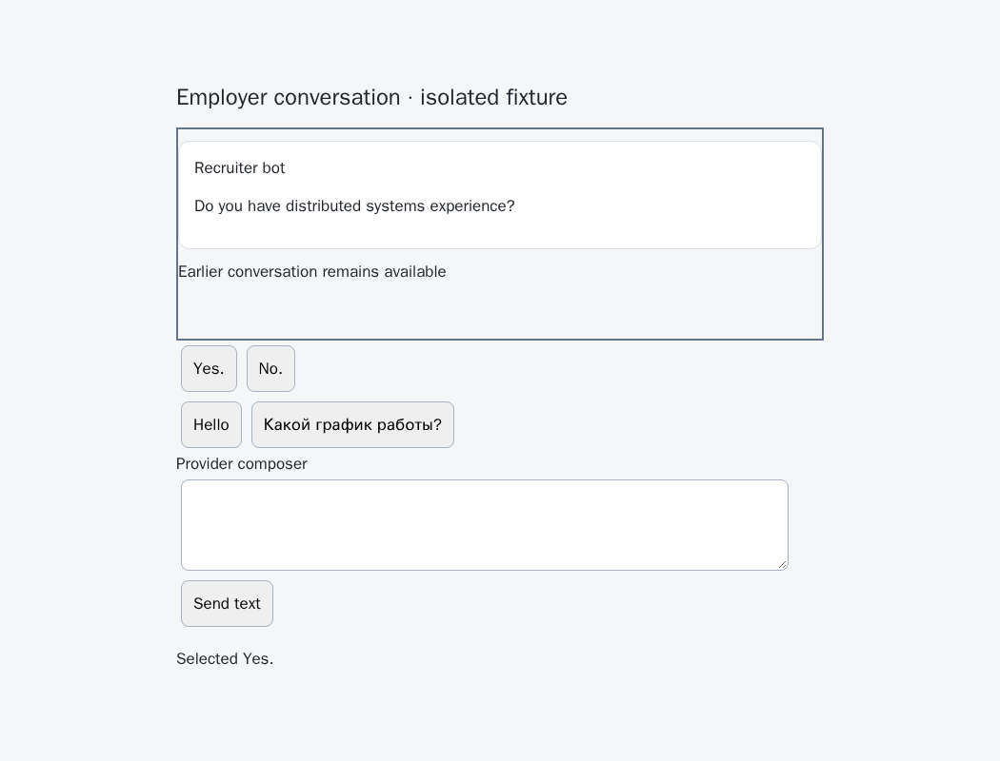
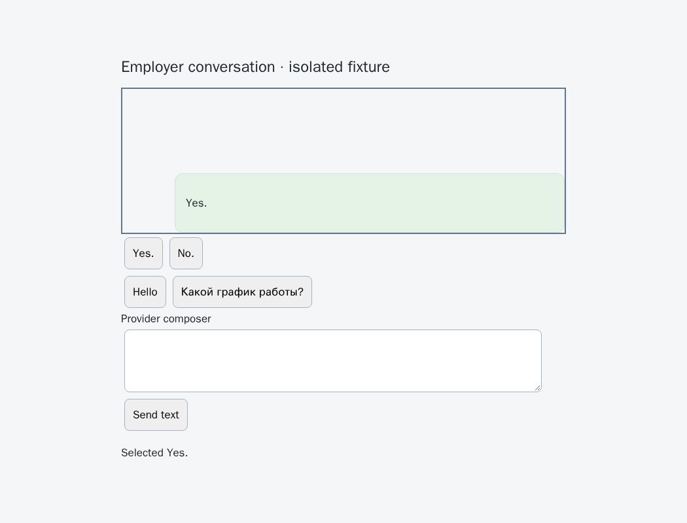
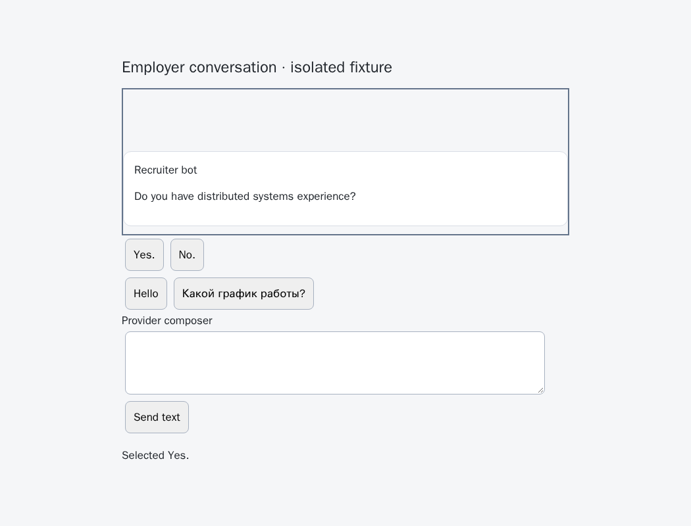
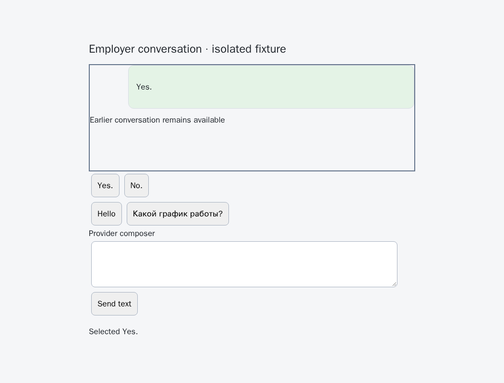
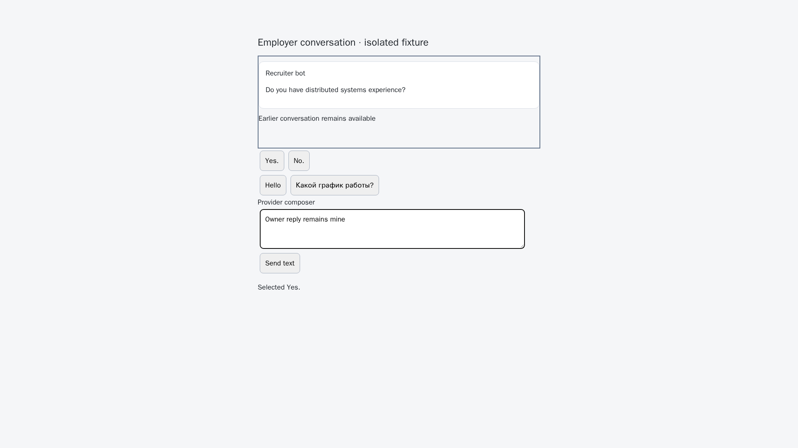

# Reveal confirmed native-choice replies without taking the owner's view

Issue [56](https://github.com/link-foundation/meta-sovereign/issues/56), [PR 57](https://github.com/link-foundation/meta-sovereign/pull/57). This implements the confirmed native-choice bubble visibility portion of reference requirement D. Guarded acknowledgement/rejection free-text delivery, unread orchestration and complete provider parity remain unfinished.

## Reproduction and correction

On parent `c35f813d507dbff50a2d094ebe12177b01304020`, a native option can have a unique confirmed outgoing receipt while its bubble remains outside the scroll pane. The reader already includes rendered offscreen bubbles, so delivery confirmation must remain independent of viewport visibility. The actual-parent experiment fails two reveal assertions, in ordinary and `column-reverse` panes, while nine ownership/refusal cases pass.

After the correction, one confirmed native reply scrolls into view with the browser's nearest-edge behavior. DOM chronology remains unchanged; a reversed visual layout needs no invented numeric message ordering. The existing historical, duplicate and incoming-message receipt refusals still pass.

Temporary capture listeners track wheel, touch movement, keyboard, input and pointer activity during delivery. The tool's own option pointer event does not count as an owner interaction. Owner activity or a restored composer draft prevents reveal. A repeated positive receipt never scrolls again, and a scrolling exception cannot erase confirmed delivery or permit another send. Both successful confirmation and uncertain cleanup remove the temporary listeners.

The page-local receipt retains a small reveal outcome (`revealed`, `owner-activity`, `owner-draft` or `unavailable`) for bounded diagnosis. It contains no message or composer content. Native selection and its durable service reservation continue to use the existing shared CLI, Lino, Chat, Operator, Questions and watch execution path.

## Verification

- Actual parent: two reveal regressions fail; nine ownership/refusal cases pass.
- Fixed production Chromium: eleven cases pass, with eleven native clicks and zero text sends.
- All twenty existing provider-choice browser cases pass, including missing/duplicate/historical receipts, late question changes, owner drafts and no API text fallback.
- Six focused Node boundary checks pass. Both hosted browser engines run the new scenario in the existing question-provider group.
- Independent Playwright MCP confirms visible ordinary/reversed replies at scroll offsets `921` and `-921`, exact receipt `102`, one native click per isolated document and zero text sends. Owner input preserves both text and scroll. No page errors occur; the browser and isolated server close afterward.

```sh
python3 experiments/issue-56/choice-visibility-before.py
node experiments/issue-56/choice-visibility-browser.mjs
node --test --test-concurrency=1 js/tests/browser-choices.test.js
node experiments/issue-56/provider-choices-browser.mjs
```

All fixture conversations are synthetic and isolated from the user's application server. The [verified evidence archive](data/choice-visibility.tar.gz) preserves sources, actual-parent logs, focused checks and independent MCP results.

## Visual evidence

These screenshots show the same confirmed selection before and after the fix. The reversed pane keeps chronological DOM order and uses negative scrolling.

| Layout   | Parent: confirmed reply remains hidden                                                      | Fixed: confirmed reply revealed                                                           |
| -------- | ------------------------------------------------------------------------------------------- | ----------------------------------------------------------------------------------------- |
| Ordinary |  |  |
| Reversed |  |  |



## Separate hosted investigation

Parent workflow [43049732719](https://github.com/link-foundation/meta-sovereign/actions/runs/43049732719), created 2026-11-11 15:34:37 UTC for `b8c0484467c15729ed4aac05755fbe57d14f10f0`, finishes with the previously reproduced context/watch failures. Its Chromium job [130624862574](https://github.com/link-foundation/meta-sovereign/actions/runs/43049732719/job/130624862574) fails before tests: complete workflow log lines 66585–66599 show Ubuntu archive/security DNS failures, missing font dependencies and browser installation exit 100. The complete raw workflow log is preserved.

Its macOS Node shard 1 is cancelled at 15:49:41, about ten minutes after starting and before the next push; it must not be described as cancelled by that push. The subsequent `c35f813d` run passes all three macOS Node shards at the recorded observation, which does not establish the cause of the earlier slow run. The older closed Questions disclosure and Lino navigation failures remain unresolved. Exact new-head full CI and every unchecked issue-wide requirement remain required; PR 57 stays draft and unmerged.
