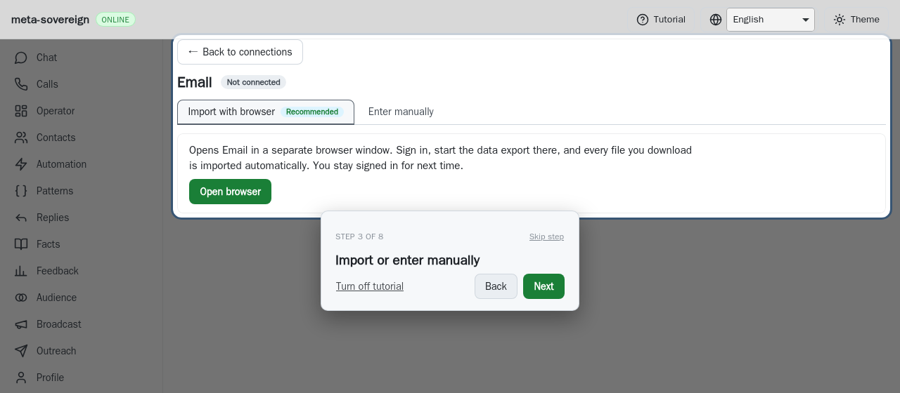
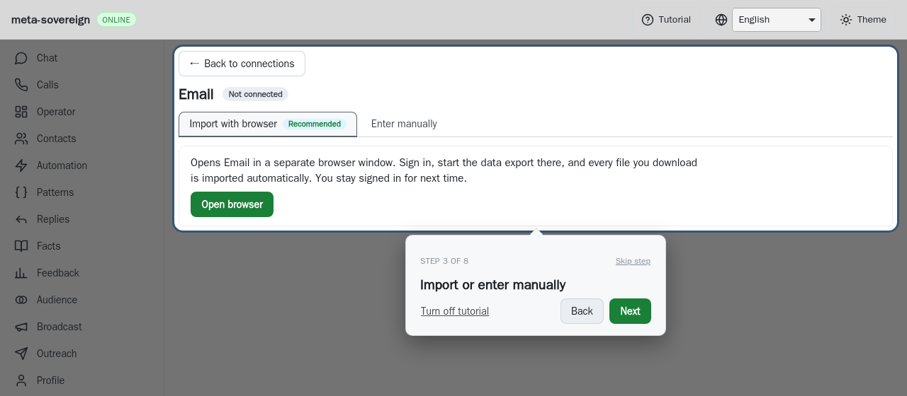

# CI investigation for 10d06262

All five workflows created **2026-11-09 22:03:59 UTC** refer to exact pushed
commit `10d06262e078625b49ab81faaa811194ca0b5f7b`. Security, desktop, Pages and
links pass. [Checks and release](https://github.com/link-foundation/meta-sovereign/actions/runs/42708371263)
fails its WebKit browser job and therefore the aggregate gate. The Checks job
records contain 32 successes, three skipped release jobs and the two failed
browser/aggregate jobs. Autopilot passes in both browsers: full-log lines 18434
and 20676. The earlier pre-click selection
observer correction is not the failure in this run.

The complete Checks log identifies the only tutorial failure at **line 20854**:
the short-desktop setup card is docked at top 277, height 142.765625, while the
target runs from 56 to 304.015625. Thus the card covers part of the import panel.
Lines 21412–21414 report the failed tutorial; lines 21605–21609 fail the browser
job and line 90733 fails the aggregate. All five complete logs, current run and
job metadata and the downloaded WebKit browser artifact are archived. This CI
artifact did not contain a screenshot of the nonthrowing overlap assertion; the
test now captures overlap geometry and a screenshot when that assertion fails.

## Cause and deterministic regression

The tutorial collapses its body when a full card cannot clear the target. Its
size hook originally measured once per step and then relied on ResizeObserver.
A body collapse within the same step could leave the old card dimensions in
placement until notification arrived. A short viewport could therefore keep the
smaller card at the old dock, overlapping a newly smaller import panel. A normal
focused rerun was intermittent, so that run alone was insufficient evidence.

`e2e-tutorial-card-resize-browser.mjs` runs the real short-viewport page and
withholds only the tutorial card's ResizeObserver notifications. Other observers,
layout and the target-clearance pass remain active. It switches from manual to
import, waits for actual collapse and checks that the card clears the target.
Against the prior source it fails: card top 300 overlaps the target ending at
304.015625. With synchronous measurement after each React commit it passes:
card top 332 clears the target ending at 320.015625. Both screenshots below were
validated as PNG and visually reviewed. The comparison experiment restores the
working source and bundle in `finally` and runs no full local browser matrix.

Before:

After:

The size hook now measures before paint after commits, retaining ResizeObserver
for later font/content changes. Equal measurements bail out without another
render. No assertion or timeout was relaxed. The focused short WebKit tutorial
walk and deterministic regression pass; existing browser CI includes the new
case. Exact-head CI must still verify the correction.

`data/ci-10d06262.tar.gz` preserves full workflow logs, run/job metadata, downloaded
browser evidence, failing/passing local logs and comparison experiment metadata
with verified per-file hashes. [PR 57](https://github.com/link-foundation/meta-sovereign/pull/57)
remains draft because the full issue inventory is unfinished.
