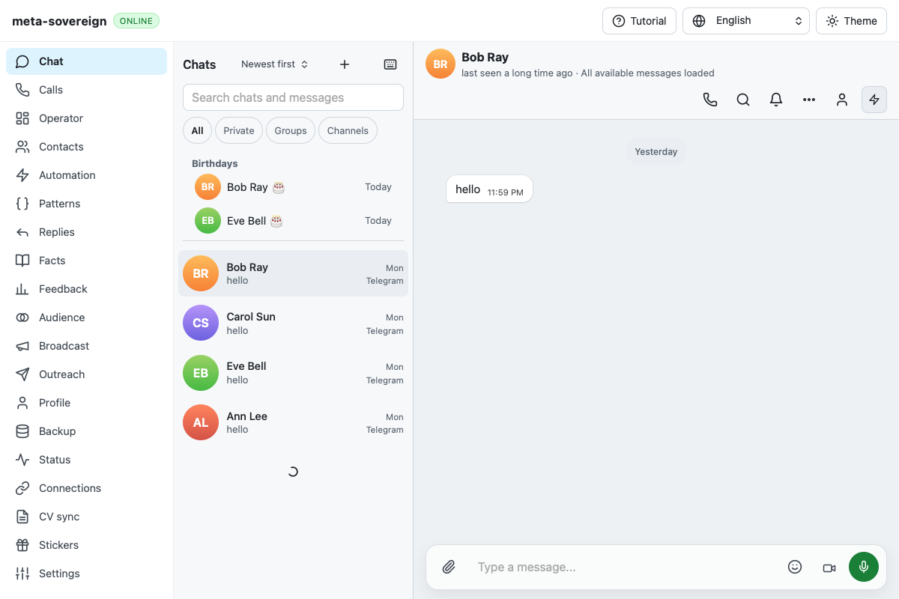

# Export-head CI: birthday clock and Windows startup

All five runs created **2026-11-09 23:37:00 UTC** target exact pushed commit
`124a223402e9ae269210b1241d3f1fc8045bebda`. Four auxiliary workflows pass.
[Checks and release](https://github.com/link-foundation/meta-sovereign/actions/runs/42721903874)
fails Windows Deno, WebKit and the aggregate gate; other jobs pass or are
appropriately skipped. The run finishes at 2026-11-10 00:03:34 UTC.

The complete 91,396-line workflow log is preserved and failure sections were
read in bounded chunks. **Line 17710** reports WebKit profile-extras:
`timed out: older sent wishes dismiss Eve`. **Line 89202** reports Windows Deno's
initial rolling-host readiness: `CLI host did not start`. The dedicated Windows
job log identifies `rolling-cli.test.js:63` at lines 5016–5020 and the final
failure at 6859–6873. It finishes with 3789 passed, one failed and six ignored.
This is a completed failure, not pending or successful coverage.

## Midnight fixture boundary

The WebKit profile test starts just after midnight. Its birthday is "today",
but its supposed older birthday wish uses `Date.now() - 120000`, making the
wish belong to yesterday. Product matching correctly leaves today's reminder
visible. The downloaded browser screenshot also shows the conversation's
"Yesterday" divider and Eve's outstanding reminder:

The bounded `profile-birthday-clock.py` experiment controls the baseline clock
at 00:00:05, retaining the old two-minute subtraction and the real production
bundle. It fails the same assertion in Chrome. With the fixture and browser
sharing a fixed noon clock, the complete focused profile-extras flow passes.
The experiment restores its source in `finally`; no live store or provider is
used. Product matching and timeouts are unchanged. The existing browser test
now supplies that fixed clock and timestamps, including its fake sent message,
so the regression no longer depends on wall-clock time or a midnight crossing.

## Windows Deno readiness remains under investigation

The test performs 200 readiness attempts separated by 50 ms. Its captured host
output is empty on this failure, so the log does not establish whether import,
snapshot preparation or worker initialization delayed readiness. The complete
job log and final workflow are retained rather than inferring a cause from the
final assertion alone.

The same specific rolling CLI tests pass on Linux Deno, including immutable
snapshot rejection. With the existing trace enabled, preparation enumerates
1135 files and completes a snapshot in about 2.9 seconds; the full two-test
run takes 16 seconds. This does not reproduce Windows latency. Deno CI now
enables the existing metadata-only lifecycle trace on Windows/macOS, as Node
already does. The focused test prints its captured startup trace on successful
readiness too, allowing comparison with a future failed phase. Product defaults
remain silent. No readiness loop, per-test deadline or job deadline is raised.

`data/ci-124a2234.tar.gz` retains full workflow/job logs, exact run/job metadata,
the relevant downloaded browser artifact, intentional midnight failure and
passing correction logs, experiment source and Linux Deno startup trace. The
adjacent manifest verifies every archived file. The next exact-head CI must
verify the clock correction and identify or clear the Windows failure. The
overall issue and [PR 57](https://github.com/link-foundation/meta-sovereign/pull/57)
remain unfinished, draft and unmerged.

## Subsequent formatting gate

The user/contact commit `aab17e78515a30f7fa4aea6eb3ae769f61e50d99`
has a completed formatting failure in run
[42726623365](https://github.com/link-foundation/meta-sovereign/actions/runs/42726623365).
Its dedicated lint job log at lines 406–410 identifies three requirement tables
needing Prettier: English, Hindi and Chinese. ESLint reports four existing
warnings and no errors. The format gate prevents the runtime/browser matrix
from running for this head. Commit `efd51d8e88d23b8895573c28c31ca41cb7adc885`
normalizes only these three table rows. Its formatting gate passes; the exact-head
runtime/browser jobs are pending at collection. This failure and correction are
retained in the Telegram login evidence archive.

## Subsequent Windows trace and cancelled browser run

The corrected head `efd51d8e88d23b8895573c28c31ca41cb7adc885` starts
[run 42727686505](https://github.com/link-foundation/meta-sovereign/actions/runs/42727686505)
at **2026-11-10 00:21:35 UTC**. Its Windows Deno job **129540110951 passes**.
The dedicated log at lines 5964–5988 records initial host readiness and both
rolling snapshots. Enumeration takes 19 ms, hashing 283 ms and snapshot
verification 2018 ms; the host becomes ready in 2023 ms for 1135 files. The
second snapshot completes in 2194 ms. The previous startup failure did not
recur, but this successful trace does not establish its cause.

That head's WebKit job **129540110478 is cancelled**, with the log recording
`The operation was canceled` after the tutorial flow started. This is not an
application assertion failure or a completed browser pass. The later login
and contact flows were not reached. The complete dedicated Windows and WebKit
logs are preserved in `data/telegram-login.tar.gz`; the exact current-head
matrix remains required before finalization.
