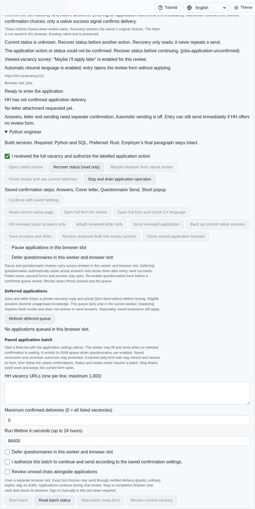
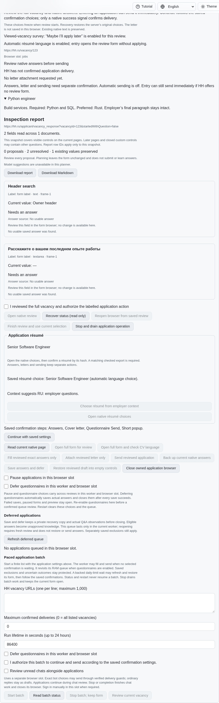
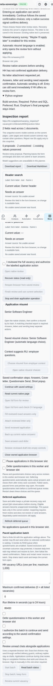

# Application context regressions in CI

The main workflow for exact source `4089a86011e1944a7f3d5fde36986bb15d036480`
reported seven portable application failures across Node, Bun and Deno on Linux,
Windows and macOS. All seven reproduce on published
`939a205bfd0f26d7dfa418773784139db08289f0` with the three affected test files
(22 pass, seven fail). The next hosted run reports the same failures on that
published source. Its other four workflows pass. Hosted validation of this
repair is still required.

The preserved [Windows shard log](https://github.com/link-foundation/meta-sovereign/actions/runs/44016045317/job/133816139085)
shows the test-preview cache write on lines 3699–3738. The
[Windows hold test](https://github.com/link-foundation/meta-sovereign/actions/runs/44016045317/job/133816139044)
fails on lines 4069–4081 because popup recovery calls `applicationResumeUrl`
with a vacancy URL. The
[macOS mode tests](https://github.com/link-foundation/meta-sovereign/actions/runs/44016045317/job/133816139949)
fail on lines 1820–1909 because their private-record whitelist predates the
canonical public vacancy cache.

Salary admission introduced the public full-vacancy snapshot and direct-form
context recovery. Three boundaries needed correction:

- A test preview may read native vacancy content for planning, but must neither
  create nor refresh its public cache. Keep that content in the application
  record for this preview. Existing saved public bytes remain unchanged.
- An application popup remains on the full vacancy page. Read that page in
  place before planning. Validate the vacancy identity before caching, and
  preserve the actual owner answer without navigating, filling or sending.
- An empty native salary means the employer did not advertise pay. `null`
  means the native content could not be read reliably. The cache's `|| null`
  conversion erased that distinction, preventing language inference even when
  the full vacancy and employer questions were readable. Preserve the empty
  string and keep unreadable content out of the public cache.

The mode tests validate the entire allowed canonical vacancy record and
continue to reject persisted worker-only mode fields on every record. No
arbitrary public data or owner questionnaire answers are allowed by that
assertion. Existing application diagnostics gain an `application-vacancy-context`
event with booleans for popup, preview and salary readability. Tracing remains
off by default (`MS_JOBS_APPLICATION_DEBUG=1` enables it), without logging owner
answers.

Six new focused regressions fail against the exact parent review module and
pass after the correction. All 73 focused context, mode, hold, application,
salary and language checks pass with one worker. The two native Chromium
scenarios that failed in CI now pass: automatic language selection and
contextual résumé selection, including full-form navigation, actual owner
answers, unsafe-target refusals, four locales and zero sends. Their existing
mandatory CI registration is unchanged. The existing popup/re-entry scenario
also passes, retaining a fresh explicit entry and a separate synthetic Send
confirmation. The new initially open popup boundary is reproduced by the
portable service fixture; that native scenario verifies existing popup recovery.

An independent Playwright MCP run against the exact parent review module
reproduces HTTP 400 `jobs-application-resume-context` when entering with automatic
language selection. The corrected server returns HTTP 200 and shows the
automatic choice. Send remains disabled pending a fresh confirmation. The choice
survives reloads in all four actually selected locales, and the 390-pixel phone
view has no horizontal overflow. Both owned fixtures close and report no page
exceptions. This fixture records native clicks rather than a dedicated send
counter; zero sends are asserted by the two native scenarios above.

The MCP harness initially reset its saved intent and locale on every reload;
that diagnostic failure is preserved. Initialization now runs only once per
origin, allowing the real saved-state recovery to be checked. Earlier failed
draft checks remain in the archive alongside the final passing receipts.

Before, automatic selection fails and the receipt requires recovery:

After, the automatic choice is retained and sending still requires confirmation:

All fifteen failed and four cancelled jobs from `44016045317` are preserved.
The Chromium failures are in job `133816138707`, lines 2921–2933 (automatic
language), and job `133816138791`, lines 1480–1497 (Russian résumé context).
Pipeline job `133826589448`, lines 371–374, aggregates the portable and browser
failures. The WebKit logs end with cancellation at approximately 04:49:58 UTC;
they provide no assertion failure. Per-job concurrency cancels superseded work,
but these logs alone do not establish who initiated cancellation. Completed
WebKit results on the repaired source remain required. Thirteen already-failed
jobs from the subsequent `939a205b` run are also preserved, including the same
seven portable failures and automatic-language timeout. The CLI refused the
whole-workflow log request because it needed too many API requests, so the
individual job logs were downloaded instead.

The [hashed evidence archive](data/ci-application-context.tar.gz) retains actual
job logs, exact parent bytes, reproducible scripts, final focused results,
native and MCP receipts, source changes and screenshot hashes. This correction
accepts no wider issue #56 criterion. All forty unchecked requirements remain
required, and [PR57](https://github.com/link-foundation/meta-sovereign/pull/57)
stays draft and unmerged.
