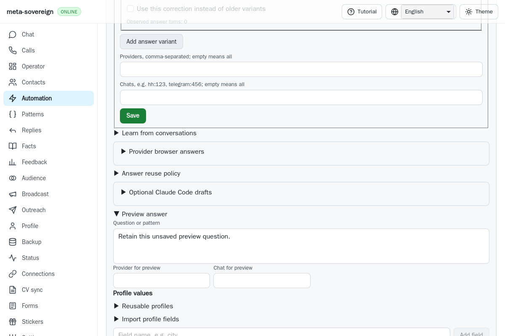

# Preserve browser checks within their existing CI deadlines

Issue [56](https://github.com/link-foundation/meta-sovereign/issues/56), [PR 57](https://github.com/link-foundation/meta-sovereign/pull/57). This corrects two independently reproduced CI defects. Exact-head hosted confirmation, the separate macOS Node cancellation and every unchecked product criterion remain required.

## Evidence and causes

The [Checks run 43078283106](https://github.com/link-foundation/meta-sovereign/actions/runs/43078283106), created on 2026-11-11 at 18:29:39 UTC for `c446791d`, finishes cancelled. Its [WebKit job](https://github.com/link-foundation/meta-sovereign/actions/runs/43078283106/job/130725304728) contains two distinct failures in the preserved raw log:

- Lines 2497–2508: `disclosure-reuse` fails with `Execution context was destroyed, most likely because of a navigation`. The fixture calls `page.goto()` on the identical full URL, then asserts that the old document still exists. WebKit reloads it. The local actual-parent fixture reproduces this error.
- Line 2940: the job reaches its unchanged 35-minute deadline during `telegram-group-greetings`, before completing the registered checks. Individual question history and text checks already passed. The cause is the accumulated work in one serial job, separate from the disclosure assertion.

The following UI-head run, [43083805944](https://github.com/link-foundation/meta-sovereign/actions/runs/43083805944), targets `41fd7342`. Its WebKit job repeats the same disclosure failure at preserved lines 2520–2529; the later superseded job cancellation does not establish a second deadline failure. Its macOS Node shard 3/3 starts at 19:22:56 UTC, begins tests at 19:25:34 and records cancellation at 19:33:07. Preserved macOS log line 1992 reports cancellation after the ten-minute job deadline; the last printed tests finish around 19:27:31. This separate stall is not explained by the browser fixes and still needs investigation.

## Corrections

The disclosure fixture now follows the existing fragment through the page's native location assignment. It still asserts original document identity, retained unsaved question, idempotent opening and reopening a closed child without closing its parent. Full reloads have no draft-retention guarantee; the test no longer assumes Playwright's `goto()` behavior is identical across engines.

Both mandatory browser engines now run four disjoint shards. The runner validates the complete nonempty registry, refuses duplicates and malformed or empty shard assignments, preserves registration order within each shard and records the shard and total registration count in its summary. Each of the 95 checks belongs to exactly one shard per engine, in groups of 24, 24, 24 and 23. Every shard remains a required member of the existing terminal release gate, with independent diagnostic artifacts. A failing selected check still fails its shard. Unsharded local commands retain all checks.

The new inactive-history scenarios also receive their own mandatory group. Their focused native observation took about 68 seconds; the previously hosted history group took about 112 seconds. Combining them would leave no room within the existing 180-second subprocess budget. Neither the 180-second subprocess deadline nor the 35-minute job deadline increases, and no scenarios are removed.

## Focused verification

- The actual preceding runner executes all four fixture checks despite being assigned only one; the new integration regression fails against that source and passes with partitioning.
- Twenty-one focused Node checks pass, including complete real-registry coverage for both engine matrices, malformed/duplicate refusal, four actual runner shards, failed-shard propagation and existing CI contracts.
- Three focused production WebKit disclosure checks reproduce the old destroyed document and pass after native fragment navigation. The same three checks retain Chromium behavior.
- Workflow policy, formatting, lint, syntax, secrets and duplication checks remain part of verification. Full runtime suites and the complete browser matrix run on hosted CI.

```sh
PYTHONDONTWRITEBYTECODE=1 python3 experiments/issue-56/ci-browser-shards-before.py
node --test --test-concurrency=1 js/tests/ci-browser-shards.test.js js/tests/ci-contracts.test.js
node js/scripts/check-ci-workflows.mjs
RUN_BROWSER_E2E=1 E2E_BROWSER=webkit QUESTION_DISCLOSURE_PREVIEW_ONLY=1 node experiments/issue-56/question-disclosure-probe.mjs
```

The [verified evidence archive](data/ci-browser-shards.tar.gz) retains source snapshots, actual-parent failures, raw hosted logs, focused results and screenshot hashes. Browser fixtures use an isolated server and synthetic accounts. All browser processes close after verification.

## Native WebKit comparison

The failure screenshot is the blank replacement document at the moment the old execution context is destroyed. It records the test's reload, rather than a claimed product rendering defect. The corrected fixture retains the original unsaved preview question.



