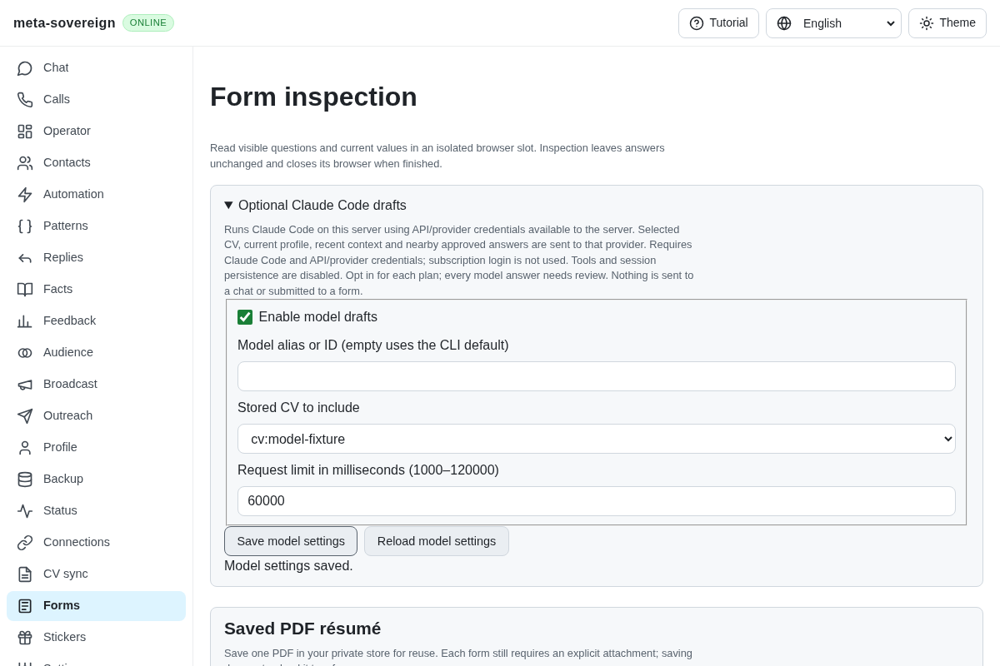
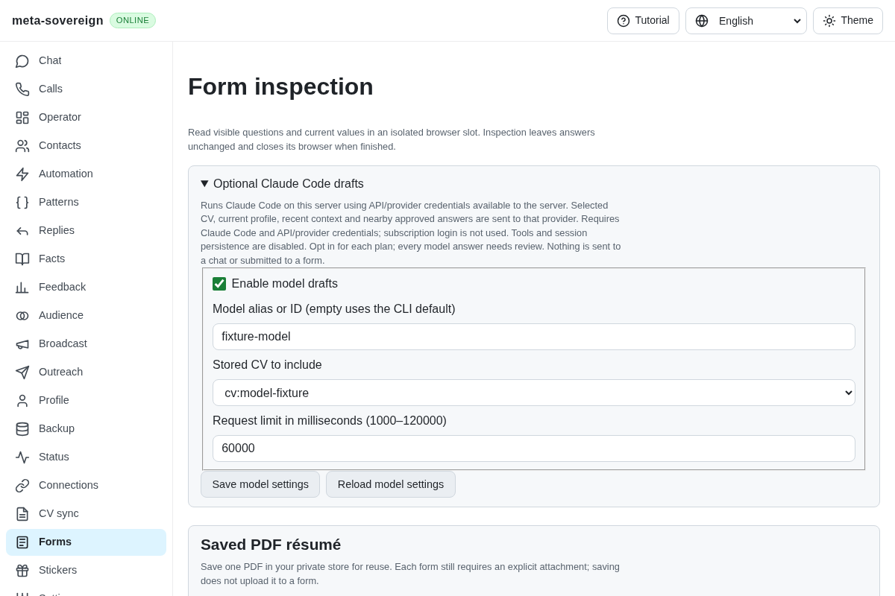

# CI investigation: context matching, model reload and backup cleanup

[PR 57](https://github.com/link-foundation/meta-sovereign/pull/57) preserves the failures from [Checks run 42934557578](https://github.com/link-foundation/meta-sovereign/actions/runs/42934557578), created 2026-11-11 00:51:02 UTC for exact head `c39127200aaa7822d3fdbc7a34f993f0df205c05`. The timestamps and SHA distinguish these failures from earlier runs. The four companion workflows passed. WebKit job `130242297357` subsequently passed at 01:26:08 UTC; the complete Checks workflow finished with failure because of the completed jobs below. Full workflow logs are also preserved. The final Pipeline status job `130255789109` correctly fails for its runtime/browser dependencies (lines 282–285); its log is preserved too.

Full completed job logs were downloaded through the authenticated job-log API. `gh run view --log` was unavailable while the whole workflow remained active. The preserved raw logs retain original line numbers.

## Existing context templates

Nine runtime jobs fail two existing `question-context.test.js` cases. The expected `$6000 in USD` becomes an empty answer, and the gross-context evidence becomes an empty list. Bun/Ubuntu job `130242297066` reports these at lines 3833–3897; Node/Ubuntu `130242297246` at 5726–5768; Deno/macOS `130242297191` at 9508–9534. Node/macOS shard 1 passes because these cases run in shard 2 (`130242297645`, lines 3764–3806). The failures are also preserved for Deno/Ubuntu, Node/Windows, Deno/Windows and Bun/macOS/Windows.

The earlier subject guard compared the generic salary template against the explicit USD/RUB/USDT question before configured context variables were expanded. The fix only abstracts configured choice keywords when every rule answer references a field supplied by that context group. Explicit pattern subjects and hardcoded/mixed answer sets keep the guard. A new regression verifies that no configuration, hardcoded pay and an explicit wrong currency still refuse, while the configured variable template resolves. All 45 focused question checks pass in Node and Deno, including the original context cases and technology subject guards. See [question-matching-options.md](question-matching-options.md).

## Model settings reload

Chromium job `130242296460` records the exact race at lines 2613–2618: `model-load` starts, `model-input` records length 13, then `model-loaded` supplies length zero and `model-save`/`model-saved` both record zero. The explicit CV/model assertion fails. The failed screenshot was extracted from that job's browser artifact and verified as a PNG before viewing.

Reload previously set `loading` in a passive effect. A fill could begin after the reload click but before that effect disabled the field; the subsequent response replaced the edit. The reload handler now closes the editing/saving gate synchronously. The regression holds the GET response open and asserts that both controls remain disabled, then releases it, saves a nonempty model and verifies persistence after a page reload. Existing invalid-alias, stale-save edit preservation, reviewed draft readback and zero-submission assertions remain.

Focused production Chromium passes `FORMS_MODEL_ONLY=1`, including one model request, one actual field write, clarification, preserved stale/owner edits and browser close. Independent Playwright MCP separately holds the reload response, sees both controls disabled, saves `mcp-reviewed-model` with HTTP 200 and reads the same value after reload. It launches no owned form browser and makes no model request.





## Failed backup cleanup

Bun/macOS job `130242297827` has one additional failure at lines 6487–6509: `a failed write leaves no archive and no temp file` finds `meta-sovereign-2026-11-11_01-07-18-650.msbk.1807.tmp` instead of an empty directory. The source's `disk gone` failure can reject the pipeline while the write stream's asynchronous open is pending. Cleanup can unlink before that open creates the file.

The durable streaming writer now awaits the sink opening before consuming the source, and awaits its close before either success processing or failure unlinking. The existing regression exercises the exact failed-source path; a normal plain-backup round trip also passes. Focused Node reports two passing checks and Bun reports the failed-write check passing. Private file modes, fsync and atomic rename remain in place.

```sh
NODE_OPTIONS=--max-old-space-size=384 node --test --test-concurrency=1 --test-name-pattern='plain backup round-trips|failed write leaves' js/tests/backup-stream.test.js
bun test --test-name-pattern='a failed write leaves no archive' js/tests/backup-stream.test.js
RUN_BROWSER_E2E=1 E2E_EXECUTABLE_PATH=/opt/google/chrome/chrome FORMS_MODEL_ONLY=1 NODE_OPTIONS=--max-old-space-size=384 node js/tests/e2e-forms-reader-browser.mjs
```

The [archive](data/ci-c3912720.tar.gz) and [manifest](data/ci-c3912720.tar.sha256.json) preserve full failed job logs, run metadata, focused regressions, before/after source snapshots, MCP evidence and screenshot hashes. [collect-ci-c3912720.py](../../../experiments/issue-56/collect-ci-c3912720.py) verifies collection markers. Complete matrices run on hosted CI after pushing; local checks stay focused. Older valid-refusal editing and Contacts-navigation failures are not explained by these fixes. All unchecked issue requirements remain open; PR 57 stays draft and unmerged.
