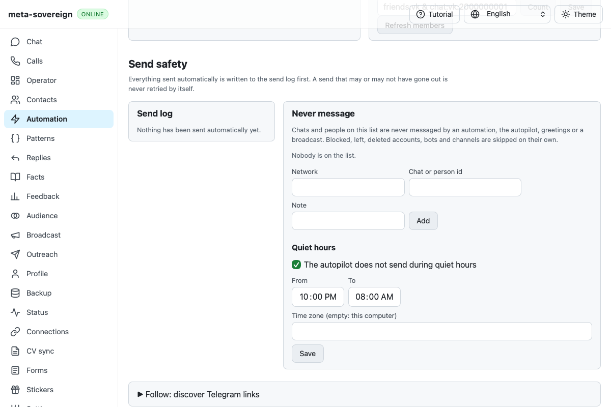

# WebKit keyboard and Follow disclosure investigation

Issue [56](https://github.com/link-foundation/meta-sovereign/issues/56),
[PR57](https://github.com/link-foundation/meta-sovereign/pull/57) remains draft.
The macOS keyboard correction needs hosted confirmation. The Follow disclosure
root cause remains unproven; its new diagnostics preserve the original interaction.

## Preserved exact failure

Checks [43177885613](https://github.com/link-foundation/meta-sovereign/actions/runs/43177885613)
ran `8c4bfc6c468e5578c5a248ee8f0c4e0cedcb0707`, created
2026-11-12T07:47:40Z and completed 2026-11-12T08:19:40Z. Only WebKit shard 2,
job `131048574094`, failed. The other browser/runtime jobs and Links, Pages,
Security and Desktop workflows passed. Its raw job log has 1,534 lines:

- Lines 1354–1390: the first three vacancy-technology scenarios pass; phone
  keyboard traversal fails `e2e-vacancy-technologies.mjs:103` because the Analyze
  button is not `document.activeElement` after Tab. This is not a width failure.
- Lines 1444–1464: Follow's first retry-attempt fill reaches the correct input,
  but the input remains invisible for the unchanged ten-second deadline after
  the original summary click. Other Follow tests continue passing.

The hosted screenshot confirms the closed disclosure state, not why it closed:

The full workflow log, raw job log, exact SHA/timestamps, artifact metadata,
browser summary and original PNG are preserved in the
[bilingual review archive](data/cv-technologies.tar.gz).

## Keyboard fixture correction

The failed job runs macOS WebKit. Apple's
[current Safari guide](https://support.apple.com/en-lamr/guide/safari/cpsh003/mac)
and [earlier shortcut guide](https://help.apple.com/safari/mac/8.0/en.lproj/cpsh003.html)
document platform-dependent Tab traversal and Option-Tab including clickable
items. The current direct page fetch returned HTTP 429; official search results
and the earlier guide retain the descriptions. Applying that documented behavior
to the hosted failure is an inference pending the next exact-head result.

Both technology fixtures now use Option-Tab only on macOS WebKit and Tab
elsewhere. They still require the actual next button to be enabled and to own
native focus. No DOM focus, tabindex, product code or keyboard preference is
changed. `CI_CV_KEYBOARD_DEBUG=1` records engine, shortcut, focus/disabled booleans
and active tag, excluding field values. All four existing analysis and four new
review scenarios pass in local Linux WebKit, with zero provider reads. This
does not establish the macOS result.

## Follow recurrence diagnostics

The unchanged Follow browser workflow passes locally. Its diagnostic replay
records one document, a closed root receiving trusted pointerdown/pointerup/click,
then an open toggle and visible retry fields. This cannot reproduce or explain
the hosted failure. No extra click, forced open state, navigation change, retry
or increased deadline has been added.

`CI_FOLLOW_DISCLOSURE_DEBUG=1` enables at most forty native disclosure events per
document and snapshots before/after navigation, after the summary click and on
the first field failure. Metadata includes document time origin/readiness,
expected fragment, connected/open state, summary rectangle/hit result and weak
node identities. It excludes titles, owner content and URL/query values. A
failure to collect a snapshot does not replace the original error. The flag is
off normally and enabled in hosted browser CI to distinguish changed documents,
wrong click targets and replaced roots on recurrence.

The focused three workflow contracts, strict scoped lint/format/secrets and the
unchanged duplication gate pass. All local fixture servers/browsers close.
Require exact-head CI before accepting the keyboard correction, and recurrence
evidence before claiming a Follow cause or fix. Every unchecked product criterion
remains required. This diagnostic unit does not complete either hosted criterion.

The [diagnostic evidence archive](data/ci-cv-keyboard.tar.gz) and [file digest index](data/ci-cv-keyboard.tar.sha256.json) retain the new source/parent snapshots, passing local replays, official reference metadata and screenshots.
