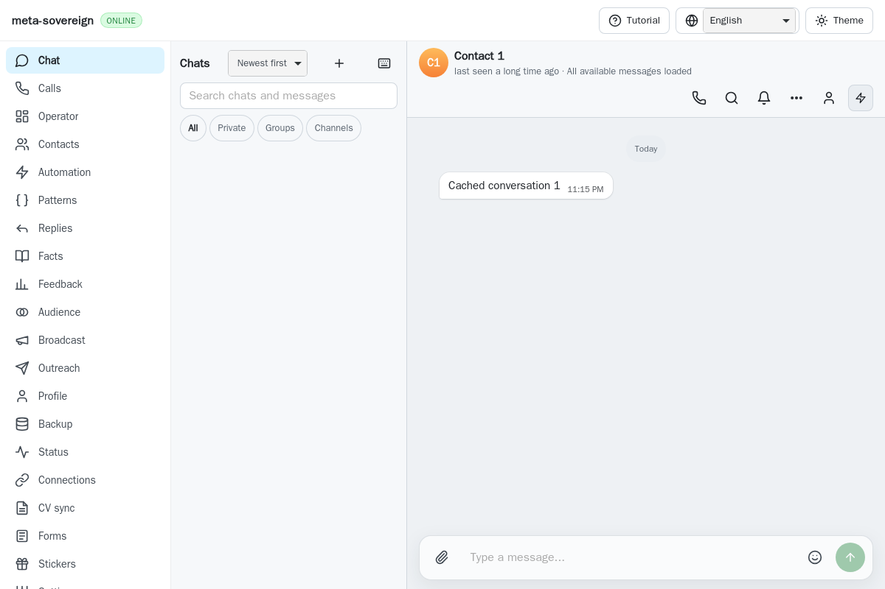
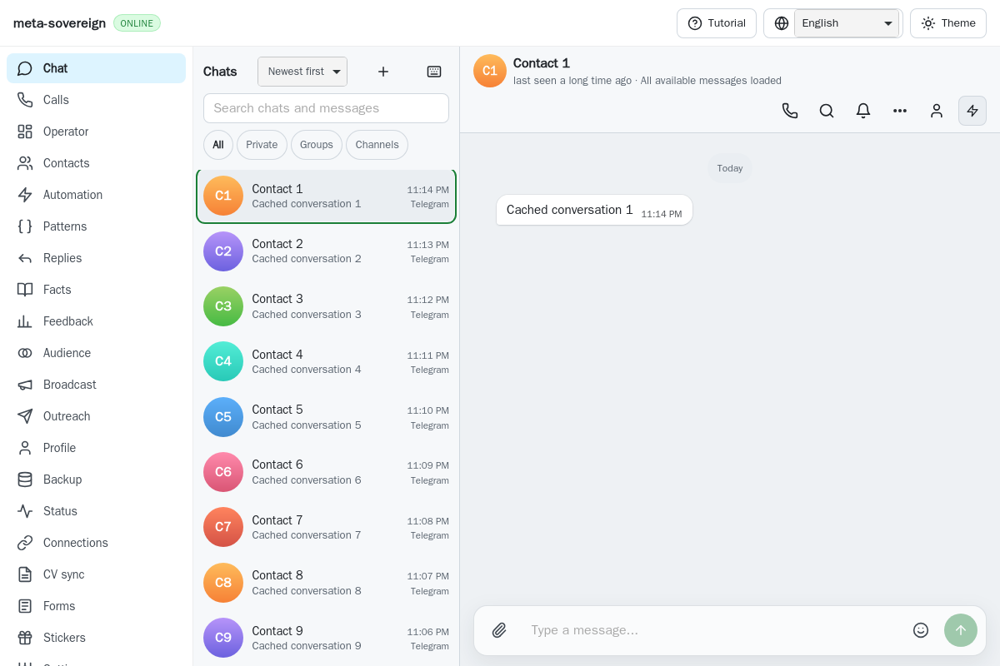
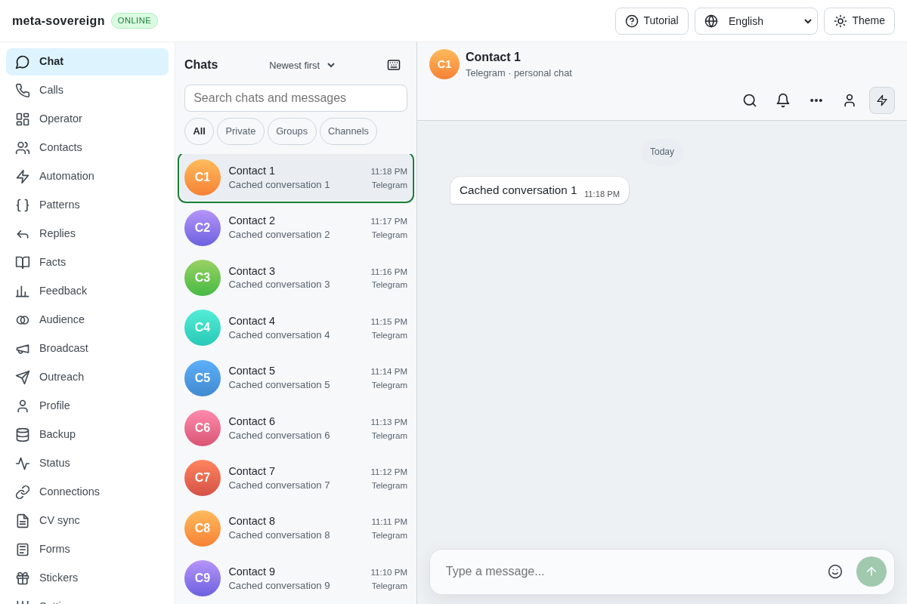

# Keyboard focus across virtual directory ranges

[PR #57](https://github.com/link-foundation/meta-sovereign/pull/57) remains
draft and unfinished. Published `222f2e80`'s
[WebKit shard 1](https://github.com/link-foundation/meta-sovereign/actions/runs/43519959078/job/132215554368)
fails `chat-responsiveness`: Home cannot focus chat 1 from chat 150.
The complete 1,299-line job log retains the assertion at line 811 and
the failed-check summary at line 1226. The downloaded artifact and inspected
PNG show focus remaining on chat 150. An unchanged local WebKit invocation
passes, so that observation alone does not establish the hosted cause.

The directory coalesces scroll measurements through an animation frame.
Keyboard reveal previously set scrollTop and requested focus while the target
row was still unmounted. A finite regression holds at most 32 requested
frames, then restores and releases them in finally. Exact published parent
`1ea671cf39f59b6652f844ba6293d48316faab1d` fails Home within the existing
ten-second assertion deadline. Count-only diagnostics show the requested
index is 0 and scrollTop is 0, but the mounted range is still 133–150.
Releasing the frame mounts the target and completes focus. This demonstrates
a real dependency; the original hosted timeout's scheduling trigger remains
unproven.

Keyboard reveal now reads the resulting viewport immediately, allowing React
to mount the target in the same update as focus. Passive scrolling retains its
coalesced frame, row measurement and bounded rendering. Optional
`metaSovereignDebug` console diagnostics record key/index/range/scroll numbers
and target presence, without chat contents. They are off by default.

The existing mandatory browser check now verifies Home, End and both arrow
directions while frames remain held, retaining fewer than 60 mounted rows and
all its original phone/prefetch, held-send, metadata, search, sort and scale
assertions. No assertion, test or job deadline increases. The finite 150-row
seed is shared with a separate local MCP fixture; it never uses a running
application or a real provider.

Reproduce and verify with:

```sh
python3 -B experiments/issue-56/directory-parent-probe.py
RUN_BROWSER_E2E=1 E2E_BROWSER=webkit CI_BROWSER_DEBUG=1 node --max-old-space-size=384 js/tests/e2e-chat-responsiveness-browser.mjs
node --max-old-space-size=384 --test --test-concurrency=1 --test-timeout=20000 js/tests/chat-directory-work.test.js js/tests/chat-list.test.js js/tests/ci-browser-shards.test.js
```

The parent probe restores production source and bundle even after failure.
All 18 focused Node checks and the final native WebKit check pass. Independent
MCP verifies four native keyboard moves with 18 mounted rows, unchanged chat
selection, subsequent click selection, no page errors and no console errors.
Its owned context, browser and temporary server are closed. The first MCP
attempt also passed its assertions, but its unmocked launch page emitted
console errors; the retained raw result is not a clean-console claim. The
final fixture starts from a blank launch page and checks its own console.

Controlled parent, while its viewport frame is held:



Corrected native WebKit, with viewport frames still held:



Independent MCP result:



The [archive](data/ci-directory-focus.tar.gz) and
[manifest](data/ci-directory-focus.tar.sha256.json) retain the full failed
hosted log, job/annotation metadata, downloaded artifact, before/after sources,
finite regression, diagnostics, focused checks and screenshot hashes.
Exact corrected-head hosted confirmation remains required.

Separately, macOS Node shard 3 job `132215553504` was cancelled during
checkout. No install or test step began. Its annotation says the job exceeded
the existing ten-minute deadline; its log endpoint returns BlobNotFound.
The underlying checkout delay remains unexplained. This is not a test
assertion failure and this keyboard correction does not fix that delay.
The same run's WebKit shard 3 was also still in checkout when GitHub cancelled
it for a newer higher-priority request. Its annotation explicitly identifies
supersession; it is not evidence of a browser assertion or deadline failure.

Every unchecked original acceptance criterion remains required, including
application execution, questionnaire policies and complete provider/platform
parity. Passing this regression does not complete issue #56.
