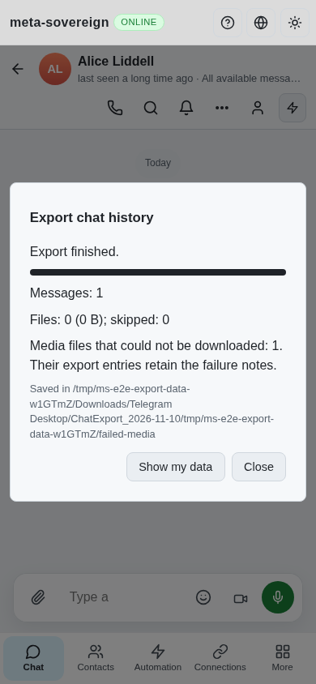
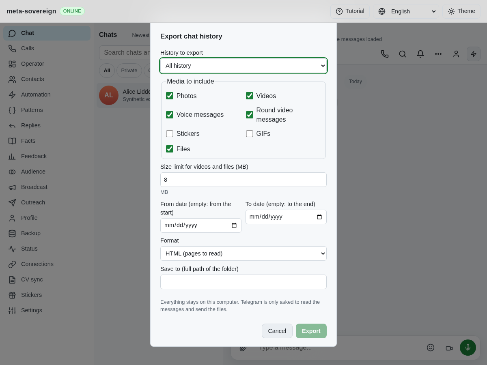
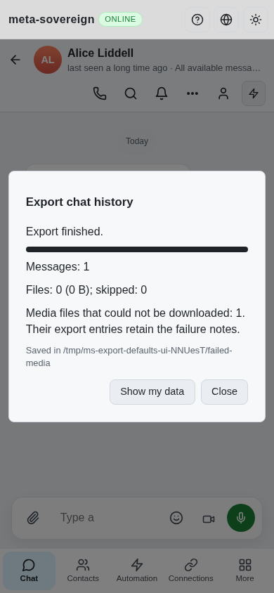

# Export destination waits for initial defaults

Work for [issue 56](https://github.com/link-foundation/meta-sovereign/issues/56)
in [PR 57](https://github.com/link-foundation/meta-sovereign/pull/57).

## Reproduction and cause

[Checks 42793097947](https://github.com/link-foundation/meta-sovereign/actions/runs/42793097947)
was created at 2026-11-10 09:43:32 UTC for
`dfa1f68d8b0888ba4468fd6e3fc354bcff216bf6`. Its completed Chromium job
129752506431 fails with `ENOENT` reading the requested
`failed-media/history-1.json` at job-log line 2317; lines 2401–2402 report the
failed browser check. The original job log and downloaded artifact are retained
locally; a numbered excerpt is archived here.

The artifact's screenshot shows that the export finished, with its output saved
under the default directory followed by the requested absolute path. Opening
the dialog starts an asynchronous defaults/status request while leaving the
empty destination editable. A defaults response can update that controlled
input between the browser selecting its contents and inserting the requested
path. Checking whether the current value is empty does not prevent that race.

The regression deliberately holds the defaults response after reopening the
dialog and asserts that the destination cannot yet be edited. It fails before
the fix. The field now waits for the initial request to settle, using the same
readiness state that already controls Export. A failed initial request still
releases the field for manual entry. Other export options remain available.

## Verification

The production Chromium flow passes after the change. Besides checking the
loading state, it verifies the exact server-side destination and reads the real
structured export there, including its truthful failed-media note. The existing
cancel, completed HTML/JSON, active-conversation Markdown, folder validation and
mobile layout checks also pass in that single focused flow. Thirty-two selected
export tests pass serially with a 384 MiB heap cap.

```sh
npm run build:web
RUN_BROWSER_E2E=1 E2E_EXECUTABLE_PATH=/usr/bin/google-chrome E2E_ARTIFACT_DIR=ci-logs node js/tests/e2e-export-browser.mjs
NODE_OPTIONS=--max-old-space-size=384 node --test --test-concurrency=1 js/tests/telegram-export.test.js js/tests/telegram-export-window.test.js
```

An isolated Playwright MCP fixture also verifies the held response, disabled
destination/Export, subsequent editing and actual output in the requested
folder. At 390 CSS pixels the completed receipt fits without horizontal overflow
and displays one failed download. This limited fixture stubs account/history
reads; unrelated unsupported-account console errors are not a clean-browser
claim. The focused production Chromium flow checks its page errors separately.
Both browsers and fixture servers were closed after validation.

Before, from the CI artifact:



After, while defaults are held:



After, exported to the requested directory:



Scoped strict lint, formatting, secret scanning and whitespace checks pass.
[Archived evidence](data/ci-export-defaults.tar.gz) and its
[manifest](data/ci-export-defaults.tar.sha256.json) preserve the failing assertion,
CI excerpt, focused checks, browser verification and source hashes. The exact
new-head CI matrix remains required; this fix does not complete the other open
PLAN.md requirements. PR 57 stays draft and unmerged.
