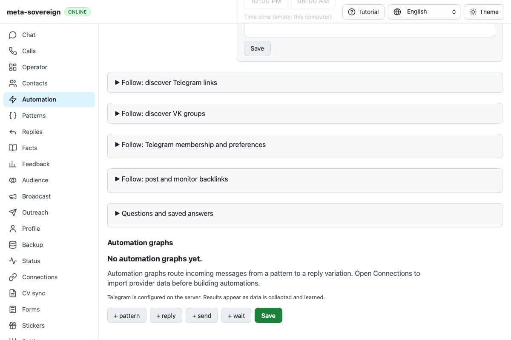

# Follow Backlinks disclosure recurrence

Exact parent `15f9c3e898805c91ca6f54a142fb279f89d598e2` Checks
[43183721390](https://github.com/link-foundation/meta-sovereign/actions/runs/43183721390),
created `2026-11-12T08:32:01Z`, failed WebKit shard 2, job `131069572747`.
Raw job lines 1521–1540 show `locator.fill: Timeout 30000ms exceeded` on the
first Backlinks chats input. The downloaded screenshot shows its disclosure
closed. This does not prove which native event or document transition caused it.
All raw failed-job logs and the full workflow are in the
[Save-watch evidence archive](data/cv-save-watch.tar.gz).

The earlier trace observed only `[data-follow-chats-panel]`. Backlinks uses
`[data-follow-backlinks]` and opens twice: initially and after the preview
cancellation/unmount workflow. Both original native clicks now have snapshots
before and after, plus a failure snapshot. No clicks, forced open states,
assertions, navigation or deadlines change.

`CI_FOLLOW_DISCLOSURE_DEBUG=1` now selects either supported panel and retains
at most 64 events per document. Trusted pointer targets, coordinates, capture
and bubble click phases, default-prevention state, native toggles, readiness,
document time origin, connected/open state, summary rectangle/hit result and
weak node identities distinguish missed clicks from replaced roots. It records
no titles, field values, owner text or URL/query values. The flag stays off
normally; hosted browser CI already enables it. Diagnostic collection errors
preserve the original test failure.

One focused Linux WebKit Backlinks replay passes. Its trace shows trusted
summary pointerdown/up/click, an open toggle and stable root identity at each
opener. The second opener has a new root after the expected route unmount.
The complete chat workflow also passes with the shared trace. Both fixtures
close their own browsers and servers. These local results do not establish a
hosted fix or explain the collapsed hosted root.

Reproduce with `RUN_BROWSER_E2E=1 E2E_BROWSER=webkit
CI_FOLLOW_DISCLOSURE_DEBUG=1 node js/tests/e2e-follow-backlinks-browser.mjs`.
The [checksummed trace archive](data/ci-follow-backlinks.tar.gz) preserves the
source, passing native event logs and exact-parent failure metadata.

The macOS keyboard correction is separately confirmed at raw job line 1393
with enabled/focused true. Nine runtime jobs fail an older capability assertion;
the Save-watch commit corrects it and passes focused local compatibility.
`b3f25848` started its own five workflows at `2026-11-12T09:30:15Z`; completed
exact-head results and Follow recurrence evidence remain required. All unchecked
issue criteria remain unfinished in [PR57](https://github.com/link-foundation/meta-sovereign/pull/57).
