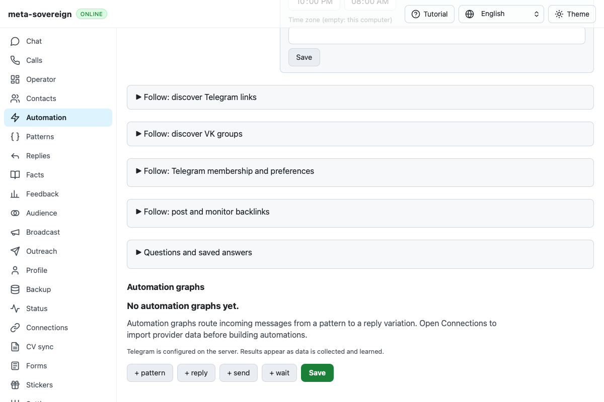
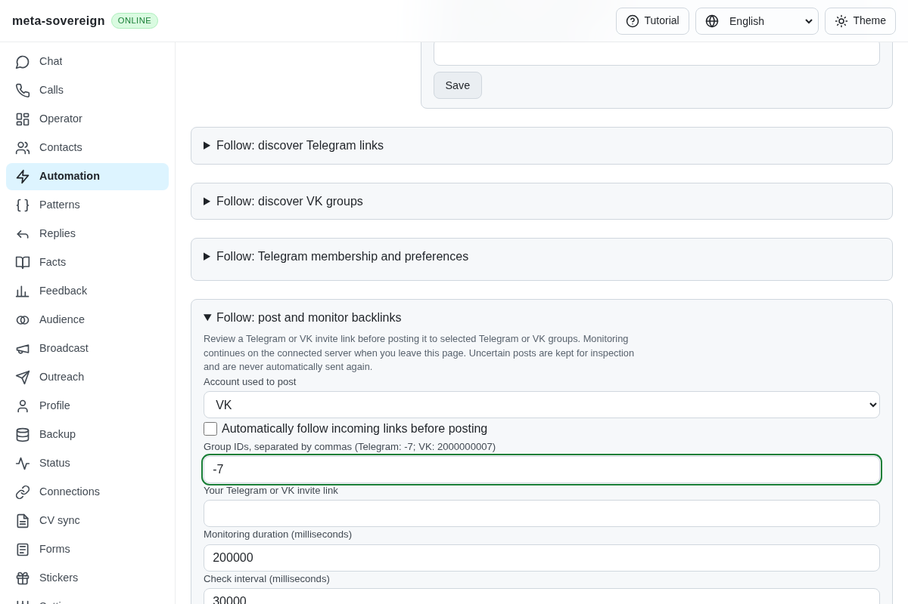

# Native Follow activation after a missed pointer

Exact `bea3183e` Checks
[43793268260](https://github.com/link-foundation/meta-sovereign/actions/runs/43793268260),
created `2026-11-16T02:37:08Z`, fails WebKit shard 3 job `133057652801`.
Preserved job lines 1295–1297 record the Telegram Backlinks summary closed after
its pointer action. Pointer-down and click target HTML outside the summary;
pointer-up targets the summary. The summary rectangle moves by 21 pixels during
that sequence. Lines 1298–1315 show the resulting hidden source-select timeout.
The downloaded artifact was verified as PNG and inspected before diagnosis.
The trace establishes the missed target; it does not establish which rendering
event caused the layout movement.

The Follow browser fixtures now activate a closed native summary with focused
Enter and verify the resulting open state. Already-open sections retain owner
input. This avoids dependence on a pointer coordinate across layout movement.
No product disclosure behavior, forced open state, retry loop, provider assertion
or existing deadline changes. Chats, Backlinks, automatic Follow and Telegram
Backlinks share the same fixture helper. The default-off 64-event diagnostic now
also records focus and activation-key metadata, excluding other key values.

The finite native regression deliberately moves a summary by the observed 21
pixels between coordinate selection and pointer-down. The click misses and the
source select is hidden. A locator proxy injects that movement into a pointer
opener while leaving actual focus/keyboard methods unchanged. The published
opener statement, wrapped in the probe, fails at the select. Focused Enter passes
and repeated opening preserves an unsaved edit. This reproduces the observed
mechanism, rather than claiming to reproduce the original rendering timing.
The regression now runs in the existing mandatory Telegram Backlinks entry.

```sh
python -B experiments/issue-56/follow-layout-before.py
node --max-old-space-size=384 experiments/issue-56/follow-layout-browser.mjs
RUN_BROWSER_E2E=1 E2E_BROWSER=webkit CI_FOLLOW_DISCLOSURE_DEBUG=1 NODE_OPTIONS=--max-old-space-size=384 node js/tests/e2e-follow-telegram-backlinks-browser.mjs
```

The full production-bundle Telegram scenario passes locally, including one-send
deduplication, confirmed incoming cleanup, unsupported supergroup cleanup refusal,
the separately confirmed subsequent run and mobile width checks. Native traces
show trusted focus, Enter, summary click and open toggle on the same root.
Independent Playwright MCP verifies focused Enter and preserved edits in the
actual production bundle with zero page exceptions or provider writes. Its raw
console also retains a favicon 404 and two browser cache-write diagnostics;
these are not reported as zero-console-error evidence. A first MCP harness
attempt rejected a trailing function semicolon before running the check; both
responses are retained. All owned browsers, server and fixtures close.

Hosted failure and independent corrected interaction:




The finite [before](../../screenshots/issue-56-ci-follow-layout/before.png) and
[after](../../screenshots/issue-56-ci-follow-layout/after.png) isolate the pointer
mechanism. The [evidence archive](data/ci-follow-layout.tar.gz) and
[byte manifest](data/ci-follow-layout.tar.sha256.json) retain full failed-job logs,
source snapshots, receipts and screenshot bytes. All 60 unchecked issue criteria
remain required, and the new head still needs every hosted check in
[PR57](https://github.com/link-foundation/meta-sovereign/pull/57).
