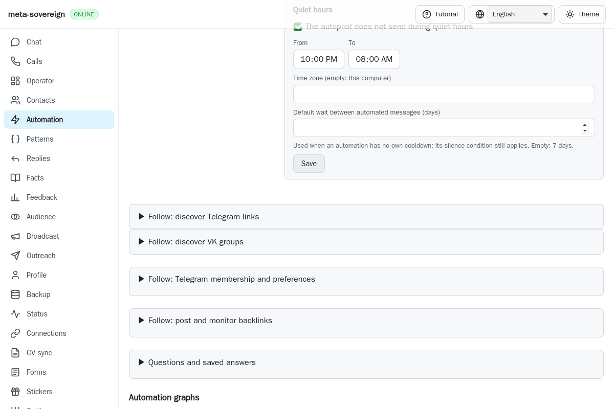
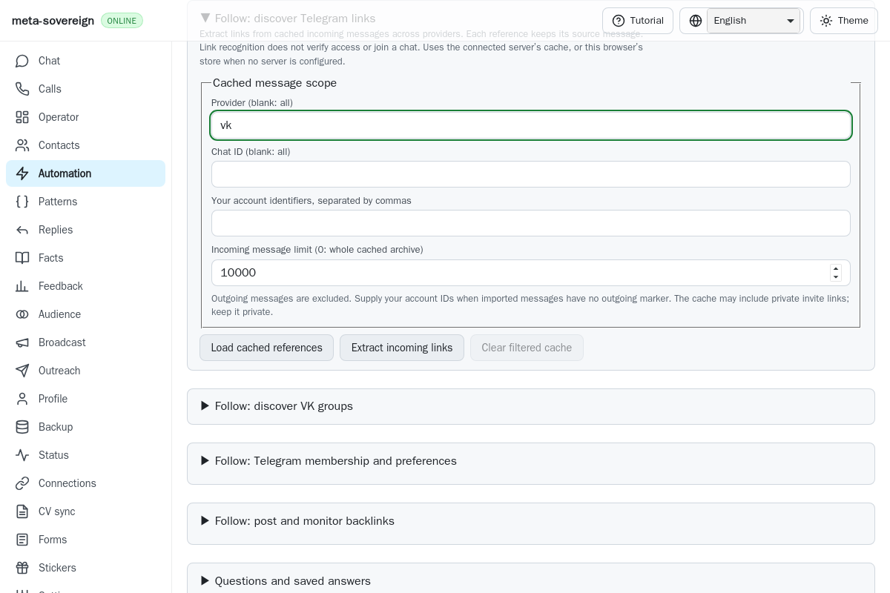

# Follow cached-link disclosure recurrence

Exact commit `997b0dd2e1c7297a6ab4db17e7a4421aa1e38094` failed WebKit shard
2, job 134521683307, in [run 44220122766](https://github.com/link-foundation/meta-sovereign/actions/runs/44220122766).
The complete raw log reports the lost Stories reload at lines 2259–2265 and
Follow's missing visible `4 cached message references` at lines 2661–2671.
The downloaded, image-verified Follow screenshot shows the section closed.
This establishes the hidden-section failure, without proving which historical
native event or document transition closed it.

At the failed commit, both Follow cache openings use direct coordinate clicks. The adjacent
Follow scenarios already use a checked native keyboard opener. A finite
experiment executes the actual caller's extracted opening statement against
one 24-pixel movement between target selection and pointer dispatch. The
parent statement misses and leaves the results hidden. The corrected caller
opens with native focus/Enter, extracts all four references, and retains an
unsaved provider filter when asked to open an already-open section. The
original hosted rendering timeline is not reproduced or claimed.

Both call sites now use the existing `openFollowDisclosure`. All extraction,
reload, failure recovery, filtering, clear/cancel and phone assertions remain.
No deadline is increased, state forced open, or toggle repeated. The existing
default-off `CI_FOLLOW_DISCLOSURE_DEBUG=1` also recognizes this panel and logs
bounded native-event metadata before/after initial opening, extraction and
reload. It excludes owner values and provider text.

The independent lost HTTP/2 reload passes in one focused WebKit replay with
existing request diagnostics, and again after enabling the new scenario-only
`CI_CHAT_LOADING_DEBUG=1` switch. Its historical cause remains unconfirmed.
The switch enables existing redacted failed-request diagnostics only for the
chat-loading fixture in CI. The default remains off. Twelve focused diagnostic
checks pass; navigation failures still fail the unchanged scenario.

```sh
RUN_BROWSER_E2E=1 E2E_BROWSER=webkit node experiments/issue-56/follow-links-opening.mjs
RUN_BROWSER_E2E=1 E2E_BROWSER=webkit CI_FOLLOW_DISCLOSURE_DEBUG=1 node js/tests/e2e-follow-links-browser.mjs
RUN_BROWSER_E2E=1 E2E_BROWSER=webkit CI_CHAT_LOADING_DEBUG=1 node js/tests/e2e-chat-loading-browser.mjs
node --test --test-concurrency=1 js/tests/e2e-page-errors.test.js
```

For the parent experiment, restore only the caller from `997b0dd2`, run the
first command with `--before`, and restore the current file in a `finally`
block. The expected hidden-results probe has a one-second deadline. Every
fixture owns and closes its separate browser/server. No provider is contacted.
No full suite or browser matrix runs locally. The exact-source failed-job
rerun is separate hosted evidence and cannot validate these unpublished edits.

| Parent's finite pointer miss | Corrected native opening |
| --- | --- |
|  |  |

The [checked archive](data/ci-follow-links-opening.tar.gz) retains the complete
hosted log, original hosted failure screenshots, parent/current caller bytes,
finite experiment, focused/native logs and reviewed screenshots. All 35 entries
were independently rehashed against the manifest after archive generation.
[PR57](https://github.com/link-foundation/meta-sovereign/pull/57) remains draft
and unmerged with every unfinished requirement still in scope.
