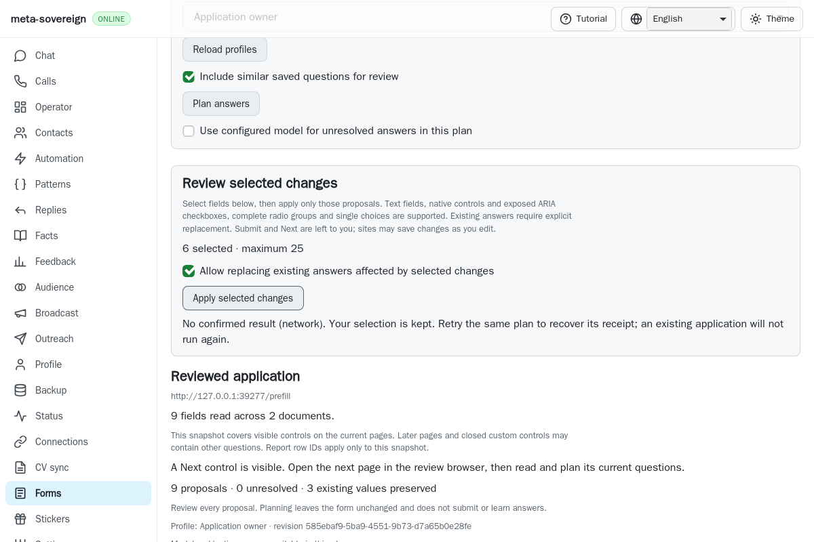
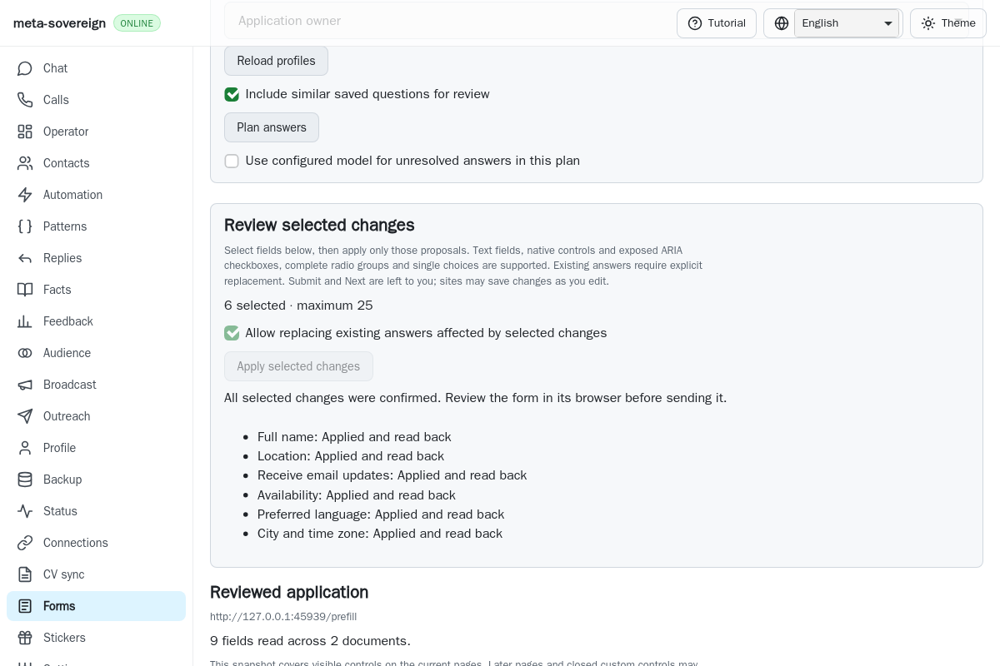
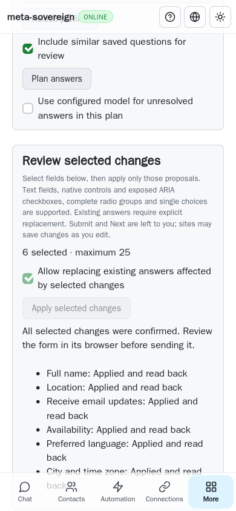
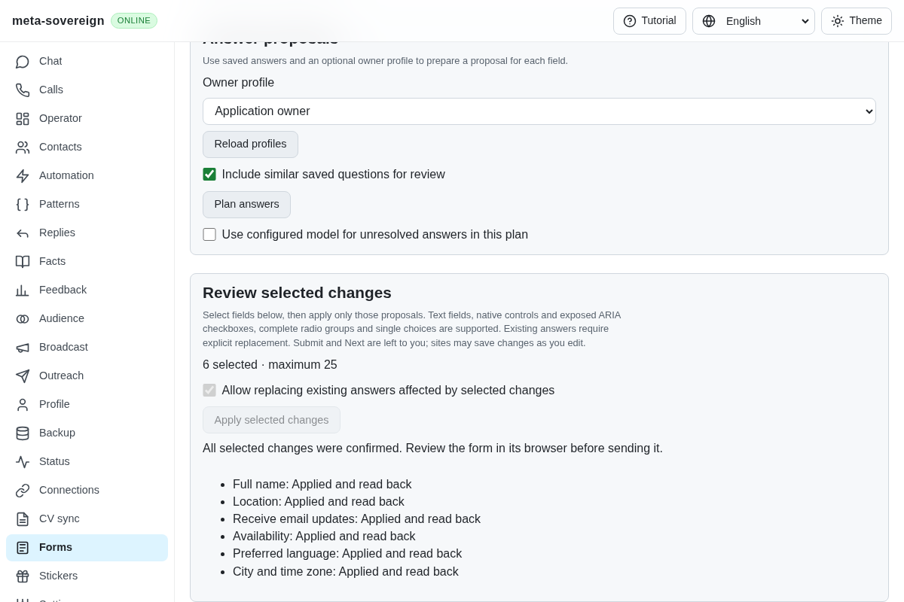
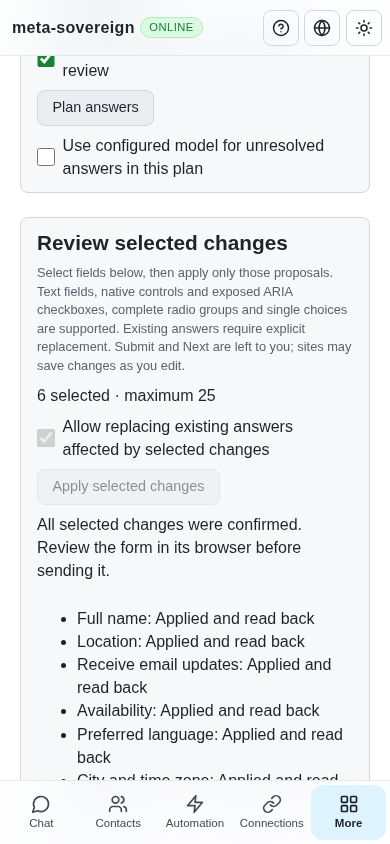

# Stable document identity for reviewed forms

[PR 57](https://github.com/link-foundation/meta-sovereign/pull/57) replaces browser-clock identity with a stable document token while preserving refusal after real navigation and control replacement.

The WebKit job `130147210202` in [run 42904657245](https://github.com/link-foundation/meta-sovereign/actions/runs/42904657245), for capacity commit `60eb49c5`, fails at complete job-log line 2299 in the lost-response prefilling check. Lines 2295–2298 show unchanged URLs but document times differing by one millisecond. The separate Chromium submission-counter defect is documented in [its investigation](ci-forms-submission-counter.md).

Both inspection and reviewed targets treated `performance.timeOrigin` as an exact document identifier. Passive capture and learning also used that clock for document association. WebKit has an [open upstream report](https://bugs.webkit.org/show_bug.cgi?id=258572) of the property drifting within one live page, attributed to repeated conversion between monotonic and wall time. The CI trace is consistent with that report; a short local native probe of 128 reads per main/child frame did not reproduce natural drift. The deterministic regression therefore shifts the property within the same live document rather than relying on host clock changes or a long wait.

The shared serializable reader now assigns each actual `Document` an immutable, non-enumerable 128-bit random token. The lightweight identity mode returns that token and the current URL without scanning fields. Initial snapshots, reviewed-target checks, automatic capture and learning share this identity. Public reports omit it. Exact element and option bindings, current-answer/knowledge checks, replacement permission and positive readback remain required. A same-URL reload creates a different token even if clock readings are identical. The token is private instrumentation metadata, not a form answer or evidence of delivery.

## Reproduction and focused verification

The finite Node regression uses the actual serialized reader with a clock getter that changes on every access. Before the correction it throws `form-changed` during inspection. The passing regression also checks a large clock jump, equal-clock same-URL document replacement, changed URL and omission of private identity from reports.

The normal production prefilling browser scenario now shifts every owned frame's clock after planning. Before the correction the held plan refuses during lost-response application, reproducing the original CI assertion. Afterward, six native/main/cross-origin fields receive actual readback receipts. The explicit retry recovers cached receipts without another field event. Owner changes still refuse, the unselected newer email survives, a real same-URL reload invalidates the old plan, every browser closes and submissions remain zero. `forms-identity-baseline.py` restores the five old implementation files temporarily and always restores the working files afterward.

```sh
NODE_OPTIONS=--max-old-space-size=384 node --test --test-concurrency=1 \
  js/tests/forms-document-identity.test.js js/tests/forms-reader.test.js \
  js/tests/forms-learning.test.js js/tests/forms-monitor.test.js \
  js/tests/forms-review-prefill.test.js js/tests/forms-review-sessions.test.js

deno test --v8-flags=--max-old-space-size=384 --allow-all --no-check \
  js/tests/forms-document-identity.test.js js/tests/forms-reader.test.js \
  js/tests/forms-learning.test.js js/tests/forms-monitor.test.js \
  js/tests/forms-review-prefill.test.js js/tests/forms-review-sessions.test.js

RUN_BROWSER_E2E=1 E2E_BROWSER=webkit FORMS_PREFILL_ONLY=1 \
  FORMS_DOCUMENT_CLOCK_DRIFT=1 FORMS_IDENTITY_SCREENSHOTS=1 \
  CI_BROWSER_DEBUG=1 NODE_OPTIONS=--max-old-space-size=384 \
  node js/tests/e2e-forms-reader-browser.mjs
```

Independent Playwright MCP also verifies one forwarded application, an aborted response, six recovered readback receipts, actual stored browser values, preserved unselected email, phone layout without horizontal overflow, acknowledged browser close and zero submissions. Its only console errors are the fixture favicon 404 and the deliberately aborted request. Both isolated fixtures and all browsers are closed afterward.

The focused Node and Deno runs each pass 58 checks. Strict changed-code lint, scoped formatting and the production bundle pass. The complete engine/runtime/platform matrix remains on hosted CI.

Before, the shifted clock refuses a live plan:



After, explicit recovery confirms all six actual values:









## Separate formatting failures and retained evidence

Counter commit `aa591e85` fails formatting in [run 42912217494](https://github.com/link-foundation/meta-sovereign/actions/runs/42912217494): complete log lines 1532–1537 name the feature inventory and four requirement ledgers. Plain-draft commit `dc74e618` formats the four ledgers; its [run 42914561321](https://github.com/link-foundation/meta-sovereign/actions/runs/42914561321) still identifies the feature inventory at line 1230. This change formats that exact remaining file. No lint, formatting, browser or pipeline gate is relaxed.

The capacity run’s cancelled pipeline job has no log; `gh run view --log` refuses that missing job. The authenticated run-level ZIP retains 33 available complete job logs, combined in the archive, including the WebKit assertion at combined line 36101 and the Chromium assertion at line 84619. The separate job log retains the original WebKit line 2299 reference.

The [verified archive](data/ci-form-document-identity.tar.gz) and [manifest](data/ci-form-document-identity.tar.sha256.json) preserve full failing job/run logs, exact-SHA metadata, native probe, deterministic before/after tests, changed code and screenshot hashes. Every other unchecked issue criterion remains required; PR 57 stays draft and unmerged until the entire requested scope and current-head hosted checks pass.
