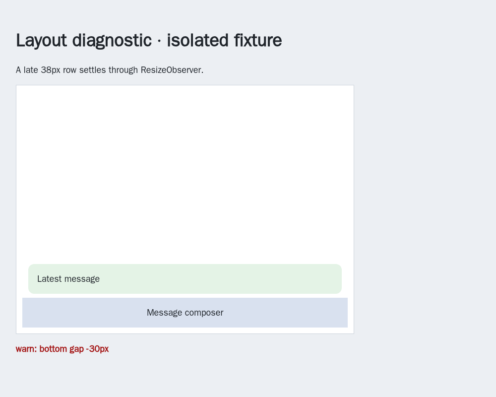
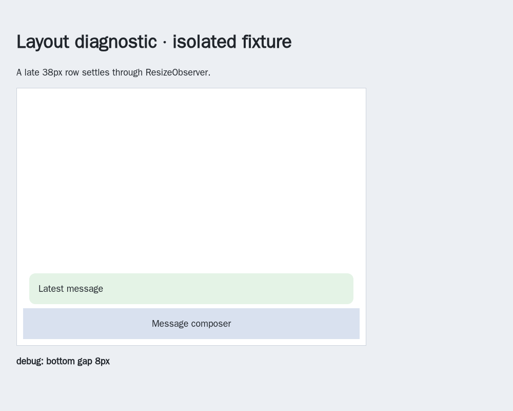
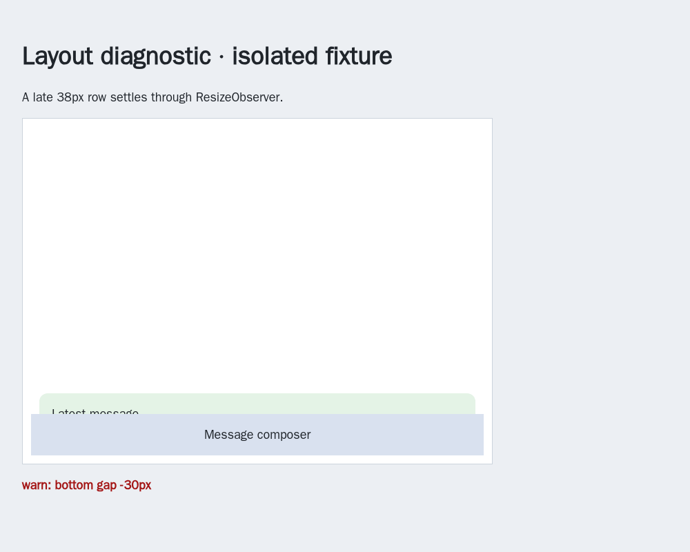
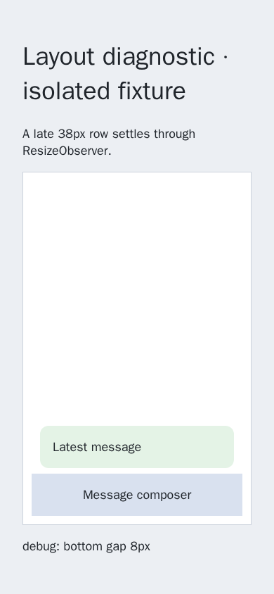

# WebKit layout warning before observer delivery

[PR 57](https://github.com/link-foundation/meta-sovereign/pull/57) preserves the failed exact-head Checks run [42975700692](https://github.com/link-foundation/meta-sovereign/actions/runs/42975700692), created at `2026-11-11T06:54:35Z` for `33eac5b55e437a471b3fd37198fca5288f016ca5`. Raw WebKit job log line **2314** reports a `chat_layout` warning: 26 messages, following enabled, scroll top 2665, height 3343, viewport 640, bottom gap -29. The pipeline job correctly fails at lines **282–283**. Other selected checks and four auxiliary workflows pass. This report addresses that warning; issue 56 remains unfinished.

## Root cause and reproduction

Animation-frame callbacks run before ResizeObserver delivery. The shared diagnostic previously assumed two nested animation frames were enough for tail following to settle. A DOM change during the first frame can schedule its observer's tail correction _after_ the diagnostic's second callback. That callback records geometry before the correction even though the same rendered frame finishes with a clear message.

A focused local WebKit run initially passed. The subsequent opt-in trace captures the relevant intermediate state at lines **273–274**: the scroll position remains 2665 while content height is 3343 (38 pixels below the tail), then content shrinks to 3305 and the same scroll position is correct. The following layout entry records a positive 9-pixel gap. The CI artifact also shows a clear message after settling. These observations motivated an observer-order reproduction rather than weakening the assertion or increasing its timeout.

The isolated [fixture](../../../experiments/issue-56/layout-observer-fixture.js) mounts the actual production React diagnostic hook and introduces a 38-pixel row during the first frame. A real ResizeObserver schedules tail correction after the second diagnostic callback. The [parent probe](../../../experiments/issue-56/layout-observer-before.py) substitutes only the hook from `4da8e615`, always restores it, and fails: `transient: accurate severity`, actual `warn`, expected `debug`. The screenshot shows the corrected message alongside the stale -30-pixel warning.

## Correction and checks

Only a suspected overlap gets one confirmation frame after observer delivery. That confirmation reads current state and geometry. A persistent overlap still warns; reading away from the live tail remains a debug event. New transitions and unmount cancel pending work. There is no continuous sampling or added timeout. Opt-in `chat_layout_pending` console tracing records candidate geometry without message text. Both Chat and Operator use this shared hook.

- **Three focused Node checks and three Deno checks pass**, covering geometry/severity, deduplication, transient correction, persistent warning, current reading intent, supersession and cancellation.
- **Three isolated WebKit browser cases pass**: transient observer correction, persistent overlap and reading. The actual parent hook fails the first case.
- The **focused production automation-chat WebKit check passes**, including the new observer fixture registered in the existing hosted browser lane. No full local browser/runtime matrix was run.
- **Six independent MCP desktop/mobile cases pass** with the production hook, matching actual gaps and severity and reporting zero page errors. All owned browsers, contexts and fixture servers close.
- The web bundle is rebuilt. Scoped lint, formatting, secret scanning and the existing duplication threshold are checked without changing their limits. Exact new-head hosted checks remain required.

## Evidence

The screenshots show diagnostic state in a synthetic fixture, not a change to product styling. The persistent case deliberately leaves a real overlap and must continue warning.

The [collector](../../../experiments/issue-56/collect-layout-observer.py) freezes sources, parent hook, full downloaded CI logs, artifact screenshot, trace, focused checks and eleven PNGs in `data/layout-observer.tar.gz`, with independently verified per-file SHA-256 hashes. The CI screenshot is a settled failure artifact; it does not capture the earlier intermediate geometry. Every unchecked original requirement remains required and PR 57 stays draft and unmerged.
