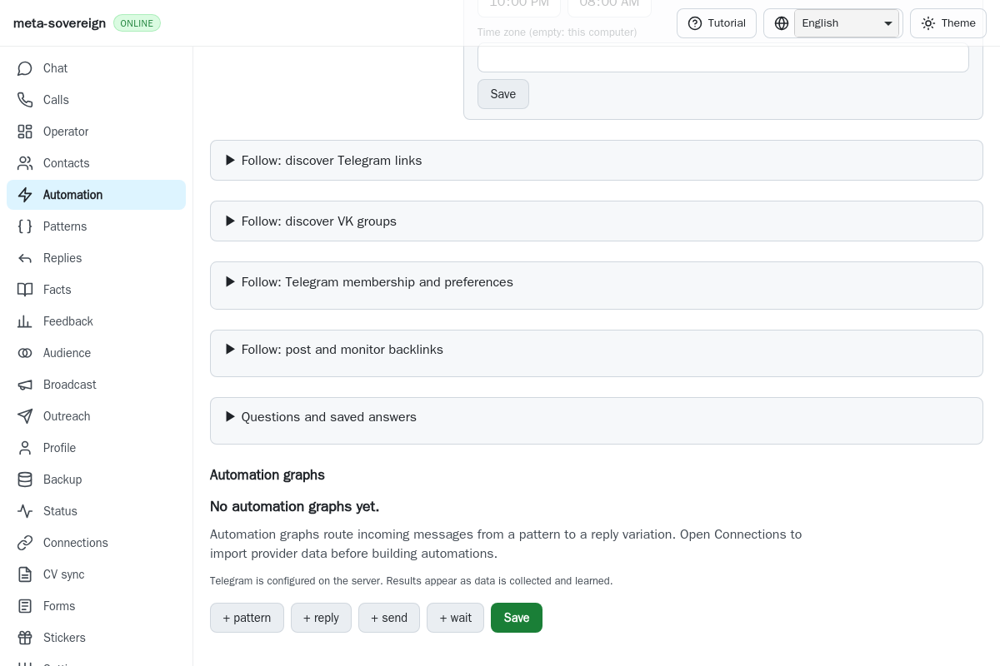
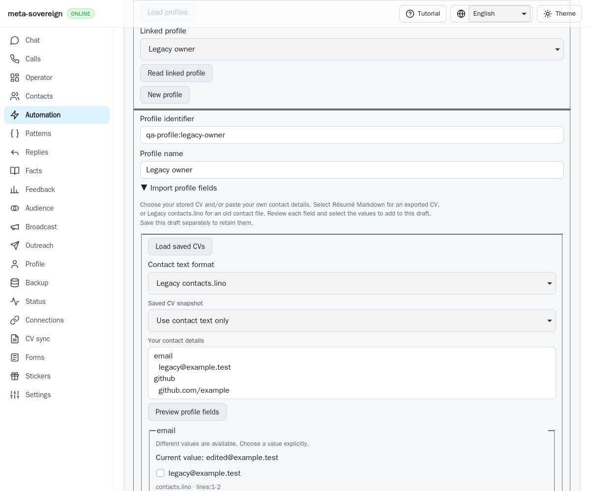

# Retained legacy-profile disclosure in WebKit

Published head `b0bb53aef2fd7556baabfbe6f51103659ce25ef2`, Checks run
`43695582515`, WebKit shard 2 job `132756355724` fails in the legacy-profile
scenario. The preserved complete 1,909-line job log reports a closed Question
section at line 1469 and a hidden nested Preview answer summary at lines
1470–1490. Other scenarios continue and the job reports `questions` as its
failure at line 1842. The downloaded job screenshot was verified as PNG and
viewed before diagnosis. The log proves the hidden-section failure; it does
not establish which browser navigation preserved the opening state.

The legacy scenario blindly clicks both summaries after navigation. A finite
real WebKit reproduction opens the sections, follows an identical fragment
link while verifying the document identity, then runs that actual scenario.
On the published helper its first click closes the parent and its nested
click times out. The correction uses the existing `openQuestionPreview`
helper: click a visible summary only when its section is closed. The same
retained-document reproduction then completes the actual legacy contact
import, rejected-save recovery, named-profile save and local override checks.
No timeout is increased, control forced open, assertion removed or provider
action issued. Existing disclosure tests cover closed and already-open
sections; the mandatory questions entry retains the complete legacy scenario.

```sh
RUN_BROWSER_E2E=1 E2E_BROWSER=webkit NODE_OPTIONS=--max-old-space-size=384 node experiments/issue-56/ci-legacy-disclosure-native.mjs
```

For the before run, temporarily restore only the actual published
`js/tests/helpers/e2e-question-legacy-profile.mjs` and add `--before`; restore
that file in a `finally` block. The experiment bounds the expected hidden
control failure to two seconds and always closes its owned browser/server.
The [archive](data/ci-legacy-disclosure.tar.gz) and
[manifest](data/ci-legacy-disclosure.tar.sha256.json) retain source bytes,
full hosted log, original job screenshot and finite before/after receipts.
The new published head still requires all hosted checks; this is not issue
completion evidence.



