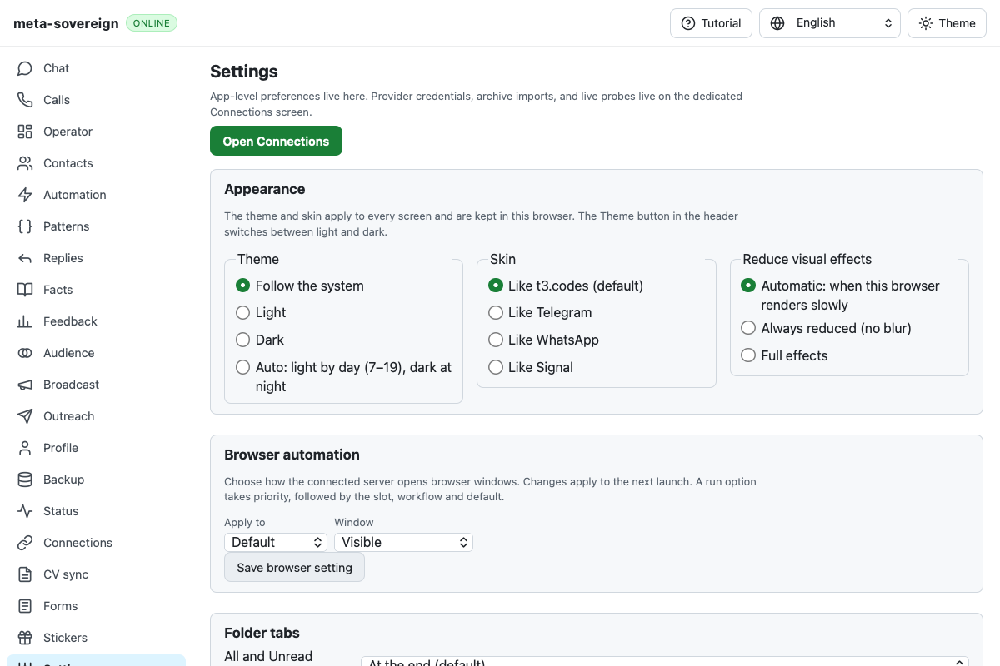

# WebKit sync loses its booted API in a hosted run

Exact head `123947451a46c18dcc94f1d424c9f66dc13f8a7b` fails [WebKit shard 3 job 130925134777](https://github.com/link-foundation/meta-sovereign/actions/runs/43139910675/job/130925134777). Individual log lines 1741–1743 show the first peer with one empty RTC event list and a negotiated Lino signaling socket, the second with neither, followed by `TypeError: undefined is not an object (evaluating 'globalThis.__msApi.get')`. Both peers previously passed the API readiness check. Convergence fails after about nineteen seconds. This establishes missing API state during the poll, without establishing why it disappeared.

The original fixture's catch closes the second peer's context before the outer failure screenshot, so its artifact contains only the first peer. The downloaded artifact is verified as a PNG before inspection. Its Settings screen remains online; it does not establish the second peer's document state.

One isolated native WebKit investigation passes. A second focused run with the retained opt-in trace also passes exact typed Unicode insertion, deletion, secret exclusion, actual Lino SDP and data-channel convergence. Its stable bundle ETags and document time origins do not reproduce the hosted loss. Same-document navigation events occur while the API stays present. No app behavior, polling exceptions, test budgets or assertions have been changed to hide the failure.

`CI_LINO_SYNC_DEBUG=1` now enables a bounded 24-event trace per synthetic peer: document time origin, API presence, ready state, mock capture state, bundle resource type/status/ETag and existing boot decisions. It prints at preparation, navigation and failure, retaining no SDP, ICE addresses or application records. The trace is off by default and enabled only in the hosted browser fixture. Failure handling also captures the second context before closing it. Reproduce the focused native check with `PYTHONDONTWRITEBYTECODE=1 python3 experiments/issue-56/trace-lino-sync.py`.

The [evidence archive](data/ci-lino-sync-navigation.tar.gz) preserves the exact failed job and downloaded artifact, local passing observations and instrumentation. Scoped lint, workflow policy, secrets and the unchanged duplication gate pass. A subsequent hosted trace is required to identify the root cause; this sync acceptance criterion remains unfinished in [PR 57](https://github.com/link-foundation/meta-sovereign/pull/57), alongside every unchecked product criterion.
