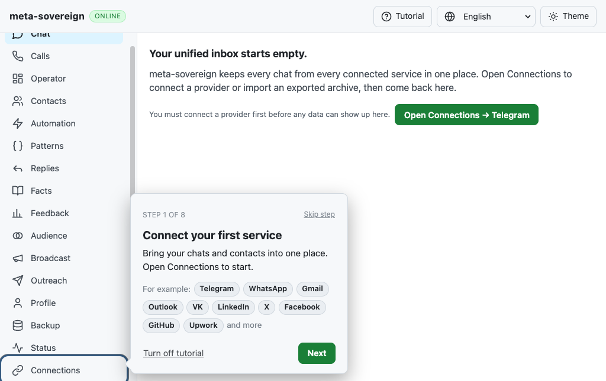

# macOS cleanup trap lint

Exact head `ba17dac9` failed the workflow contract gate in
[run 44028318708](https://github.com/link-foundation/meta-sovereign/actions/runs/44028318708/job/133854350748).
The preserved log `ci-logs/checks-44028318708-133854350748.log`, lines 399–404,
reports ShellCheck SC2329 on `cleanup`, which is invoked indirectly by the
owned image's EXIT trap. The gate stopped before the runtime matrix started.

The function now has a scoped SC2329 annotation explaining that invocation.
ShellCheck 0.11.0 reproduces the diagnostic on the parent and passes both
package scripts after the annotation. All four finite mocked cleanup tests
pass. Their logs use the `ci-macos-trap-call-` prefix. No package verification,
trap behavior, signature check, retry count or workflow deadline changes.

This repairs the CI lint gate only. Full issue acceptance remains unfinished.

Hosted follow-up: [desktop run 44029677088](https://github.com/link-foundation/meta-sovereign/actions/runs/44029677088)
passes all five platform builds at `1120026a`. Its macOS job verifies both
application architectures and disk images, then launches the packaged ARM64
application with a rendered window and positive backend before exiting.
The preserved job log and metadata are
`ci-logs/checks-44029677088-133858807483.{log,json}`. The launch artifact is
`14305410613`; its screenshot is included below. The isolated update feed
returns a visible 404 for `latest-mac.yml`, so this is launch evidence rather
than an update-delivery claim. The runtime matrix and full VD09 remain required.

