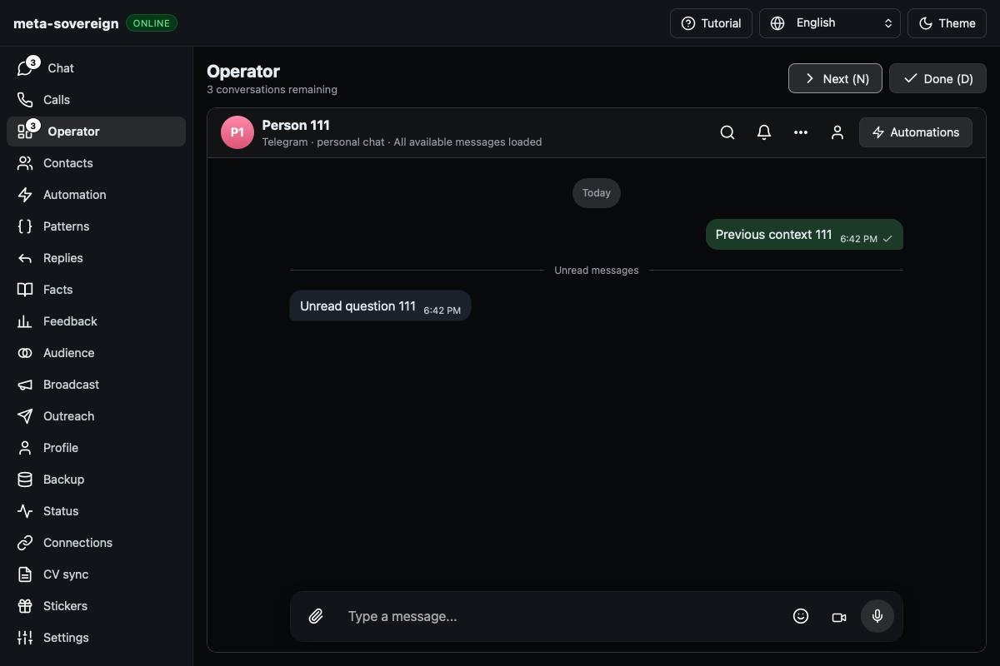
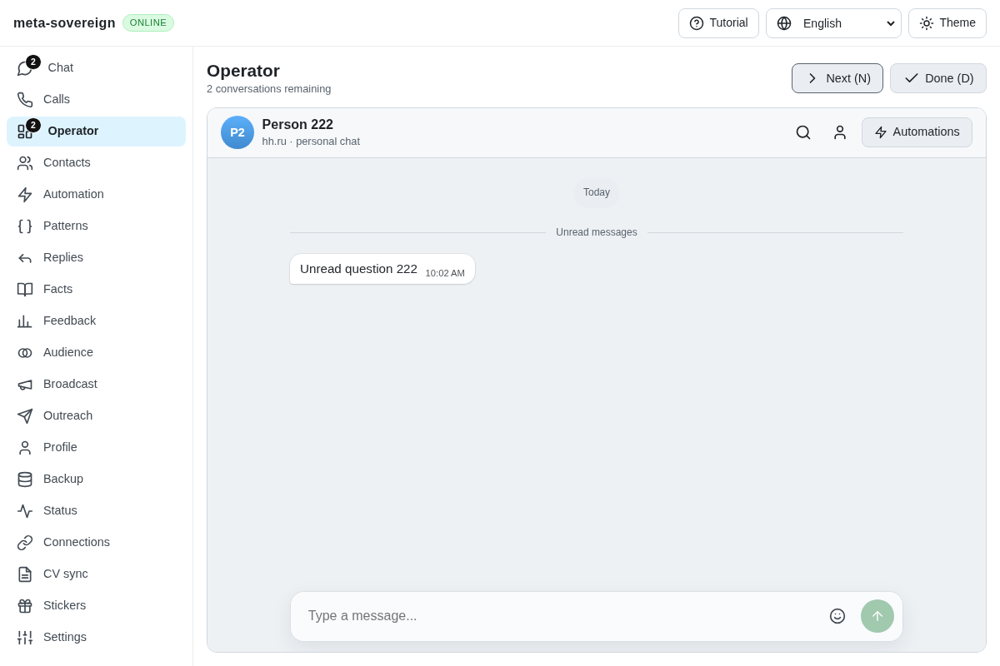

# Operator history destination race

The exact `9b718571f1b8750266a6df7029e731e431c4bbe0` checks run [42674537967](https://github.com/link-foundation/meta-sovereign/actions/runs/42674537967) started at 2026-11-09 18:29:57 UTC. Its WebKit log line 1983 reports `timed out: Forward restores the next Operator card`; the preserved artifact shows Person 111 instead of the expected Person 222. Other browser scenarios continued, including the question controls. This is an individual assertion failure, not a whole-job deadline.

Operator's verified-card effect unconditionally replaced the current Operator URL. A card committed before a Back/Forward transition can run its effect after history has already selected the next chat. The stale effect then replaces that destination with its own card. `operator-route.test.js` deterministically reproduces the ordering: restore the second destination, then run the first card's pending synchronization. Before the guard it changes `222` back to `111`.

The effect now preserves a different requested chat while that chat remains in the eligible queue. It can still fill an empty route or replace finished, filtered or otherwise ineligible work. Next keeps its normal history entry; Done, unread acknowledgment and provider capabilities retain their existing behavior. Opt-in browser diagnostics record current/requested identifiers without message text. The existing browser flow accepts `E2E_OPERATOR_TRACE=1` for bounded history-event traces.

All 17 focused Operator, route and navigation cases pass with concurrency one. Focused lint and the production bundle build pass. The targeted WebKit Operator flow passes before and after; the intermittent CI failure itself is not claimed to reproduce on demand. The deterministic stale-effect regression fails before and passes after. Independent Playwright MCP verifies Next → Back → Forward → reload against an isolated HH fixture, matching card and URL throughout and retaining both unread conversations. A second capture provides an unobstructed final screenshot. Both browsers and fixture servers are closed; nothing is sent or marked read. The reusable fixture is `experiments/issue-56/operator-ui.mjs`.

Raw CI log, local before/after traces, regression logs and MCP metadata are retained in `data/operator-history.tar.gz` with verified hashes. Exact-head CI remains required. See [PR 57](https://github.com/link-foundation/meta-sovereign/pull/57).

| Before: CI failure artifact                                                                                                                                                        | After: actual-server history restoration                                                                                                                                |
| ---------------------------------------------------------------------------------------------------------------------------------------------------------------------------------- | ----------------------------------------------------------------------------------------------------------------------------------------------------------------------- |
|  |  |
