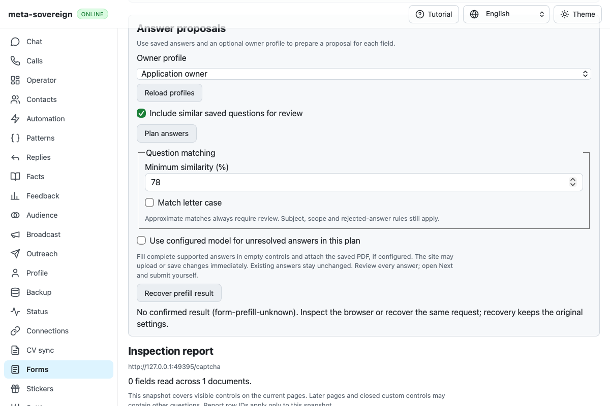
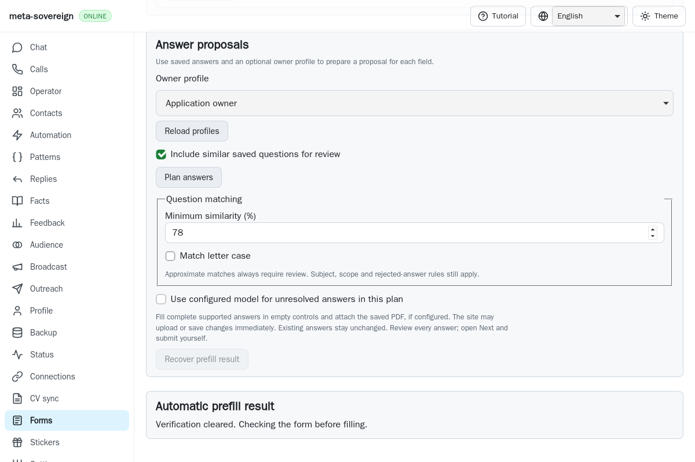
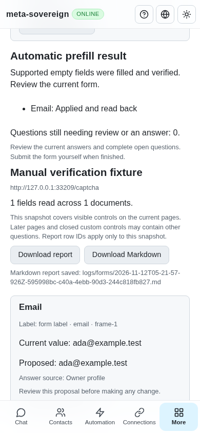

# Prefill status during browser cleanup

Commit `56419934dcefb3c4acd319a9b04f2812038c7565` has Checks run
[43156663984](https://github.com/link-foundation/meta-sovereign/actions/runs/43156663984),
created 2026-11-12 04:43:35 UTC. Only WebKit shard 2/4, job `130979772788`,
fails. Raw job log lines 1412–1414 show the CAPTCHA scenario waiting 30 seconds
for the completed result. The retained CI screenshot shows
`form-prefill-unknown` and the recoverable original request. The ordinary
60-second budget did not expire: the trace records pause, verification clearing,
resume and stop with 59,990 ms remaining. This differs from the earlier
[100 ms test-fixture deadline failure](ci-captcha-deadline.md).

The original CI log does not contain the rejected status body. A bounded local
investigation identifies a production race consistent with that evidence:
automatic prefill sets `ok: true`, then awaits browser-handle cleanup before
setting its terminal state and completeness. A status read during that await
therefore returns `state: prefilling`, `ok: true`, `complete: false`. The UI
correctly rejects this inconsistent pending receipt and stops polling. Browser
writes have already finished; replaying them is unnecessary.

The regression holds exactly one real target disposal until the UI reads its
status. The actual `57bb7360` parent fails both the small reader/client check
and the existing WebKit scenario. Its opt-in trace confirms the inconsistent
shape and its screenshot reproduces the recovery error. With the fix, success
stays private until cleanup completes. The public pending receipt remains
`ok: false`, `complete: false`, with its confirmed field receipts; the same
read-only poll then receives `prefilled`, `ok: true`, `complete: true`. Existing
deadline, manual-wait and CI limits remain unchanged.

Screenshot review also found that the verified/prefilling state still displayed
instructions to solve the CAPTCHA. Only the waiting-owner state now displays
those instructions. A separate failing-before rendering assertion covers that
correction. No strings or locale keys change.

Optional `form-prefill-status` diagnostics use the existing browser trace hook.
They report only state, boolean flags and receipt/upload counts. They exclude
answers, URLs, request IDs and challenge content, remain silent without a trace
hook, and cannot break status recovery if the callback throws.

Focused verification:

- Thirty-four checks pass in each of Node and Deno, including frozen-request
  recovery, actual text/binary Lino routes and existing automatic prefill behavior.
- `node --test --test-concurrency=1 js/tests/forms-captcha.test.js js/tests/forms-automatic-controls.test.js js/tests/forms-auto-prefill.test.js`
- `deno test --allow-all` with the same three files.
- `PYTHONDONTWRITEBYTECODE=1 python3 experiments/issue-56/captcha-status-before.py`
  replays the actual parent and restores the working production source in
  `finally`; its browser probe keeps the existing 30-second locator limit.
- `RUN_BROWSER_E2E=1 E2E_BROWSER=webkit FORMS_CAPTCHA_ONLY=1 node js/tests/e2e-forms-reader-browser.mjs`
  exercises actual DOM extraction, one held cleanup, lost-response recovery,
  exactly one owner release, one confirmed email receipt, zero challenge reads,
  zero submissions and closed owned browsers. The same controlled cleanup is
  mandatory in the existing hosted CAPTCHA scenario for both engines.
- Independent Playwright MCP uses an isolated actual server and synthetic owned
  browser. It verifies waiting/Close availability, then completed desktop/phone
  UI with one positive receipt, no replay, no horizontal overflow and confirmed
  close. Server evidence records one email input, one owner release and zero
  challenge reads/submissions.

| Actual CI failure                                                              | Fixed pending cleanup                                                                 |
| ------------------------------------------------------------------------------ | ------------------------------------------------------------------------------------- |
|  |  |

Raw hosted logs/artifacts, before/after checks, opt-in traces, current sources
and screenshot hashes are preserved in
[the evidence archive](data/ci-prefill-cleanup.tar.gz).
Exact new-head hosted validation and every unchecked issue criterion remain
required. [PR57](https://github.com/link-foundation/meta-sovereign/pull/57) stays
draft and unmerged.
