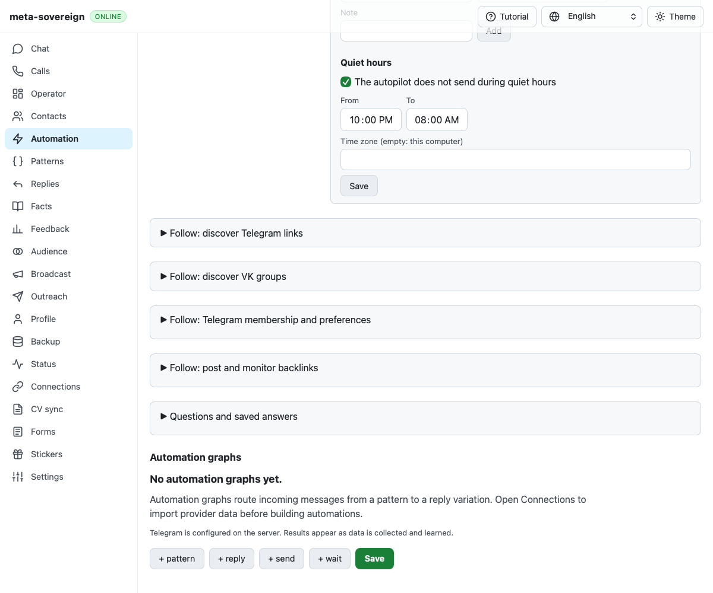

# WebKit résumé profile navigation investigation

Issue [56](https://github.com/link-foundation/meta-sovereign/issues/56),
[PR57](https://github.com/link-foundation/meta-sovereign/pull/57) remains draft.
The hosted failure is unresolved; this unit adds diagnostics and a finite replay.

## Preserved failure

Exact parent `3a6a49fdf06f20669972653d43db78945183c516` has Checks run
[43162679447](https://github.com/link-foundation/meta-sovereign/actions/runs/43162679447),
created 2026-11-12 05:38:01 UTC. WebKit shard 4/4 job `130998380216`
log lines 838–861 fail `verifyResumeProfile` while clicking the hidden Preview
answer summary. Its `[profile-state]` has a closed Questions root and no recorded
click/toggle events in the current document. The preserved PNG confirms the
closed panel.

 Security, Links, Pages and Desktop pass for that exact commit.

The full run, numbered job log, artifact metadata, raw question log and valid
PNG are retained in the evidence archive. This failure is distinct from the
previously corrected identical-URL disclosure-retention test.

## Bounded investigation

An isolated legacy-to-résumé replay passed. The reusable navigation experiment
now runs the four actual profile helpers in their CI order: contact import,
shared profile, legacy import, then résumé import. Its explicit initial email
supplies the earlier CI fixture's existing profile field. An initial experiment
without that prerequisite timed out in the first contact-import helper; it did
not reach or reproduce the hosted résumé failure.

The complete four-helper sequence passes both before and after diagnostics.
The diagnostic trace observes a new document after navigation, initially without
the asynchronously rendered root. The original locator then waits for the root,
reads it closed, clicks it once, opens Preview once and completes the résumé
import without storage writes or horizontal phone overflow. This passing trace
cannot identify the hosted cause. No production behavior, disclosure opening
rule, navigation, existing assertion or deadline has been changed.

`CI_PROFILE_NAVIGATION_DEBUG=1` enables six metadata snapshots around navigation,
root-state sampling/click and preview-state sampling/click. Each includes the
native document time origin, readiness, expected fragment, root open attribute
and property, connection/summary visibility, and at most twelve existing native
disclosure events. It excludes owner field contents and URL/query values. The
flag is enabled in hosted browser CI and otherwise disabled. Unavailable
snapshots preserve the original operation rather than throwing a new error.

Run the bounded sequence with:

```sh
RUN_BROWSER_E2E=1 E2E_BROWSER=webkit CI_PROFILE_NAVIGATION_DEBUG=1 NODE_OPTIONS=--max-old-space-size=384 node experiments/issue-56/resume-profile-navigation.mjs
```

Four browser partition contracts pass, including both mandatory engines,
complete registry coverage, failed-shard propagation and unchanged budgets.
Workflow policy checks pass. Scoped strict lint, formatting, secrets and the
unchanged 6.5% duplication gate pass. The isolated browser and server close at
the end. Full runtime/browser matrices remain in hosted CI.

The [checksummed archive](data/ci-profile-navigation.tar.gz) preserves the actual
hosted failure, passing local baseline, final diagnostic trace, source snapshots
and screenshot hashes. Require new exact-head CI and recurrence evidence before
claiming a root cause or a correction. Every unchecked issue criterion remains
required.
